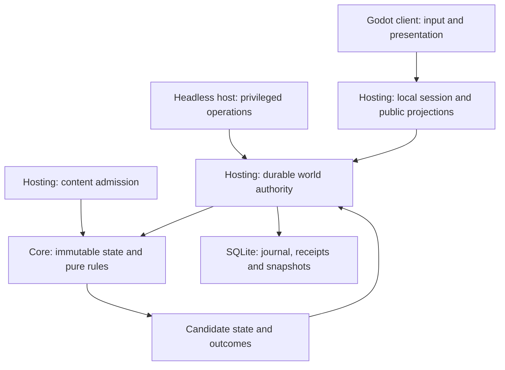

# Runtime and authority

## Module boundaries

The arrows describe dependencies and calls, not separate processes. The
[Core project](../../src/OpenFantasy.Core/OpenFantasy.Core.csproj) contains engine-free domain types,
rules and canonical formats. [Hosting](../../src/OpenFantasy.Hosting/OpenFantasy.Hosting.csproj)
adds storage, content admission, session pacing and projections. The
[headless host](../../src/OpenFantasy.Host/OpenFantasy.Host.csproj) and
[Godot client](../../client/OpenFantasy.Client.csproj) use these shared assemblies. Toolchain versions
are pinned in [global.json](../../global.json) and [toolchain.json](../../toolchain.json).

Core application types have cohesive responsibilities, immutable values and explicit dependencies.
Composition is preferred to broad inheritance trees or service locators. Module folders need not
be assemblies or services. The core and application use C# in one process; portability comes from
engine-free domain contracts. Algorithms, data layout, allocation and scheduling are the optimization
boundaries. A custom native kernel or IPC worker is outside this architecture.

## Runtime bindings: state ownership

[WorldSnapshot](../../src/OpenFantasy.Core/Worlds/WorldSnapshot.cs) is the immutable composed world
root. It binds inventory authority, spatial state, residents, calendar, dialogues and the optional
gathering, production, progression, quest, construction, geography and physical reservoirs admitted by its
saved profile. World revision and advancing-step count are separate counters.

Dry structural profiles retain fabrication, physical member placement and complete load policy in that
same root. [Coupled settlement](coupled-settlement.md) adds an explicit construction-support interpretation
and finite assembly policy. Ordinary successors retain both; an unrelated action cannot drop the physical
owner or silently revert its contact law. Stable admission uses the world's retained load policy, actual
carried/installed mass and complete candidate scene. A separately selected read-only calibration cannot
replace that authority. Saved [consequence work](consequence-continuation.md) reserves the original action's
advancing interval while its geometry is evaluated; provisional motion is not a second published world.

[Contained reservoir worlds](reservoir-containment.md) retain their immutable sealing policy in the
same root as fixed vessels, material stock and terrain. Complete admission requires actual closed floors
and walls, clear nominal interiors and admitted material pins. Read-only inspection under another policy
cannot change the saved interpretation. Fixed containment excludes displaced construction and transport;
joining them requires explicit volume, load, actuation and consequence contracts.

[Detailed liquid worlds](liquid-cell-flow.md) retain exact cell portions backed by those same live
holdings. Flow moves portions, never mints material or opens another custody ledger. The component
pins its material owner and calendar boundary; material actions reconcile it before complete admission.

[WorldAdmissionValidator](../../src/OpenFantasy.Core/Worlds/WorldAdmissionValidator.cs) checks the
composition, including actor/control/presence consistency, definition pins, dialogue participants,
material relationships and identity roles across the complete finite admitted root.
[WorldIdentityIndex](../../src/OpenFantasy.Core/Worlds/WorldIdentityIndex.cs) combines dynamic roles
with immutable terrain and watershed identity layers. Macro reservations include every admitted
network member, province and shared face. Layer reuse requires the same single-basin, network and
terrain references, with scope validation on each composed root. Equal-looking data is not permission
to skip validation.

| Owner | Responsibility | Boundary |
| --- | --- | --- |
| Core domain planners | Validate an intent and prepare candidate component states | No filesystem, wall clock, rendering or durable acknowledgement |
| `WorldStepProcessor` | Compose selected actions, movement and time into one candidate world | Cannot publish or write storage |
| `SqliteWorldAuthority` | Serialize decisions, reserve historical identities and commit atomically | Sole writer of its owned world |
| `LocalWorldSession` | Select local input and NPC proposals at a host cutoff; produce public views | Trusted local control adapter, not network authentication |
| Godot controls and scene views | Inspect projections and submit semantic intent | No direct domain mutation or private-state queries |

The smaller [SqliteCountedAuthority](../../src/OpenFantasy.Hosting/SqliteCountedAuthority.cs) hosts
the standalone counted-custody profile. It is not a concurrent inventory writer beside
`SqliteWorldAuthority` for the same world.

## Runtime bindings: action lifecycle

1. The client inspects a captured offer, including its exact target, costs and revision expectations.
   Submission carries intent, not a newly selected nearby substitute.
2. [LocalWorldSession](../../src/OpenFantasy.Hosting/Simulation/LocalWorldSession.cs) checks control
   and selects a bounded batch. One player action can be pending; identical pending bytes share its
   eventual outcome and a different request is refused while that slot is occupied.
   [Ordinary helper aid](ordinary-care.md) is a Host-owned proposal under separate helper control and
   patient permission. Actors already assigned a player/NPC action are excluded as helper or patient
   from that cutoff's aid selection. A stable semantic proposal identity prevents an unchanged refused
   helper choice from becoming an automatic new command on each clock tick; clocks and unrelated
   storage activity do not select a replacement identity.
   [Saved material proposals](material-proposals.md#local-session-selection) use that same queue and
   cutoff. A complete, read-only preview of a captured acceptance excludes the consenting sender's
   optional work only when settlement is currently valid. An invalid acceptance leaves NPC work
   eligible. The final batch still rechecks both participants and publishes the only outcome; no
   independently advancing service is called from the tick. Participant views read the bounded live
   proposal owner. The explicit session history query runs in one bounded background slot under the
   same serialization boundary, authenticates the fixed player, and never selects a step. It shares
   duplicate pending lookups and refuses a second identity; stopping finishes selected inspection
   before disposing storage. A full archived replay can delay the simulation without synthesizing
   catch-up time. It is never part of a frame or tick projection. An archived paid-quote inspection runs
   a second verified replay, pinned to the same head, to project the outcome against the recorded root
   that published it (for its canonical market record). `VerifyRecordedHistoryAsync` is the same kind of
   explicit background read: one complete verified replay to the head, returning only whether it reproduced
   the head. The cargo world's regional terrain observation is projected at view publication from the same
   immutable root as that view, on the serialized host owner; frames read the published view only and never
   take the authority's writer gate, so they keep rendering while a recorded read holds it.
   Explicit [NPC gift preferences](material-proposals.md#explicit-npc-gift-preferences) advise offers
   and replies under each configured Host actor's own control. Their copied immutable configuration
   is separate from world consent; saved commands and permanent identity occupancy prevent unchanged
   decisions from becoming new requests after refusal, archive rotation or reopening.
   [Scheduled trading](scheduled-trading.md) joins the same cutoff after gifts and before ordinary work.
   A player's trade inquiry is transient session input, never a world fact; configured host merchants
   answer it in admission order with their own quotes, and configured host shoppers show, ask and accept
   under their own control, in person only and with bounded reconsideration attempts. A valid paid
   acceptance reserves its issuer, so neither participant works or walks in the settling step. Participant
   quote history uses the same bounded background slot as proposal inspection. The
   [native stall](native-trading.md) submits through these same calls; a confirmation its client blockers
   refuse (closed window, unpaid total, moved or unreachable issuer) is never submitted, so it leaves no
   receipt, and an issuer's open offer keeps its own window while a refused shopper earns funds or waits
   for the issuer to return. Long walks use [cargo itinerary advice](cargo-circuit.md#itinerary-ownership-and-restart):
   a host coordinator supplies one ordinary movement sample per cutoff from actual feet and stops on a
   refused or unplannable leg, holding that stop until the walker, nearby bodies, terrain, structures or
   its movement admission change; it is never saved and owns no authority. Saved proposals, NPC gift
   preferences and ordinary care bind in profiles 30, 32 and 33 through one `LocalProfileBindings` gate.
   Paid and market commands are refused at submission outside an unheld exploration boundary. Ordinary,
   care, lifecycle and encounter selection refuse a queued command their batch kind cannot carry before
   building the batch. A boundary change after admission therefore yields an ordinary refusal. Retained
   consequence continuation still requires its waiter to match the durable command; a mismatch is an
   integrity failure.
3. [WorldStepProcessor](../../src/OpenFantasy.Core/Worlds/WorldStepProcessor.cs) evaluates the
   host-selected [WorldStepBatch](../../src/OpenFantasy.Core/Worlds/WorldStepBatch.cs) against the
   committed profile, scope, revision and hold state. Domain planners recheck rights, resources,
   bodies, reach and dependencies. The batch bounds per-actor action/movement selection.
   For reservoir worlds, [WorldReservoirBinding](../../src/OpenFantasy.Core/Worlds/WorldReservoirBinding.cs)
   reconciles each material candidate against the latest accepted physical owner before reserving spawned
   identities or publishing any side effect. Rejection restores gathering, Production, quests/rewards,
   construction and space together. Rejected construction does not consume the actor's movement slot.
   Capacity-only runoff admission/cancellation is staged in that same owner before following actions.
   Existing reservation IDs are references, while command/result IDs receive ordinary durable history.
   Earlier accepted actions remain accepted; validating only the final batch state would hide transient
   physical violations. Ordinary successors cannot add or remove reservoir ownership.
   Transport worlds additionally preserve the [scheduled funding journal](reservoir-transport.md).
   Contained worlds additionally validate the reconciled material candidate against their retained seals.
   This includes construction's selected eventual work/time boundary and all occupants. Rejection restores
   the complete attempted action; a successful post-time movement root can be reused only after complete
   admission and encoding. Action preflights never stand in for the eventual published root.
   After actions and the selected calendar increment, due stages run in canonical arrival/identity order,
   unless a reading hold is active; they precede movement. Actual stock, receiving obligations and new
   fragment identities join the same candidate. A blocked stage retains all water and capacity in place.
4. [WorldCommitPreparation](../../src/OpenFantasy.Hosting/Worlds/WorldCommitPreparation.cs) prepares
   canonical state, outcomes and identity reservations. Gameplay rejection is an outcome; malformed
   dispatch, identity conflict or storage failure is not a fabricated gameplay receipt.
5. [SqliteWorldAuthority](../../src/OpenFantasy.Hosting/Worlds/SqliteWorldAuthority.cs) writes the
   transaction. Only after commit does it publish the new immutable state and acknowledge results.
6. The session rebuilds permitted projections. Rendering and NPC planning consume the appropriate
   observations; they cannot award a second reward in response to a completion animation.

At each cutoff the session also presents a changed root published by another authority caller, including
when a reading hold or refusal prevents this session from committing anything. A private cached content hash
detects changes; an unchanged root reuses its immutable view. Displaying the observed state neither advances
time nor authorizes a pending action. The renderer performs no authority or historical reads.

An exact authorized retry retrieves its durable result. Reusing an identity with changed content
rejects. A stale or rejected intent never silently retargets, selects replacement ingredients or
rerolls. A command pending in memory is not durable acceptance.

## Design contracts: hosted play and extension

Transport authenticates principals and sessions before actor control and knowledge checks. The
production host supports one to four players with one authoritative world and explicit readiness,
disconnect and control-handoff policies. An in-process local session does not establish those
network properties. Server delivery, retry and reconnect preserve the same command and ownership
contracts rather than reproducing domain rules in the transport.

New domain work identifies its canonical owner, typed intent, immutable plan, commit participation,
codec/version, knowledge projection and failure behavior. Cross-domain changes join one transaction
or use explicit durable staged work. Parallel computation returns immutable candidates and follows
deterministic scheduling; whichever worker finishes first cannot win an authoritative race.

See [persistence](persistence-and-history.md), [time](time-and-encounters.md) and
[content composition](content-and-composition.md) for their respective invariants.
