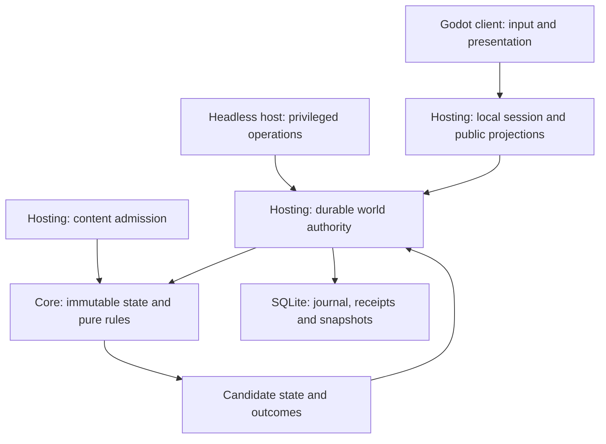

# Runtime and authority

## Module boundaries

The arrows describe dependencies and calls, not separate processes. The
[Core project](../../src/OpenFantasy.Core/OpenFantasy.Core.csproj) contains engine-free domain types,
rules and canonical formats. [Hosting](../../src/OpenFantasy.Hosting/OpenFantasy.Hosting.csproj)
adds storage, content admission, session pacing and projections. The
[headless host](../../src/OpenFantasy.Host/OpenFantasy.Host.csproj) and
[Godot client](../../client/OpenFantasy.Client.csproj) use these shared assemblies. Toolchain versions
are pinned in [global.json](../../global.json) and [toolchain.json](../../toolchain.json).

Core application types have cohesive responsibilities, immutable values and explicit dependencies.
Composition is preferred to broad inheritance trees or service locators. Module folders need not
be assemblies or services. The core and application use C# in one process; portability comes from
engine-free domain contracts. Algorithms, data layout, allocation and scheduling are the optimization
boundaries. A custom native kernel or IPC worker is outside this architecture.

## Runtime bindings: state ownership

[WorldSnapshot](../../src/OpenFantasy.Core/Worlds/WorldSnapshot.cs) is the immutable composed world
root. It binds inventory authority, spatial state, residents, calendar, dialogues and the optional
gathering, production, progression, quest, construction, geography and physical reservoirs admitted by its
saved profile. World revision and advancing-step count are separate counters.

Dry structural profiles retain fabrication, physical member placement and complete load policy in that
same root. [Coupled settlement](coupled-settlement.md) adds an explicit construction-support interpretation
and finite assembly policy. Ordinary successors retain both; an unrelated action cannot drop the physical
owner or silently revert its contact law. Stable admission uses the world's retained load policy, actual
carried/installed mass and complete candidate scene. A separately selected read-only calibration cannot
replace that authority. Saved [consequence work](consequence-continuation.md) reserves the original action's
advancing interval while its geometry is evaluated; provisional motion is not a second published world.

[Contained reservoir worlds](reservoir-containment.md) retain their immutable sealing policy in the
same root as fixed vessels, material stock and terrain. Complete admission requires actual closed floors
and walls, clear nominal interiors and admitted material pins. Read-only inspection under another policy
cannot change the saved interpretation. Fixed containment excludes displaced construction and transport;
joining them requires explicit volume, load, actuation and consequence contracts.

[WorldAdmissionValidator](../../src/OpenFantasy.Core/Worlds/WorldAdmissionValidator.cs) checks the
composition, including actor/control/presence consistency, definition pins, dialogue participants,
material relationships and identity roles across the complete finite admitted root.
[WorldIdentityIndex](../../src/OpenFantasy.Core/Worlds/WorldIdentityIndex.cs) combines dynamic roles
with immutable terrain and watershed identity layers. Macro reservations include every admitted
network member, province and shared face. Layer reuse requires the same single-basin, network and
terrain references, with scope validation on each composed root. Equal-looking data is not permission
to skip validation.

| Owner | Responsibility | Boundary |
| --- | --- | --- |
| Core domain planners | Validate an intent and prepare candidate component states | No filesystem, wall clock, rendering or durable acknowledgement |
| `WorldStepProcessor` | Compose selected actions, movement and time into one candidate world | Cannot publish or write storage |
| `SqliteWorldAuthority` | Serialize decisions, reserve historical identities and commit atomically | Sole writer of its owned world |
| `LocalWorldSession` | Select local input and NPC proposals at a host cutoff; produce public views | Trusted local control adapter, not network authentication |
| Godot controls and scene views | Inspect projections and submit semantic intent | No direct domain mutation or private-state queries |

The smaller [SqliteCountedAuthority](../../src/OpenFantasy.Hosting/SqliteCountedAuthority.cs) hosts
the standalone counted-custody profile. It is not a concurrent inventory writer beside
`SqliteWorldAuthority` for the same world.

## Runtime bindings: action lifecycle

1. The client inspects a captured offer, including its exact target, costs and revision expectations.
   Submission carries intent, not a newly selected nearby substitute.
2. [LocalWorldSession](../../src/OpenFantasy.Hosting/Simulation/LocalWorldSession.cs) checks control
   and selects a bounded batch. One player action can be pending; identical pending bytes share its
   eventual outcome and a different request is refused while that slot is occupied.
3. [WorldStepProcessor](../../src/OpenFantasy.Core/Worlds/WorldStepProcessor.cs) evaluates the
   host-selected [WorldStepBatch](../../src/OpenFantasy.Core/Worlds/WorldStepBatch.cs) against the
   committed profile, scope, revision and hold state. Domain planners recheck rights, resources,
   bodies, reach and dependencies. The batch bounds per-actor action/movement selection.
   For reservoir worlds, [WorldReservoirBinding](../../src/OpenFantasy.Core/Worlds/WorldReservoirBinding.cs)
   reconciles each material candidate against the latest accepted physical owner before reserving spawned
   identities or publishing any side effect. Rejection restores gathering, Production, quests/rewards,
   construction and space together. Rejected construction does not consume the actor's movement slot.
   Capacity-only runoff admission/cancellation is staged in that same owner before following actions.
   Existing reservation IDs are references, while command/result IDs receive ordinary durable history.
   Earlier accepted actions remain accepted; validating only the final batch state would hide transient
   physical violations. Ordinary successors cannot add or remove reservoir ownership.
   Transport worlds additionally preserve the [scheduled funding journal](reservoir-transport.md).
   Contained worlds additionally validate the reconciled material candidate against their retained seals.
   This includes construction's selected eventual work/time boundary and all occupants. Rejection restores
   the complete attempted action; a successful post-time movement root can be reused only after complete
   admission and encoding. Action preflights never stand in for the eventual published root.
   After actions and the selected calendar increment, due stages run in canonical arrival/identity order,
   unless a reading hold is active; they precede movement. Actual stock, receiving obligations and new
   fragment identities join the same candidate. A blocked stage retains all water and capacity in place.
4. [WorldCommitPreparation](../../src/OpenFantasy.Hosting/Worlds/WorldCommitPreparation.cs) prepares
   canonical state, outcomes and identity reservations. Gameplay rejection is an outcome; malformed
   dispatch, identity conflict or storage failure is not a fabricated gameplay receipt.
5. [SqliteWorldAuthority](../../src/OpenFantasy.Hosting/Worlds/SqliteWorldAuthority.cs) writes the
   transaction. Only after commit does it publish the new immutable state and acknowledge results.
6. The session rebuilds permitted projections. Rendering and NPC planning consume the appropriate
   observations; they cannot award a second reward in response to a completion animation.

An exact authorized retry retrieves its durable result. Reusing an identity with changed content
rejects. A stale or rejected intent never silently retargets, selects replacement ingredients or
rerolls. A command pending in memory is not durable acceptance.

## Design contracts: hosted play and extension

Transport authenticates principals and sessions before actor control and knowledge checks. The
production host supports one to four players with one authoritative world and explicit readiness,
disconnect and control-handoff policies. An in-process local session does not establish those
network properties. Server delivery, retry and reconnect preserve the same command and ownership
contracts rather than reproducing domain rules in the transport.

New domain work identifies its canonical owner, typed intent, immutable plan, commit participation,
codec/version, knowledge projection and failure behavior. Cross-domain changes join one transaction
or use explicit durable staged work. Parallel computation returns immutable candidates and follows
deterministic scheduling; whichever worker finishes first cannot win an authoritative race.

See [persistence](persistence-and-history.md), [time](time-and-encounters.md) and
[content composition](content-and-composition.md) for their respective invariants.
