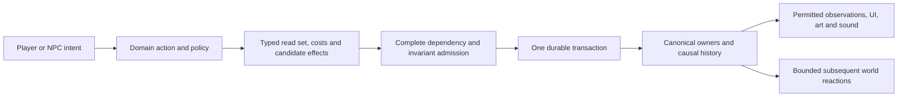

# World composition

## Design contract and abstraction level

The world combines meaningful domain concepts with reusable typed operations. A person, healing
spell, trade, flood or institution remains a recognizable concept with its own rules. Those concepts
compose the same ownership, identity, permissions, resource, time and transaction contracts.
This is a design contract; the concrete bindings and qualification remain documented in the subject
references and [implementation handoff](../../../implementation/AGENT_HANDOFF.md).

“Atomic” has two meanings here. A semantic operation is the smallest useful operation whose owner can
enforce its rules. A transaction publishes a complete consistent interaction indivisibly. It does not
mean one entity per pixel, one component per scalar, or one database commit per effect. Reducing a
Potion, restoring health and charging its use cost are individually understandable operations and
one indivisible treatment transaction.

Use ordinary encapsulated C# types, immutable snapshots and named planners. Logical composition does
not require an ECS framework, dynamic property bag, reflection-based mutation, universal scripting
language or another process. Shared mechanics are extracted when distinct real interactions need
the same contract; a speculative abstraction does not justify rebuilding all existing owners.

## Definitions, facets and relations

| Layer | Meaning | Ownership rule |
| --- | --- | --- |
| Definition | Versioned species, item, action, material, wound or institution rules | Immutable content; no instance health, possessions or promises |
| Entity identity | A continuing person, item instance, place, assembly or institution | Stable identity within explicit branch/incarnation rules |
| Facet | A cohesive area of state, such as anatomy, resources, custody, knowledge or structure | One canonical owner; typed state and legal transitions |
| Relation | A typed connection: custody, attachment, support, kinship, permission, membership or belief | Directed/symmetric semantics, endpoints, scope, revision and lifetime are explicit |
| Capability | What an entity can do under its current facts | Derived from relevant facets and policy; cached results carry dependency versions |
| Activity/process | An accepted commitment or exposure-driven evolution | Actual participants, costs, time domain, progress and interruption rules |
| Interaction | A meaningful attempted action across owners | Typed intent, exact participants, validation, candidate effects and one publication |
| Evidence/projection | A permitted observation of what happened or is known | No independent mutation of world truth |

A facet is a logical responsibility, not necessarily a separate table, allocation or object attached
to every entity. People use the same body, resources and action rules regardless of controller.
A tree, ghost, mounted person, door and nation have different applicable facets; absent facets do not
silently appear because an operation requests them. Large terrain and fluid fields retain compact
region/cell representations rather than becoming millions of general-purpose actors.

Physical condition, vitality, consciousness, eligibility to act and life/death are distinct concepts.
Rules derive capabilities from the applicable form, resources, injuries and effects. One HP threshold
is a supported rule for a particular profile, not a universal definition of life for every species,
machine or spirit. Restoring HP does not regrow an arm, cure poison, resurrect a dead person or restore
an inherited estate unless an explicit operation provides that behavior.

Relations also keep distinct meanings. Affection is not consent; party membership is not inventory
ownership; a legal title is not physical control; spatial proximity is not perception. Bilateral
agreements retain the relevant participants and terms. A patient's permission does not authorize
spending a helper's property. Subject matter belongs to the relevant owner, even when relation
indexing, revision checks or expiration use shared infrastructure.

## Active interactions

An interaction pins its initiator, targets, tools/resources, definition versions, relevant revisions
and applicable time domain. Plans expose dependencies instead of mutating another component through
callbacks. At publication, the authority validates identity, controller, permission, capability,
geometry, stock, capacity, time and all affected cross-owner invariants against the selected state.
Every component candidate remains private until that transaction commits.

Operations are semantic: consume an exact material interval, transfer custody, restore permitted
vitality, add a defined condition, repair a specific part, pay action debt, or transition a lifecycle.
Do not expose a public “set arbitrary field” primitive. Healing and structural repair can reuse the
transaction mechanism while retaining different biology, material, tool and conservation laws.
Physical substances retain accountable dispositions; a health increase is not fabricated material.

The transaction records actual effects, including capped amounts, causes and before/after resource
revisions. A combat result records an event; it does not own the target's current health forever.
Later damage, treatment or regeneration follows the same ordered resource-change contract. The
single canonical resource owner stores current truth; retained journal/checkpoint evidence proves
the authorized sequence. A self-consistent archive alone cannot authenticate a fabricated history.

Repeated requests return the original receipt. Conflicting selected inputs either resolve in the
declared order or reject; they cannot spend the same dose twice. The action definition names whether
failure occurs before commitment, spends a declared attempt cost, or completes a separately paid
activity stage. There is no universal rollback of already earned time or partially completed labor.

Cross-system consequences needed for a valid boundary are part of that same transaction. For example,
restoring an incapacitated combatant can change encounter eligibility; the encounter coordinator
reconciles participation and phase before publication. Treatment does not directly dictate the
encounter's broader policy. Later reactions, such as a witness deciding to offer help, become new
ordered proposals. An event subscriber cannot secretly heal, reward, transfer or damage anything.

## Passive processes and time

Regeneration, bleeding, hunger, wear, plant growth, fluid movement and ecological change are explicit
processes, not background edits. Each process declares its owned state, affected dependencies,
applicable exposure clock, rates/thresholds, exact remainder, finite inputs and interruption rules.
Passive means no new player command is required, not that the process has no cause or cost.

Presentation time, local exposure, tactical readiness and calendar remain separate. Paused exposure
earns neither healing nor hunger. Offline restoration does not manufacture elapsed time. A coarse
update may aggregate only where it preserves the declared ordering and intermediate consequences;
damage, death and healing cannot be rearranged merely because their net arithmetic is convenient.

Large dependency sets use deterministic bounded work and persisted continuation where required.
An unfinished logical action does not publish half an invalid world. Causal reactions have stable
ordering, explicit phase boundaries and finite budgets; recursive callbacks cannot loop until an
arbitrary fixpoint. If closure exceeds the supported envelope, retain the obligation and report the
limit rather than omitting participants or weakening the invariants.

Not every relationship creates physical or temporal coupling. Carrying cargo, supporting a rider,
sharing an active treatment or burning on a deck can couple time; being friends or citizens does not
automatically freeze a distant town. Dependency edges name the relevant coupling law.

## Applying the contract across the world

| Domain concept | Cohesive state and relations | Integrated consequence |
| --- | --- | --- |
| Healing, injury and rest | Body parts, vitality, conditions, care permissions, actual doses and activity/exposure | Treatment changes the body/resources and costs together; rest does not fabricate medicine |
| Magic and classes | Learned abilities, grants, affinities, spell definitions, mana/material costs, effects | A researched spell composes reviewed operations; regrowth and resurrection retain their stronger contracts |
| Crafting, cooking and alchemy | Recipe, exact ingredients, tools, labor, environment and output custody | Cooking can produce consumables whose effects use the same target/resource mechanisms |
| Mining and construction | Material provenance, hardness, excavated cells, members, support and ownership | Removing rock can open a cave, change support and redirect water without duplicate ore |
| Wear and repair | Part condition, exposure/event damage, maintenance activity and replacement parts | Repair restores defined function using actual resources; it does not erase original history |
| Fluids, weather and ecology | Conserved stocks/flows, temperature rules, habitat, populations and individual organisms | Floods alter access and growth; affected actors receive real exposure through the same clocks |
| Pets, mounts and vehicles | Actors, assemblies, containment, attachment, needs, cargo and control | Feeding, riding and maintenance share ordinary custody/activity rules; riders keep their identities |
| Trade and markets | Cargo ownership, funds, orders, route commitments, local knowledge and institutions | Prices inform proposals; exchange moves both goods and money atomically, caravan losses change real supply |
| Society and politics | Beliefs, motives, directed affinities, agreements, membership and office mandates | A political event produces scoped evidence and feasible decisions, not universal omniscient mood edits |
| Narrative and quests | Causal events, participant roles, facts, commitments and knowledge | Rescue can become a remembered relationship or quest event without a second scripted truth |
| Geography and generation | Versioned candidate definitions, topology, chronology and established facts | Composition validates resource/access/history compatibility before acceptance; lived contradictions cannot trigger rerolls |
| Planes, dreams and time travel | Spatial/realm address, branch incarnation, tethers, carried dependencies and history | Transit accounts for the coupled group; neither travel nor a dream grants free healing or cloned goods |
| Presentation and navigation | Observed facts, available offers, posture/gesture/contact semantics, stateful ambience | An icon, animation or sound expresses the accepted interaction and never causes its authoritative effect |

NPC reactions pass through evidence, belief, goals and capabilities. An observed rescue may create a
memory, modify a relationship under its rules or satisfy an obligation. It does not necessarily grant
affection, and unseen people do not learn it automatically. This distinction connects small actions
to political and narrative consequences without making every event an arbitrary global score change.

## Encapsulation, extension and validation

For each feature, identify its state owner, relation semantics, legal proposals, exact dependency set,
cost/effect operations, exposure law, durable history and observable cues. Reuse a contract only when
these meanings match. Keep domain planners readable; a central coordinator composes prepared results
and enforces publication, rather than becoming the implementation of every gameplay rule.

Body/resource rules, permissions and action choices must work with player and NPC initiators. At least
two substantively different actions should demonstrate a new reusable boundary before it spreads
across unrelated systems. Validate active/passive intersections, refusals, interruption, exact retry,
restart, legacy profiles and authoritative-to-presentation correspondence. Complete production still
requires scale, platform and human acceptance evidence; abstraction elegance proves none of them.

Finite detailed histories are implementation envelopes, not a rule that a person can only be healed
256 times. Production growth needs versioned, lossless history/checkpoint ownership consistent with
the game's temporal-access contract. Avoid an unbounded event list copied inside every entity, and
avoid deleting provenance to fit a bound. Save compatibility and migration are explicit, separately
qualified transitions; newer rules do not silently reinterpret older worlds.
