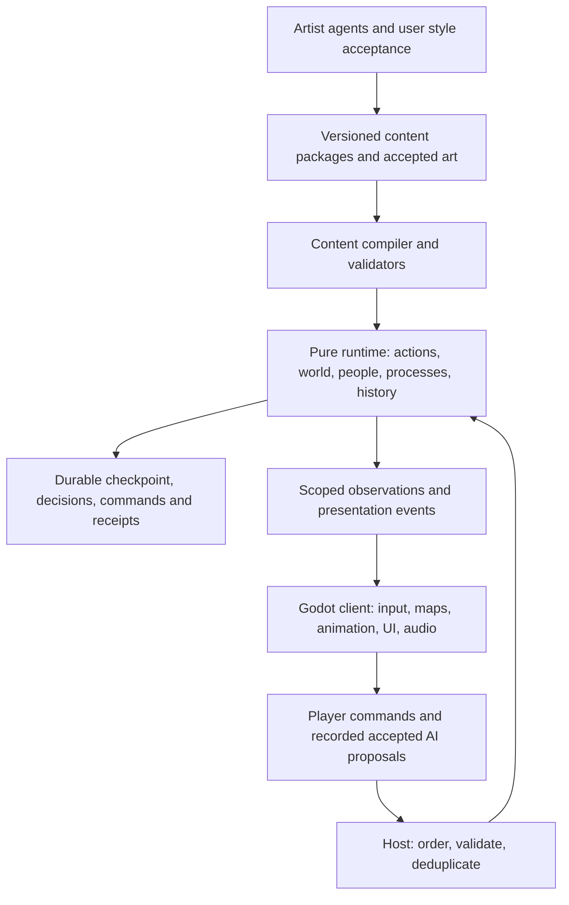

# OpenFantasy successor: architecture and product decision

8 September 2026 · Review of the current working tree, Beta v0.2, RogueFiction, and the GameDev AI ecosystem

**Recommendation: build a new, independently bounded game runtime in Beta, retain Godot/C# as the leading implementation option, and selectively extract proven OpenFantasy algorithms while importing all original concepts and content. Keep Beta's GDD as the vision, then make its unresolved decisions concrete through a playable feasibility slice. Do not expand the existing `World` model into the entire Beta platform, and do not discard the useful work already done.**

The owner's subsequent direction makes complete original OpenFantasy content preservation and incorporation mandatory. Selectivity now applies to implementation reuse and additional RogueFiction contributions, not to dropping original content. Preserve the deterministic, seeded, engine-independent simulation philosophy. Rebuild world-state ownership and persistence where Beta needs stronger contracts, while retaining suitable pure algorithms and tests. The original runtime as a whole still does not demonstrate Beta's persistent, historical society model. See the [complete migration plan](/Users/alucinor/Workspace/Projects/OpenFantasy/Beta/content-migration/README.md), [deeper narrative design](/Users/alucinor/Workspace/Projects/OpenFantasy/Beta/narrative-simulation-design.md), and [language/boundary decision](/Users/alucinor/Workspace/Projects/OpenFantasy/Beta/runtime-language-decision.md).

This is a recommendation, not a claim that a rewrite or the full release scope has already been approved or implemented. The [direction addendum](/Users/alucinor/Workspace/Projects/OpenFantasy/Beta/direction-addendum-v0_3.md) distinguishes established owner preferences from proposed technical decisions. The separate [reference architecture study](/Users/alucinor/Workspace/Projects/OpenFantasy/Beta/reference-architecture-research-2026-09-08.md) documents the external evidence and its limits.

## 1. What exists, and what Beta changes

OpenFantasy is a working multiplayer JRPG prototype with a meaningful architectural strength: its authoritative simulation is plain C#, separate in source from Godot presentation and ENet transport. It has real gameplay, generated sites, frontier settlements, travel, character progression, inventory, quests, and deterministic tests. It is considerably more than a mockup.

Its product model is nevertheless different from Beta's. It centers on a fixed authored overworld extended by procedural frontier, real-time combat, spawned enemies/resources, character progression, and personal quest/chest progress. Beta centers on persistent worlds whose materials, people, relationships, construction, history, and alternate timelines remain coherent as players change them. This changes the identity and ownership of almost every important entity.

| Area | Current OpenFantasy, observed | Beta v0.2 intent | Consequence |
|---|---|---|---|
| Product loop | Explore, fight, collect, quest, craft, travel; multiplayer presence/chat | Adventure plus making, recruitment, settlement, society and history | Preserve the playable adventure loop; expand around a specific player promise |
| World | Authored 512×512 Aldermere plus seeded frontier and generated sites | Coherently generated worlds, prehistory, civilization, continuing history | Current generators become modules/profile components, not the complete world model |
| Persistence | Character JSON, including some quest/chest state | Durable world, stable identities, decisions, branches, package versions | Replace persistence contract and authoritative state ownership |
| People | Player/monster/NPC/node entity categories; NPC wandering and dialogue | People with households, professions, loyalties, obligations and history | New identity/components and lifecycle required |
| Making | Immediate recipes and item stacks by definition ID | Material transformations, provenance, tools, labor, knowledge and mechanisms | Import every original recipe and item; redesign transactions and durable item instances |
| Combat | Implemented ATB-like real-time loop | Mode and clocks explicitly unresolved | Use current combat as a comparator; do not mistake it for an approved final choice |
| Extensibility | JSON definitions plus hardcoded systems and site registry | First-class packages across major game domains | Design supported content/behavior contracts before promising arbitrary extensions |
| History/travel | Spatial travel and instances | Planes, historical states, alternate histories and transactional travel | A new foundational capability, not an extra map selector |
| Visuals | Functional 16-pixel tile, small modular sprite prototype | User-approved Chrono Trigger baseline; Sea of Stars/Stardew-level finish | Dedicated artist pipeline and representative in-engine quality proof |

The repository contains 43 C# files, about 9,958 lines including tests. Data files contain 3 classes, 12 abilities, 35 monsters, 63 items, 45 quests, 28 recipes and 123 NPC definitions. Counts are inventory, not measures of content quality. The old `docs/GDD.md` and technical-design document describe earlier milestones; they cannot be used as the sole account of the current game. Source, README and milestone 8 are more current.

Beta's Markdown is approximately 21,768 words with 79 requirements and 32 named acceptance tests. Its coverage is strong, but coverage is not a production schedule. Many crucial choices are correctly marked as proposals or open ADRs. It would be a mistake both to dismiss the GDD as thoughtless scope creep and to treat it as an implementation-ready specification.

## 2. Verification and the decisive gaps

### Actual checks

| Check | Result | What it establishes |
|---|---|---|
| OpenFantasy `dotnet build --no-restore` | Pass, zero warnings/errors | Current project compiles in the installed environment |
| Godot 4.4.1 .NET headless `--selftest` | 40 passed, zero failed | Existing authored tests pass |
| Plain .NET harness compiling unmodified `src/Sim/**/*.cs` without Godot | Pass | Simulation code is already extractable from the engine dependency |
| Dedicated server with two automated clients in isolated copy | Both saw two players and four chats; no damage events recorded | Basic networking, presence and chat work; combat was not proven by this run |
| Automatic solo launch and screenshot in isolated copy | Pass, normal exit | Actual renderer launches; screenshot inspected |
| RogueFiction `cargo test --offline --locked` with temporary target directory | 57 passed, zero failed | Unit, playthrough, topology and conversational-flow coverage passes |

The isolated game copy redirected saves to a temporary directory. Existing player saves were not used. No sustained manual playtest, latency simulation, cross-platform replay comparison, security audit, or long-running memory benchmark was performed. Those remain required before corresponding quality claims.

The capture shows a functioning game but also the presentation gap: repetitive large floor fields, limited environmental composition and overlapping labels. The earlier preset gallery establishes useful silhouette experimentation, not the requested final art bar. Enlarging these sprites or adding lighting alone will not produce the desired art direction.

### Persistence is the main reason to rebuild the core

The [save store](/Users/alucinor/Workspace/Projects/OpenFantasy/src/Net/SaveStore.cs:10) serializes characters. [SnapshotSave](/Users/alucinor/Workspace/Projects/OpenFantasy/src/Sim/World.cs:133) does not checkpoint the whole world. A server starts a [new World and normally a new random seed](/Users/alucinor/Workspace/Projects/OpenFantasy/src/Net/ServerNode.cs:54). The world clock, modified site terrain, instance population state, and a world/package manifest are not restored by character saves.

Two executable probes exposed the practical difference:

- A dungeon tile modification disappeared after saving the character and reconstructing the world, even with the **same seed**.
- A genuinely generated and accepted frontier bounty was absent after restoring the character into a fresh world. Its generated quest definition was not present when [quest restoration checked the definition table](/Users/alucinor/Workspace/Projects/OpenFantasy/src/Sim/World.Systems.cs:123).

The terrain probe deliberately changes a tile through the public simulation API; it is a coverage diagnostic, not a claim that players currently have a construction tool. Beta explicitly needs such mutations to survive. The bounty probe does exercise an existing content path.

The current [StateHash](/Users/alucinor/Workspace/Projects/OpenFantasy/src/Sim/World.cs:675) also remains unchanged when chest ownership, a respawn schedule, or a dungeon tile changes. Passing a replay test using this hash therefore cannot establish complete state equivalence. This does not invalidate the covered movement/combat/generation tests; it limits their claim. The probes are preserved as inert source text in [review evidence](/Users/alucinor/Workspace/Projects/OpenFantasy/Beta/review-evidence/README.md).

### Other boundaries that would become expensive in place

The partial `World` owns over two thousand lines of movement, combat, gathering, vehicles, instances and settlements. A single [mutable Entity](/Users/alucinor/Workspace/Projects/OpenFantasy/src/Sim/Entity.cs:49) combines several distinct domain identities. Generated settlement definitions are inserted into shared `GameData` tables during play. Network handlers can invoke actions directly without a durable ordered command receipt. Map IDs are assigned as instances are encountered. These choices are reasonable prototype shortcuts but poor contracts for stable historical identities, package migration, and duplicate-safe co-op transactions.

The frontier renderer [remembers all chunks it has built](/Users/alucinor/Workspace/Projects/OpenFantasy/src/Client/WorldRenderer.cs:168); relevant world/chunk/settlement caches and visited instances also lack a complete residency/eviction policy. There is some wild-entity cleanup, so this is not a claim that nothing is cleaned up. It is a finding that “practically unbounded frontier” currently has no demonstrated bounded-memory implementation. A long-running benchmark should measure the effect before assigning a numeric severity.

These problems are coupled: replacing save semantics requires stable identities; stable identities affect commands, content instances, network views and hashes; history/branches require versioned state; society requires new entity relationships. The cost is in changing foundational contracts, not merely increasing line count.

## 3. Choosing the migration strategy

| Option | Benefit | Main cost/risk | Decision |
|---|---|---|---|
| Grow the existing game in place | Fastest visible incremental features | Repeated migrations of central state; old defaults quietly become permanent constraints | Suitable only if the intended product becomes a substantially narrower OpenFantasy sequel |
| Rewrite everything, including engine and generators | Complete freedom | Discards working evidence and adds unnecessary tool/rendering risk | Reject |
| New Beta runtime; selective extraction; Godot client | Fresh contracts with useful proven modules | Requires a bridge slice and disciplined migration | **Recommend** |
| Fully import original content through explicit Beta mappings | Meets the owner's no-loss requirement and preserves identity | Requires reconciliation of clocks, progression and dependencies; extra art/content verification | Required content strategy; does not require preserving the entire old implementation |

The independent .NET compile is especially valuable: separation does not require speculative reengineering. Preserve the original working tree as a baseline, including its staged milestone 8 work. Extract small units with their tests. Let a Beta slice demonstrate that one imported generator works against the new identity/content/save contracts. Avoid maintaining two expanding product branches indefinitely.

If executable Beta code is later placed under this repository, isolate both build systems. The root C# project's default recursive source discovery can accidentally compile `Beta/**/*.cs`. The parent Godot project can also discover nested assets. Establish an explicit source exclusion and Godot import boundary, or choose a separate repository, **before** adding executable Beta source. This review adds documents and inert evidence only; it does not scaffold or start the new engine.

### Retain, adapt, replace

**Retain as candidates with evidence:** seeded RNG utilities; grid/pathfinding helpers; topology-first site recipes; connectivity/secret/lock validators; bounded generator retries; deterministic test cases; interest filtering; separation of simulation and renderer. [SiteGenerator](/Users/alucinor/Workspace/Projects/OpenFantasy/src/Sim/SiteGen/SiteGenerator.cs:12) already uses a finite retry bound, an important property to preserve.

**Adapt:** frontier biome and settlement generation; vehicle/traversal mechanics; character customization; ATB mechanics; inventory/quest/recipe definitions; generated rumors; map rendering/import tooling. Replace hardcoded global content registration with package definitions and durable runtime instances. Current networking is a behavior reference and transport prototype, not the eventual persistence/security contract.

**Replace:** character-only persistence as the world store; mutable shared definitions; transient entity/map IDs as canonical identity; presentation event lists as purported history; incomplete hash oracle; unbounded residency; hardcoded systems masquerading as fully extensible packages.

**Review independently:** art, audio, prose and external asset provenance. Having usable source code does not establish release-ready content or portable asset rights. Preserve attribution and existing source provenance when extracting modules.

## 4. Incorporate the full original game around a coherent promise

A useful product promise is: **lead an adventuring company through a beautiful world whose people, places and creations remember what you do.** Discovery, dangerous expeditions, meaningful relationships and building a home should reinforce one another. The settlement is an emotional and mechanical anchor for adventure, rather than another mandatory management game layered over it.

Original OpenFantasy offers an unusually compatible identity: postwar reconstruction, hopeful melancholy, Aethertech, distinctive travel and communities. An Aldermere-derived world profile can express that identity through cultures, landmark roles, architectural kits, ruin families and historical constraints. Preserve the fixed Aldermere map and all named places. The proposed main-world integration varies placement by seed while retaining required identities, routes and quest dependencies; a faithful authored-map realization supplies compatibility evidence. Neither a disconnected archive nor chance-based omission meets the full-import requirement.

Ships, canoes, tanks and airships can become capabilities that alter route choice, cargo, expeditions and settlement links. Preserve the evocative Brasswing idea as an original vehicle identity subject to narrative review. Prove meaningful ship travel early, then complete all five original vehicle capabilities. Sequence is a production choice; none may be silently dropped.

RogueFiction adds a smaller set of high-value design primitives:

- **Information as an action:** listen, smell, examine and search expose scoped observations from actual world state. Decorative narration must not advance authoritative RNG or invent facts.
- **Costs that change the scene:** prying a lock produces noise, which can alter enemy behavior. A secret, tool and sensing system then interacts without a bespoke quest script for each combination.
- **Narrative choices with effects:** dialogue predicates and typed effects can connect vows, discoveries and consequences to the same action/state layer.
- **Paced topology:** its area design deliberately alternates lean story floors with looped exploratory floors. Maximal maze complexity everywhere is not the desired experience.
- **Persistent local changes:** opened compartments and doors survive return trips through its in-memory `SavedLevel` mechanism. That illustrates necessary mutation preservation, but does not itself provide durable disk saves or live offscreen simulation.

The topology lineage is already partly in OpenFantasy; do not count it twice. Port the unincorporated behaviors and tests into Beta's contracts rather than embedding the Rust game, its single-action turn clock, flags bitset and complete story graph as a second authority.

## 5. Architecture proposed for the first real proof

Use a **modular monolith** with an engine-independent runtime and a thin presentation client. C# and Godot remain the leading implementation candidates. Core decoupling, seeded determinism and a restrained number of boundaries are owner-established requirements. The core must not depend on Godot types, graphics, transport or platform-specific storage. Host adapters supply ordered inputs, persistence and observations without imposing IPC on solo play. Start with a handful of explicit assemblies, not a microservice network or a universal ECS framework. Godot/C# is a strong default because there is working local evidence and it supports the required presentation direction; it remains a candidate subject to the platform and art slice. C# platform/export limitations must be checked against the actual target list before freezing the engine. [Godot C# documentation](https://docs.godotengine.org/en/stable/tutorials/scripting/c_sharp/c_sharp_basics.html)

### Core data and authority

Separate immutable definitions from durable instances and from observations. A sword definition is not a specific sword with an owner, material composition, condition and history. A character's ancestry is not its currently active body in a branch. A region's network ID is not its persistent address. Record these distinctions before adding many features.

A practical initial command includes world/branch identity, actor identity, command ID, expected revision where needed, and typed intent. The host orders commands and validates authority. A transaction commits resulting state, accepted decisions and a receipt; retrying the same command returns the existing result. Observations and cosmetic events are derived afterward. A visual effect, NPC sentence, or remote AI response never directly mutates the authoritative world.

SQLite is a reasonable first storage candidate for a local/dedicated-host prototype: atomic transactions and checkpoints can handle durable state plus receipts. This is an application design choice, not an assertion that selecting SQLite solves replay. Its WAL model still has a single writer at a time and is not a distributed database. Keep active simulation in memory and serialize intentional durable changes; do not execute a database query for every sprite tick. [SQLite atomic commit](https://sqlite.org/atomiccommit.html), [WAL](https://sqlite.org/wal.html)

Build checkpoints plus ordered commands/accepted decisions first. Add a consequential history index for queries and narrative. Do not require every cosmetic frame or footstep to become an eternal event-sourcing record. Preserve old executable rules or migrate through a declared process; a seed plus current code cannot replay an old package version by itself.

### Time, locality and branches

Give simulation time, world calendar and narrative deadlines explicit contracts. Keep fixed/integer authoritative scheduling, but do not equate that with one combat mode. The leading combat experiment should compare current real-time ATB against an on-field command timeline with readable intent and cooperative techniques. Pause, disconnection and simultaneous players need rules; a solo menu pause cannot silently stop another player's ongoing world.

Generate macro constraints before lazily generating detail. Geography, rivers, political claims and historical sites must be consistent across chunk boundaries and exploration order. Use separate keyed RNG domains for generation, combat, society and cosmetic variation. Persist the generator/package identity and accepted generation decisions.

Simulate the active scene in detail and distant regions at declared coarser intervals. Record exact conserved resources and named identities across promotion/demotion; approximate explicitly permitted quantities such as anonymous population distributions. Neither “simulate every being everywhere each tick” nor “freeze all offscreen state” meets Beta's intent.

For the first temporal proof, use one supported historical checkpoint and an explicit branch-on-intervention policy. Make cross-branch travel atomic and forbid implicit merging. An artifact's lineage may continue across branches, but its live instance cannot be duplicated into unlimited resource value. Initially copying a small checkpoint is easier to verify than a sophisticated copy-on-write store; optimize only after measurement. Branch count, retention and travel permissions need enforceable budgets.

### Content and creation

Start with typed declarative definitions and a small effect/process vocabulary used by first-party content. Demonstrate one external package that adds a meaningful behavior and survives load/save/version checks. Pure reskins are not sufficient evidence for Beta's extensibility requirement.

Do not start with arbitrary native DLLs as the community extension contract. A restricted DSL may be sufficient; introduce Wasm only if a concrete extension needs it. Wasm execution requires controlled imports, numeric behavior and resource limits to become deterministic; a sandbox alone is insufficient. [Wasmtime deterministic execution](https://docs.wasmtime.dev/examples-deterministic-wasm-execution.html)

The in-game maker should submit the same validated definitions/processes through a restricted capability set. It must not grant unrestricted admin rights merely because developer content uses the same schema. Knowledge progression controls what a character can understand or construct; essential UI/accessibility remains available independently.

## 6. Feasibility and the gates that matter

No inspected project demonstrates Beta's full union. There is no basis to promise a polished 60–80-hour procedural epic, Dwarf Fortress-level society, Terraria-level creation, timeline branching, rich co-op, broad modding and the requested art quality on a specific solo-agent schedule. Model improvements can reduce implementation work; they do not establish entertainment quality, consistent art, content throughput, or maintenance cost.

Preserve the whole vision. Treat each expensive domain as a capability with a proof and a release priority, not as a paragraph that is already funded. V0.2 already contains sensible gates and admits unknowns. Strengthen it by making these choices explicit:

| Gate | Deliverable | Failure that changes the plan |
|---|---|---|
| A: visual calibration | User-accepted people, creature, props, scene; motion sample before bulk animation | No accepted style or no reliable production export; revise art tools and scope before expanding assets |
| B: durable kernel | Stable IDs, one material transaction, restart, duplicate-command receipt, full-state oracle | Loss/duplication or replay disagreement; stop expanding world systems |
| C: distinctive play | One original town, wilderness, dungeon, recruit, obligation, craft and consequence | Players cannot perceive or enjoy the cross-system consequences; revise loop before more simulation |
| D: historical travel | One supported epoch, one intervention branch, artifact travel, two clients | Duplication, unintended cross-branch mutation, inscrutable narrative; simplify temporal policy |
| E: production viability | A second region/content package produced with the same tools and accepted visual standard | First slice was hand-tuned beyond repeatable production; revise authoring pipeline and campaign size |
| F: bounded operation | Measured exploration, residency, save size, package upgrade/removal, failure recovery | Memory/latency/storage grows outside declared budgets; narrow supported configuration |

The first playable slice need not deliver every gate simultaneously. B and art exploration can proceed independently; C is the early product decision; D tests a foundational unique risk before campaign production. A single “universal engine proof” would delay learning about the actual game.

A suggested slice is a 30–60-minute expedition, not the full release: recruit a smith with a family obligation, retrieve a historically situated material, choose a route/tool that changes risk, build a useful mechanism, and return to a town visibly affected by the decision. Demonstrate restart and two-player ownership with AI disabled. Introduce the time branch as a second bounded proof after that loop is coherent.

Estimate the release only after measuring scene/animation throughput, new-region authoring, bug/repair rate, readable NPC stories and playtest retention. Count unique character animation sets, environment kits, portraits, encounter patterns, event arcs, translations and accessible UI states. A generator's ability to output many files is not accepted-content throughput. The mandatory full original-content migration also needs its own coverage gates; the first slice does not waive the remaining import obligations.

## 7. The ecosystem: useful after removing friction

The ecosystem is useful as **curated instructions, tested tools and shared evidence conventions**. It is not a proven reusable runtime, and its large skill inventory is not itself an advantage. The existing flexibility contract and generation-evaluation document are worth retaining. They emphasize project authority, optional pipelines, and the difference between simulation correctness, playability and perceived experience.

The observed liabilities are concrete:

- Multiple documents allocate precision implementation to Claude and breadth to Codex, while command wrappers tell Claude to hand all implementation to Codex. Both contradict the desired interchangeable roles and each other.
- A global readiness skill requires a weighted 90% score and assigns 15% to finding an existing OSS implementation. A valid novel design without a precedent is capped below its own threshold. Its claimed universal precision is unsupported by this audit.
- Some skills mix current C# defaults with older GDScript runner examples and project-specific framework advice. Such examples need version checks and relevant scope, not automatic application.
- A testing guide discouraged visual-output testing wholesale. That is unsuitable for a game whose quality bar explicitly depends on rendered presentation.
- Duplicate skill installations can drift. Some identical names under `.agents` and `.codex` have different contents. Maintaining reviewed sources and target hashes is more useful than adding another instruction layer.

There is no direct measurement here of how much these instructions change any model's performance. They do not remove “innate talent”; they can direct attention, constrain decisions, consume context and trigger unnecessary handoffs. Their value should be evaluated on comparable tasks. OpenAI's current guidance likewise advises auditing conflicting or over-specified instructions for strongly instruction-following models. That is not evidence of universal model superiority. [Official model guidance](https://developers.openai.com/api/docs/guides/latest-model)

The revised operating model makes Codex and Claude interchangeable end-to-end leads; Antigravity performs bounded maintenance. Artist agents separately own style exploration, assets, animation and consistency. Tool access and actual output quality determine assignments. An artist's reference sheet does not count as a runtime-ready sprite set, and an engine builder cannot mark placeholder art accepted.

The persistent updates are maintained in `/Users/alucinor/Workspace/Projects/GameDevAIEcosystem`, with synchronized installed instructions, backups and a target manifest. See the ecosystem's [operating contract](/Users/alucinor/Workspace/Projects/GameDevAIEcosystem/.specs/agent-operating-contract.md) and [skill sources](/Users/alucinor/Workspace/Projects/GameDevAIEcosystem/skills/README.md). No paid service or new MCP integration is enabled by these documentation changes.

For a future comparison, give the same frozen tasks to minimal-context and curated-skill profiles using the same model/version, input, budget and evaluator. Measure correctness, unjustified pauses, repair count, elapsed work, and blind play/visual judgments over repeated trials. Retain the rules that help; abandon the ones that do not. There is no obligation to make every imported skill or framework fit Beta.

## 8. Decision boundary

Continue investing in **the lineage and working evidence**, while changing the runtime foundation. The current game should remain the playable benchmark until Beta proves it has improved both persistence and experience. Beta should earn its larger engine one useful, interacting capability at a time.

Reconsider this recommendation if the intended product narrows to a conventional multiplayer exploration JRPG with character persistence; in that case incremental OpenFantasy development becomes more attractive. Reconsider Godot if target-platform or art-pipeline experiments demonstrate a material limitation. Reconsider the ambitious scope if the second region and accepted animation set cannot be produced repeatably. None of those decisions should be made from nostalgia, a model brand, or a count of GDD requirements.
