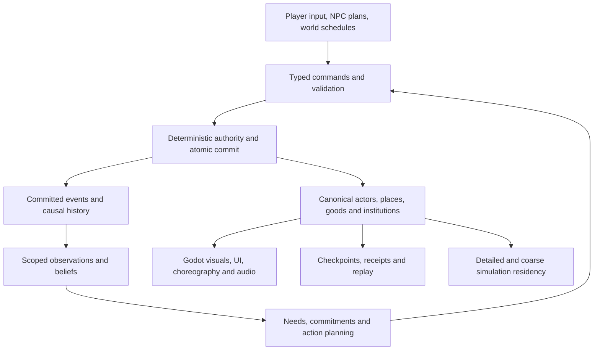

# Beta OpenFantasy architecture synthesis v0.6

8 September 2026. Current architecture synthesis and final review of the expanded owner direction. Read with the [consolidated requirements register](requirements-consolidated-v0_6.json), [v0.2 product GDD](persistent_seed_jrpg_gdd_v0_2.md) and the retained specialist designs linked below. This edition replaces earlier architecture recommendations where it explicitly resolves them; it does not claim that unimplemented systems or open contracts are complete. Previous editions are [archived](archive/README.md).

## 1. Architectural decision

Build the successor in Beta on an engine-independent, seeded, deterministic C# simulation core, with Godot as its presentation and platform adapter. Import all original OpenFantasy content and selectively retain proven algorithms and fixtures. Do not extend the original monolithic world and movement-mode vehicle implementation into the successor's fundamental state model. Keep one authoritative simulation, with logical domain modules in the same process unless measured deployment needs justify another boundary.

The central design rule is now **player and NPC character parity**. Every individual NPC is a living actor with the same applicable character-state model, action vocabulary, progression, possessions, relationships, commitments and history as a player. Input control differs; intrinsic depth does not. Important characters may receive more bespoke authored scenes, but that does not entitle them to deeper simulation than an ordinary farmer, soldier or shopkeeper.

The player can adventure, lead, trade, build, study, farm, serve a faction, resist it or change allegiance. Major events may arise without the player, be resolved by another person, or never occur. NPCs act from their own knowledge and circumstances within the same world. This strengthens the existing open-life vision and revises any interpretation that a chosen protagonist must complete one predetermined world-saving plot.

Adopted Wait combat and seamless transitions remain unchanged: bounded on-field encounters, full required-decision holds, controlled admission, shared pause in solo/coordinated play, and explicit tactical/world-time distinctions in independently exploring co-op. Seamless grid streaming remains separate from encounter ownership. See [v0.5 encounter decision](combat-transitions-and-timing-decision-v0_5.md).

The detailed designs below are the selected architectural recommendations for implementing the owner's requirements. Numeric tuning, some timing policies and the evidence gates in §12 remain open. No Rust/C++, IPC bridge, distributed service system or universal scripting language is required to express these features.

## 2. What the original game contributes

| Area | Evidence reviewed | Successor treatment |
|---|---|---|
| Vehicles | [Original vehicle implementation](../src/Sim/World.Vehicles.cs), [items](../data/items.json): canoe, sailboat, ship, dwarven tank and Brasswing airship; inventory ownership changes a player's movement mode | Preserve all identities, acquisition paths and travel purposes. Replace movement-mode-only ownership with persistent assemblies and boarding relationships. |
| Vehicle behavior | The original skips hostile targeting of riders and prevents ordinary ability use aboard vehicles in [World.cs](../src/Sim/World.cs) | Record these as compatibility behavior to reconcile. Beta's actual vessel combat and exposure replace blanket immunity; do not silently inherit an exploit or erase the legacy behavior from the migration ledger. |
| Making | [28 recipes](../data/recipes.json), including a canoe, potion/tonic, rations, metalworking, berry pie and miners' stew | Preserve exact authored recipes and item identities; add process, ingredient, material, labor and quality depth around their meaningful outcomes. |
| People and progression | Existing class/ability definitions and NPC appearance, shop and quest records | Preserve everyone and every progression identity. The new common actor model adds capabilities not demonstrated by the old fixed records. |
| Broader simulation | The Beta baseline already specifies species histories, institutions, crafting graphs, affinities, domestic careers and war | This pass connects those intentions through explicit owners, state and interactions. Their presence in a GDD is not runtime evidence. |

Carriages, chariots, sandships, tunneling ships, air balloons, the expanded mount families and deep modular customization are new explicit obligations here, not features claimed to have been discovered in original source. The owner has now confirmed sandships as required transport coverage, superseding their candidate status in v0.4/v0.5. Ships and airships retain their established obligations. The migration inventory still reports no executable Beta import.

## 3. One core with accountable domain ownership

These are logical responsibilities, not a requirement for one assembly or process per row. Domain commands commit through the same transaction boundary. A module owns its fields; other modules request changes through typed operations. Events trigger bounded follow-up work rather than callbacks recursively mutating unrelated state.

| Owner | Persisted state | Representative public operation / output |
|---|---|---|
| Core authority | Entity/definition IDs, world/branch IDs, rules/package versions, command receipts, RNG domains, commit order | `SubmitCommand`, `Validate`, `Commit`; durable outcome and explanation trace |
| World and history | Space, terrain mutations, calendars, environment, historical events, cosmology and lineage epochs | `AdvanceWorld`, `ApplyExposure`, `RecordHistoricalEvent`; environmental and historical facts |
| Actors and capabilities | Body, traits, stats, skills, learned powers, health, needs, personal inventory references and control permissions | `EvaluateCapability`, `PerformAction`, `Learn`, `ApplyCondition`; legal consequences using shared rules |
| Society and cognition | Directed relations, kinship, memories, beliefs, values, goals, commitments and party/household roles | `Observe`, `ProposePlan`, `OfferRecruitment`, `CommitJointAction`; scoped knowledge and negotiated participation |
| Production and material condition | Item/material instances, assemblies, attachment topology, process jobs, reservations, quantity/quality, part wear and maintenance history | `StartProcess`, `FitPart`, `Repair`, `Salvage`; conserved outputs and work in progress |
| Travel and logistics | Vehicle routes/movement state, boarding/towing/mount relationships, local coordinate frames, crew assignments and cargo transfers | `Board`, `Mount`, `Route`, `AssignCrew`, `TransferCargo`; valid movement and custody |
| Institutions and conflict | Memberships, offices, claims, laws, treaties, trade contracts, covert organizations, military orders and occupation | `OfferTreaty`, `DispatchShipment`, `IssueOrder`, `ResolveClaim`; accountable institutional actions |
| Narrative | Authored definitions, arc instances, participant bindings, eligibility, witnessed developments and quest continuations | `EvaluateArc`, `OfferChoice`, `AdvancePhase`; semantic action requests and presentation cues |
| Encounters | Membership, tactical progress, ready/held decisions, costs, hazard dependencies and outcomes | `Admit`, `CommitCombatAction`, `MergeAtBoundary`, `Exit`; authority-preserving phase changes |
| Host adapters | Storage, network delivery, Godot integration, platform I/O and optional provider connections | Read snapshots / submit validated inputs; no competing gameplay state |

Ownership distinctions matter. The production owner holds installed-part condition; travel derives performance from it. The actor owner holds an animal's health; mount equipment has its own condition. Institutions issue ownership transfers through the common custody transaction. A quest cannot hold another copy of the requested item, and a ship manifest cannot count goods already in a warehouse.

Definitions are versioned templates; instances are durable things. Sparse storage and shared defaults may compact state without removing capability. Derived caches can be rebuilt; consequential memories, condition, learned abilities, command receipts and mutations cannot. Branch transfers carry provenance and follow the temporal contract rather than copying resources freely.

## 4. Player-equivalent NPCs that participate in the world

### Character parity

An applicable action has the same prerequisites, resource costs, checks, effects and learning opportunities whether selected by a person at a controller or an NPC planner. That includes fighting, casting, crafting, using equipment, navigating, trading, recruiting, studying, worshipping, forming relationships and exercising a legitimate office. Roles and permissions limit particular actions; the `isNPC` distinction does not remove entire game systems.

Every individual has persistent identity and recoverable state. A shopkeeper can improve a craft, owe a debt, learn from travel, grieve, recruit help, become a refugee, gain office or join an expedition if circumstances support it. This does not require every shopkeeper to know every spell or want to become a hero. An animal uses the same body/needs/action architecture with its supported cognition and capabilities; parity does not give all creatures identical intelligence, anatomy or powers.

Player control is an adapter attached to an authorized actor. NPC planning is another. This does not authorize players to take over arbitrary NPCs; recruitment, temporary control, possession and succession each have explicit in-world and host permissions. Handing a permitted actor between controllers must preserve the same stats, knowledge and commitments.

### Continuous responsiveness without omniscience

Use a causal loop: **world fact → available evidence → perception/belief → relevance to needs and commitments → chosen action → actual consequence → memory and social response**. Immediate threats interrupt promptly where perceived; routine work and long-term planning run on bounded schedules. “Living constantly” means ongoing causal participation, not evaluating every possible action for every person every rendered frame.

For example, an army damages a trade road. A merchant learns from a delayed shipment, seeks another route and changes orders. An herbalist sees fewer supplies, substitutes a usable ingredient and asks a guild contact for help. A farmer hears an uncertain rumor, weighs family safety against harvest needs and may shelter travelers. A guard who has not received a message cannot know an enemy's secret destination just because it exists in host state.

Perception indexes, affected-location subscriptions and scheduled obligations keep reactions bounded. Plans consume actual labor, supplies and travel. News has sources, delays, reliability and audiences; one world event does not instantly update every mind. Contradictory beliefs are legitimate character state. Contradictory authoritative ownership is a defect.

Distant simulation must retain the same individual capability and history. It may batch uneventful work and schedule meaningful decisions less often. It cannot upgrade a generic citizen into a deep actor only when a camera approaches, reroll a friend, finish work twice or retrospectively invent travel. Compression of groups must retain recoverable individual state and an identity index. Historical population aggregates describe populations, not replacements for already instantiated people. Measure the cost of this parity; do not silently weaken it to hit a target.

### Relations, parties and shared capabilities

Separate personal friendship, affection, trust, respect, fear, rivalry, grievance and obligation from institutional reputation and abstract elemental affinity. Keep relationships directed and contextual. Shared danger, work, study, promises, betrayal, gifts and absence have specific causes. A person may trust a skilled rival with a task while disliking them.

Party membership is an agreement with participation, leadership and departure rules. It must coexist with households, employment, loyalties and dependants. Recruitment reserves actual time and changes duties; there is no simultaneous full-time worker and adventuring duplicate. NPCs can form their own parties and organizations.

Joint actions declare participants, roles, prerequisites, readiness, consent/control, costs, contribution and outcome credit. The same framework supports a cooperative combat technique, a scout guiding travel, a mage protecting a crossing, a pilot/engineer maintaining a vessel, or cooks and herbalists preparing an expedition. Commit a combined action atomically and preserve costs if it is interrupted under the relevant rule. Bond-based benefits need caps and stacking groups, avoiding an uncontrolled bonus for every pair in a large party.

## 5. Cosmology, species, cultures and individual agency

Model distinct layers with explicit provenance:

1. **Cosmology:** a seeded, versioned configuration of magical/crystal/elemental relationships, celestial influences and deities where the world profile includes them.
2. **Lineage history:** species and subspecies have ancestry and historical events affecting bodies, inherited potentials, affinities and vulnerabilities. Branching, convergence, magical transformation and permitted interbreeding have typed causes; similar traits need not imply common ancestry.
3. **Culture and civilization:** languages, institutions, technologies, learned practices, traditions and collective histories. A species can inhabit many cultures; a culture can include many species.
4. **Individual realization:** inherited traits, birth variation, upbringing, experience, belief, choices, training, exposure and supported transformations. Record why this person differs from a lineage tendency.

The cosmic layer establishes species-associated affinity rules and distributions for that world and epoch. It does not set every individual's destiny. Rare births, mixed ancestry where supported, magical events, training, vows and deliberate transformation can create exceptions with actual mechanics and costs. An affinity can affect aptitude, resistance, available techniques or interaction with a crystal; it need not be an absolute class lock.

Keep inherited traits, learned culture, devotion, supernatural grants, ethical dispositions and political allegiance separate. Worship can affect conduct, bonds, powers and alignment through declared rules. Changing allegiance to a god can have consequences without silently replacing personality. A deity's demands, an institution's doctrine and what a worshipper believes are distinct facts. Species identity alone does not dictate morality or hostility.

**Gods and deities are first-class world entities.** Where the cosmology includes active gods, each has identity, domains/portfolios, powers and limits, motives, relationships, knowledge and a history of interventions. Pantheons, rivalries, divine alliances, worshippers, temples, priesthoods, rites, pacts, boons and curses connect through the same actor/institution/effect contracts. A religion can misinterpret its deity or worship something whose claimed nature is false; belief alone does not create an authoritative divine fact.

Divine action has a supported mode—such as omen, grant, manifestation or intervention—with declared scope, cost/constraint, evidence and consequence. Avatars reference their deity and retain explicit body/control/custody rules. Divine power is not a hidden administrator write bypassing determinism. Omniscience, immortality, apotheosis or the death of a deity, if supported by the selected cosmology, require specific capability rules; none follows automatically from the label “god.” NPCs and players can worship, reject, bargain with or oppose deities under the same applicable mechanics.

History generation produces versioned lineage states and evidence. A cosmic event changing future inheritance must not retroactively rewrite all living people; an event that changes living beings needs an explicit effect. Eon-scale steps use bounded epoch models; live time uses compatible transitions. Temporal travel retrieves the appropriate lineage/cultural state in its branch. Save migration must not regenerate affinities under a newer rule version.

Presentation communicates these histories through supported body families, dress, gestures, material traditions and magical effects. Individual exceptions remain readable. A combinatorial trait system must validate equipment and animation compatibility; it cannot promise arbitrary new silhouettes from existing sprites.

## 6. Crafting, herbalism, cooking and alchemy

Use a typed process graph shared with construction, vehicle parts, maintenance and magical creation. Inputs can require several ingredients together, choose alternatives, depend on a tool/station or depend on knowledge and environmental conditions. A simple linear recipe tree cannot represent this adequately.

A process definition records input predicates and quantities; consumed versus reusable catalysts/tools; skill/knowledge prerequisites; worker roles; stages and durations; heat/energy/environment; output quantity and property rules; waste/byproducts; quality; failure/interruption; and explanation data. A job instance reserves specific lots, workers and station capacity and retains work in progress. Output provenance follows the actual ingredients and transformations.

- **Herbalism:** species/variety, habitat, season, growth, identification, preparation, drying, preservation, cultivation and medicinal or magical properties. What a character believes a plant is can differ from its identity.
- **Cooking:** preparation methods, heat, combinations, preservation, freshness, nutrition, personal preference and cultural traditions. Meals connect farming, morale, relationships, travel supplies and trade rather than only combat buffs.
- **Alchemy:** extraction, separation, concentration, combination, solvents/catalysts, reactions, residue and stability. Magical transformations remain declared world rules with costs. Ingredient substitutions produce explainable differences.
- **Engineering and enhancement:** material treatment, compatible parts, attachments, enchantments, repairs and salvage use the same transaction and process language.

Quality is a vector where useful—durability, potency, taste, purity, stability—rather than one universal rarity color. Keep the normal interface focused on intent, available ingredients, expected outcome and tradeoffs. Analytical views expose deeper graphs and real evaluation traces as knowledge permits.

Validate dependency reachability, incompatible types, unavailable knowledge, dead-end ingredients and unpriced resource cycles. Useful cycles such as repair/recycling remain allowed with accountable costs and losses. Enforce bounded evaluation; do not solve an unlimited global optimization problem for every cook. Batch orders and delegated NPC work use the same jobs and can be interrupted by danger or changed obligations.

### Magic as researched and crafted capability

Schools of magic, elemental affinities and effect operations are distinct axes. Support specializations such as illusion and invocation with original defined practices and learning routes. A school is a discipline of study; an elemental affinity modifies access or aptitude; an operation describes what a spell actually does. A fire enchantment can combine a fire affinity, an enhancement practice and an item-binding operation without creating three unrelated magic engines.

Represent a spell definition as a typed, versioned composition of source/power, school/prerequisites, elemental facets, operations, target predicates, delivery/shape, duration, triggers, costs, limits and explanation data. Facets can reinforce, oppose or transform each other through authored compatibility rules. Multi-element fusion must have an explicit resulting effect; blending arbitrary words is not sufficient to create executable magic.

Support direct spells, rituals, weapon/object enhancement, spellbinding, persistent areas and effects attached to people or objects. Bound spells record the actual item/actor, charge or upkeep, trigger permissions, stacking group, expiry/dispel conditions and provenance. An enhancement on a sword persists when it changes hands according to its rule; the sword does not duplicate its enchantment when transferred or repaired. A familiar bond uses this system's explicit lifecycle alongside the actor model.

Lingering effects are first-class instances with source, location/attachment, affected targets, propagation, clock domain, periodic schedule and termination conditions. A flame field can consume declared fuel and interact with weather; an illusion changes perceived evidence through supported senses rather than rewriting the underlying historical fact. Wards, enchantments and hazards use the same targeting and stacking semantics in exploration and combat. An area crossing an encounter boundary must follow admission/coupling rules before causing a consequence. It cannot keep dealing real-time damage to held combatants.

Magical research is a real process: acquire knowledge or observe a phenomenon, propose a supported composition, inspect known prerequisites/risks, reserve materials/time/facilities, experiment, and record the result. Success, failure, discoveries and side effects follow the declared research rules. New spells become validated, versioned definitions with inventor, discovery history and knowledge/teaching permissions. Players and NPCs can research, teach, combine and improve them; knowledge is not automatically distributed to every actor.

The compiler validates effect types, affinity interactions, legal targets, bounded recursion/spawning, costs, stacking and duration before a definition becomes executable. World rules may allow costly matter creation or powerful combinations explicitly; free-resource loops are not research discoveries. Existing spells and recorded casts stay pinned to their definition versions when a new technique is learned or a package changes. Optional generative assistance may propose a composition, but only supported primitives and validated transactions can make it real.

Present this through schools, teachers, libraries, laboratories, ritual spaces and a comprehensible spell-workbench view. Start with a modest connected set of well-tested primitives that can express the required examples; expand depth by meaningful interactions and discovery routes. Do not promise an unbounded arbitrary-language magic interpreter.

## 7. Vehicles, mounts, pets and familiars

### Persistent transport assemblies

Vehicles are constructed, owned entities with part topology and capabilities. A blueprint describes a valid design; it does not create free parts. Frames/hulls, joints, wheels/tracks, sails/rigging, propulsion, steering, armor, storage, stations, seating, weapons and magical modules are reusable definitions with compatible attachment rules. Not every transport needs every category. Preserve a simple canoe as a useful simple build.

Support ships, boats, canoes, carriages, chariots, dwarven tanks, sandships, tunneling ships, air balloons and airships, plus extensible fantastical transports. Customization covers functional construction, parts/materials, enhancement and visible identity within validated structural/body families. A crystal-driven skiff or walking carriage is a candidate configuration of capabilities, not a mandatory hard-coded new engine.

Travel domains require their own concrete constraints: sandships interact with traversable substrate, slope and propulsion; tunneling ships interact with geology, excavation, spoil, power, clearance and occupied spaces; balloons depend on lift, load, atmosphere and steering limits; powered airships add controlled propulsion and landing requirements. Underground travel modifies or follows real world passages under the chosen excavation rules. None of these vehicles can clip through settlements, ignore a loaded obstruction or regenerate traversed terrain to fit a route. Air balloons and airships are distinct supported profiles, not interchangeable cosmetic names.

Derive usable capacity, mass/load, propulsion, travel domain, handling, stability/buoyancy/lift where applicable and required crew from the assembly and its condition. World rules can use deterministic approximations; no general fluid or rigid-body simulator is required by this architecture. Piloting and crew skills participate through ordinary actor actions.

Wear follows actual use, load, exposure, damage and maintenance. Track meaningful parts and failure modes: damaged wheels, worn tracks, leaking hull sections, frayed rigging or unstable magical fittings as supported. Inspect, patch, repair, replace, improve and salvage have distinct outcomes. Replacing a part transfers custody and preserves the vehicle's identity, name, history and surviving attachments. Cosmetic age can survive a functional repair.

Construction validates legal attachment, structure and navigation clearance. Cosmetic placement cannot create a working engine or enlarge cargo capacity. Store cargo once with explicit containment and ownership; enforce capacity during transfers. Boarding, disembarking, docking, towing, wreck recovery and theft follow permissions, routes and physical capability. A vehicle persists when its owner walks away.

Mounted actors and attached objects use stable local coordinates under a vehicle transform. The encounter timing contract covers the moving vessel and relevant dependencies before onboard combat is enabled. No invulnerability from simply boarding, and no duplicate hull/cargo when streaming. Component-level detail must be budgeted and tested on a populated, customized vessel.

### Mounts and companions

Mounts are actors, not equipment that grants speed. Include different horse types and fantastical lizard and bird families, with package-defined bodies, sizes, temperaments, terrain abilities and care. Riding birds need not all fly; a flying mount's lift, load, landing and stamina must be explicit. Lizards may offer supported climbing, swimming or terrain access rather than being horses with a recolor.

Mount compatibility depends on anatomy, rider size/load, equipment and training. Saddles, harnesses, barding, packs, reins and towing fittings are condition-bearing items. A carriage or chariot can combine an assembly with living draft animals: propulsion depends on those animals' ability, fatigue and cooperation. Husbandry, breeding where supported, injury, feeding, shelter and bonds connect to ordinary ecology, crafting and society.

Pets and familiars have persistent identity, needs or supernatural upkeep, abilities, bonds and autonomy. Feeding and care are required gameplay: appropriate food/water, shelter, rest, health, grooming or other species-specific attention, and treatment of injury or illness where applicable. A supernatural being can have an explicitly different care requirement; calling it a familiar does not silently eliminate upkeep. Neglect has readable, species-appropriate consequences and recovery paths. Care can be delegated to actual keepers/stables with real supplies and commitments, including during travel or player absence under the host clock policy.

Companions can participate in exploration, sensing, retrieval, support, communication and combat where capable. Training and relationships affect cooperation without replacing it with a universal obedience number. Equipment and commands respect anatomy and cognition.

Summoned familiars use an explicit bond/entity lifecycle. Dismissal, death, recall, distance and re-summoning must preserve or transform the correct individual according to the spell rule. They cannot duplicate inventory, memories or a companion. Magical shared senses transmit only information acquired through supported perception; they do not grant host omniscience. These rules also support NPC-owned pets, mounts and familiars.

## 8. Politics, trade, covert power and world crises

Institutions are durable entities with members, offices, goals, resources, territory/claims, rules and obligations. Support nations, towns, guilds, religious bodies, overt factions, covert organizations and alliances. A directed relationship between institutions can express treaties, hostility, tribute, access, dependency, embargo, rivalry or clandestine cooperation. Individuals retain their own relations and motives alongside membership.

Secret alliances and conspiracies exist as authoritative facts with scoped evidence and knowledge. Public diplomatic views expose what the viewer knows. Spies, messengers, intercepted cargo, testimony and forged claims change beliefs through traceable actions. “Secret” is not just a label attached to a globally replicated object.

Political actions require agency and means: authority, money, labor, information, supply, allies and travel. A nation cannot create an army from a story flag. Recruitment, shipment, sabotage, law, conflict, succession and occupation share actual people and resources with local play. Coarse war resolution must preserve committed casualties, named participants, resource losses and causal history; entering a battlefield cannot reverse a resolved result.

### A contingent dark lord

A dark lord is a possible actor and evolving political/magical role, not a required global boolean or preassigned player nemesis. Preconditions, ambitions, resources, discoveries, followers and opposition can produce such a threat. Multiple competing threats or no such figure are valid. A character may acquire or abandon the role, be defeated, inherit an organization, negotiate or undergo a supported change of allegiance.

The world can resolve a crisis through the player, another player, NPC adventurers, military action, intrigue, economic pressure or another supported causal route. The player can remain a farmer/merchant/craftsperson, join an expanding power, oppose it, flee it or face conquest. The dark lord could become an adventuring companion if motive, relationship, accountability and recruitment conditions actually permit it.

Occupation, captivity and enslavement are persistent political/social conditions with actual captors, control, obligations and constraints. Define playable continuations such as escape, rescue, negotiation, revolt, changed service or succession; do not reduce the character to an unexplained permanent input lock. Consequences can be severe, but the rules should make the changed situation understandable and actionable. These systems also apply to NPC lives and commitments.

Narrative systems discover and dramatize consequential state. Authored arcs bind actual participants and expose truthful choices. They do not secretly spawn unlimited armies, force a villain's return or wait indefinitely for the player when the world rules say others can act. NPC achievements enter history; news reaches the player through the knowledge system.

The existing 60–80-hour adventure goal remains a quality target for a player pursuing substantial adventure, not a mandatory destiny or a requirement to delay NPC success. Other careers require satisfying progression and stories. Preserve the original OpenFantasy quest graph and faithful test realization. In a live world, if another actor resolves an objective first, record that fact and provide a meaningful continuation; do not resurrect a target to fake an untouched quest. Reachability tests must distinguish the original route's valid starting conditions from a promise that every route remains available after every possible world change.

“Anything is possible” means broad combinations of supported rules and agents. Unsupported verbs remain explicit extension work; an optional language model cannot invent a legal action or override world truth to make prose come true.

## 9. Tabletop and Final Fantasy breadth

Use a capability inventory, preserving the original game's definitions while composing original new rules. The desired breadth is larger than combat statistics alone.

**Classes are first-class progression definitions.** Preserve Squire, Mage and Scout and every original ability, then support new class/job paths and specializations through versioned definitions. A class specifies identity, entry/training requirements, progression, granted or learnable capabilities, equipment proficiencies, resource rules and specialization choices. The actor stores actual class progress and learned capabilities rather than deriving a whole person from one class enum.

Class, profession, social office, species and current party role are distinct. A mage may be a farmer, guild officer or shipboard specialist without acquiring a contradictory second actor record. School-of-magic specialization composes with class training. Multiclass/subclass or job-combination support belongs in the model, with explicit prerequisites, retained learning, loadout limits and stacking rules in the selected rules profile. The exact starting roster and respecialization costs remain content/balance decisions; architectural support does not silently grant unrestricted access to every class.

NPCs learn, specialize, combine eligible paths and use the resulting abilities by the same rules as players. Authored class identity provides coherent play styles and readable choices while interdisciplinary skill/magic research permits growth. Class-specific animations and equipment still use the approved body/attachment pipeline. Do not turn every combination into a separate hard-coded class implementation.

| Capability family | Required architectural support |
|---|---|
| Attributes and resolution | Primary/derived stats, trained skills, checks/opposed actions, defenses/resistance, situational modifiers, transparent success/failure traces |
| Roles and progression | Classes/jobs, professions, abilities, talents/passives, learned specializations and combinations; progression paths available to NPCs and players |
| Combat | Equipment, range/area, positioning, physical/magical effects, conditions, resource costs, recovery, cooperative techniques and initiative under the adopted Wait policy |
| Magic and powers | Elemental/crystal/divine affinities, reusable effects, rituals, enchantment, summoning, transformation, traversal and noncombat applications |
| Objects and making | Weapons, armor, tools, consumables, ingredients, components, relics, attachments, durability, repair and historical provenance |
| Exploration and social action | Senses, stealth, search, traps, locks, movement, mounts, survival, knowledge, persuasion, deception, obligations and institutional authority |
| Life and continuity | Needs, injury, recovery, death, supported resurrection/transformation, relationships, households, succession and consequences over time |

D&D's official rules separate checks, resistance through saving throws and attacks while supporting social interaction, exploration and combat. This is evidence for a broad action vocabulary, not a requirement to use its dice, action economy or exact statistics. [Official playing rules](https://www.dndbeyond.com/sources/dnd/br-2024/playing-the-game).

Final Fantasy XIV's official guide treats gathering and several crafting professions as playable disciplines. That supports including deep domestic/professional identities in the reference comparison; it does not demonstrate our autonomous society or require its crafting rotation. Chrono/FFVI lessons remain in the [earlier reference study](reference-architecture-research-2026-09-08.md). [Official crafting and gathering guide](https://na.finalfantasyxiv.com/crafting_gathering_guide/).

No claim of importing every mechanic from every D&D or Final Fantasy edition is made. Keep a named feature backlog and explicit coverage rather than a false “all systems complete” label. Do not import incompatible action economies wholesale. Definitions, stacking, rounding, costs, resistance and exceptions must compile into one coherent rules profile.

## 10. Retained implementation sequence

Use this dependency order within the existing release vision. It stages evidence, not content cuts or disposable prototypes.

1. **Core contracts:** isolate Beta build/import boundaries; versioned IDs, command receipts, deterministic state, rules evaluation, persistence and scoped projections. Retain a player/NPC action-parity fixture from the start.
2. **One connected legacy loop:** import a real NPC/quest, class/ability, recipe/item, monster and place. Add world evidence → NPC response → work/recruitment → original quest outcome. Include the accepted native art/animation proof and on-field Wait encounter.
3. **Production and transport:** make a canoe and a part-based carriage or vehicle fixture using the same jobs/materials; add a living mount and companion. Demonstrate maintenance, custody, boarding, injury and streamed persistence. Preserve the rest of the legacy vehicle/content delivery obligations.
4. **Institutions and autonomous arcs:** connect a disrupted shipment, guild/faction response, NPC party and crisis outcome. The player can help, ignore or oppose it; a nonplayer resolution remains valid and persistent.
5. **History and wider continuity:** connect cosmic/lineage changes, individual exceptions, cultural change, distant detailed-state reconciliation and a retained temporal-branch transfer. Then scale content families, regions, packages and supported platforms using measurements.

Implement world/history interfaces early enough that steps 2–4 do not hard-code a timeless world. The temporal fixture and package extension remain early architectural proofs, not optional post-release work. Final production ordering must trace every requirement in the consolidated register, including farming, settlement/dungeon building, ecology, arenas, portals, introspection, audio/accessibility and optional AI. They are not removed because this pass emphasizes the new domains.

## 11. Acceptance scenarios for the added requirements

All scenarios below are specified, not executed. Use the intended modules and retain their fixtures/tests.

| ID | Scenario and observable pass condition |
|---|---|
| SYS-01 | Fit, damage, repair, replace and salvage a vehicle part across a retry/restart. No lost/duplicated part, cargo or ownership; performance and visible condition derive from actual state. |
| SYS-02 | A person refuses a party role because of a real obligation; later joins, performs an exploration synergy and a combat combination. Costs, contribution, relationships and work assignments remain consistent. |
| SYS-03 | Generate related and convergent lineages across epochs, two cultures of one species and an individual affinity exception. Explain each trait's provenance and restore it unchanged under the pinned rules. |
| SYS-04 | Change worship, training or a magical condition for one person. Only declared traits/powers/relationships change; personality and other species members are not silently overwritten. |
| SYS-05 | Follow an herb through harvest, preparation, cooking and alchemical alternatives. Interrupt a reserved job, substitute an ingredient and salvage leftovers; quantities, quality, knowledge and byproducts remain accountable. |
| SYS-06 | A covert alliance disrupts a shipment. Different NPCs receive different evidence and choose feasible responses. Unauthorized projections expose neither secret membership nor unrevealed routes. |
| SYS-07 | Exercise authored fixtures for no dark lord, NPC defeat of a threat, player nonparticipation, player allegiance, recruitment of a former antagonist and conquest/captivity with playable continuation. Outcomes persist without compulsory protagonist substitution. |
| SYS-08 | Run equivalent legal actions using player input and NPC plans from identical actor state. Check the same prerequisites, costs and consequences; transfer permitted control without rebuilding or improving the character. |
| SYS-09 | Simulate a known NPC offscreen through work, relationship and world-event changes; return, inspect and restart. Their identity, learned powers, possessions, commitments and causal history reconcile without fabricated production or omniscience. |
| SYS-10 | Mount supported horse/lizard/bird families, tow a carriage, care for an injured animal and command a pet/familiar. Invalid anatomy/load is rejected; recall/dismiss/reconnect preserves one companion and its possessions. |
| SYS-11 | A world event spans production, politics, travel and narrative while one group is in Wait combat. Apply the declared clock/admission rules; no free outside contribution, retroactive event or hidden duplicate labor. |
| SYS-12 | Research a school/element composition, bind an enhancement to a weapon, transfer it and sustain an area effect across a Wait boundary. Player and NPC researchers use the same rules; costs, knowledge, versioned definitions, targeting, expiry and dispel remain correct after restart. |
| SYS-13 | Traverse sand, excavatable ground and air using sandship, tunneling ship, balloon and airship profiles. Check load, propulsion, blockers, excavation changes and cold streaming without terrain reset or illegal passage. |
| SYS-14 | A deity grants a bounded boon under a pact; a priesthood and an individual interpret an omen differently. A later broken obligation or valid dispel changes only the declared effects. Restore divine identity, knowledge, worship ties and intervention history after restart. |
| SYS-15 | Import a legacy class/ability, train a specialization and combine a permitted second path for a player and NPC. Enforce identical prerequisites, retained learning, loadout and stacking rules, with no loss of the original class identity. |

## 12. Final architecture pass and outstanding contracts

**Conclusion:** the new requirements fit the selected portable core. They strengthen the case for rebuilding state ownership in Beta while importing original content. The principal risk is interacting systems and production scale, not C#'s suitability established in advance of measurements.

The pass resolved these design ambiguities:

- Vehicles become persistent assemblies, mounts/companions remain actors, and cargo/part condition have one owner.
- Every individual NPC has player-equivalent applicable depth; lower simulation frequency is not permission for a shallow alternate character model.
- Cosmic lineage tendencies, culture, religion and individual agency are separate, interacting causes.
- Relations and synergies span work, exploration and combat; parties coexist with other obligations.
- Politics and quests operate on the same people and resources; world crises are contingent and can resolve without the player.
- Optional authored adventures coexist with autonomous outcomes; legacy preservation does not require freezing the live world.

The following still need concrete contracts before the affected implementation hardens. The [readiness register](implementation-readiness-audit-2026-09-08.md) remains active:

| Contract | Remaining decision / evidence |
|---|---|
| Timing | World-calendar exposure, appointments/deadlines, merging, environmental/vehicle coupling and disconnect policy during bounded Wait encounters; demonstrate SYS-11 and TIME scenarios |
| Spatial and vehicle representation | Coordinate/height units, attachment/socket representation, movement/load approximations, maximum supported assembly/crew sizes and scene staging on decks |
| Common rules | Actual stat set, numeric representation, stacking, costs, checks, learning and supported trait/body families; validate player/NPC parity before separate feature code proliferates |
| History and identity | Lineage transition rules, births/exception distributions, deity/power semantics, branch/custody and recoverable individual compression; preserve causal rather than decorative history |
| Platform and workload | Exact launch OS/devices, minimum hardware, toolchain, headcount and measured detailed/coarse budgets; scalability targets remain unproven |
| Content and experience | Complete semantic migration ledger, native animation/tool throughput, crisis pacing, alternate-career progression and a genuinely enjoyable connected playtest |

No requirement is waived by these outstanding decisions. The consolidated register provides traceable requirements and preserves prior wording/history. This architecture pass is complete as a design synthesis; a final executable specification and implementation readiness require closing these contracts and producing the named evidence.
