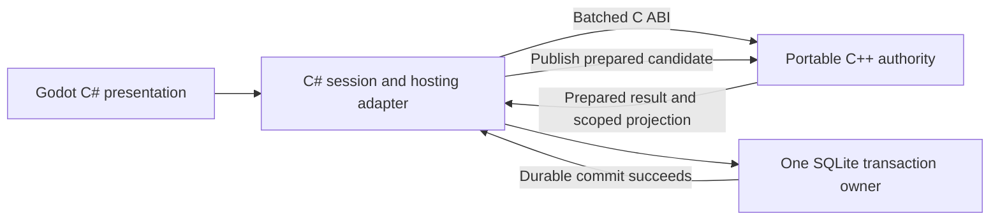

# OpenFantasy core language decision specification: C# and C++

**Status:** decision recorded on 20 September 2026: **retain C# for the portable core and application**, as directed by the owner for simplicity and a streamlined architecture. No language migration or custom native calculation layer is authorized or underway. The C++ alternatives and qualification proposals below remain retained research, not implementation tasks.
**Assessment date:** 19 September 2026. **Scope:** the portable simulation core, its actual callers, and Windows/macOS/Linux delivery with mobile later. Godot C# presentation, deterministic worlds, preserved history/content, and one authoritative simulation remain requirements.

## Decision recommendation

**Keep the core in C# while measuring representative workloads. Preserve an in-process C++ option, preferably first for a demonstrated computational hotspot. Do not undertake a wholesale C++ rewrite on the evidence available.**

C++ has real potential value: explicit memory layout and lifetimes, mature native libraries and profiling tools, and control over allocation, vectorization and cache behavior. Those advantages could matter greatly for dense terrain, ecology, pathfinding and historical simulation. We have not established that the managed runtime is the limiting factor, however. Several visible costs arise from repeated serialization, whole-world validation, scans, copying and replay. Translating those operations unchanged would retain their algorithmic cost.

A full native core becomes reasonable if representative measurements show pervasive managed allocation/latency or memory costs that a focused C# revision cannot resolve, or a concrete embedding requirement needs a native library. If so, use **one portable C++ authority behind a coarse C ABI in the same process**. IPC is a separate deployment decision, not a requirement of C++.

This assessment supplements the preserved [language qualification](../research-v0_8/csharp-rust-core-reassessment.md) and [implementation plan](../spec-v1_1/IMPLEMENTATION_PLAN.md). It adds C++ to the comparison; it neither changes the selected language nor waives LANG-01–04. The prior Rust option remains available if a native implementation is justified. No evidence here establishes that C++ outperforms Rust for this workload.

## What is actually being migrated

The [source inventory](CORE_LANGUAGE_CPP_EVIDENCE.json) pins the measured working tree, including the live profile18 integration subsequently preserved in implementation commit `8f19911`. Counts exclude generated `bin`, `obj` and `.godot` output; lines are physical lines, not a complexity score.

| Production area | C# files | Lines | Role |
|---|---:|---:|---|
| Portable Core | 424 | 30,525 | Domain state, algorithms, admission, canonical bytes and deterministic decisions |
| Hosting | 73 | 5,904 | SQLite transactions/recovery, scheduling, player/NPC coordination and projections |
| Host executable | 24 | 1,103 | Operator commands and headless entrypoints |
| Godot client scripts | 42 | 6,698 | Input, UI, scene integration and presentation |
| Total production application | 563 | 44,230 | Excludes tests, content and supporting scripts |

Core targets .NET 8/C# 12 and has no package/project dependency or Godot dependency. Hosting and the Godot client also target .NET 8; the operator Host targets .NET 10. The client uses Godot.NET.Sdk 4.6.0. The pinned SDK used for current verification is 10.0.401. Runtime target and SDK version are different concepts. See [Core](../Runtime/src/OpenFantasy.Core/OpenFantasy.Core.csproj), [Hosting](../Runtime/src/OpenFantasy.Hosting/OpenFantasy.Hosting.csproj), [Host](../Runtime/src/OpenFantasy.Host/OpenFantasy.Host.csproj) and [client](../Runtime/client/OpenFantasy.Client.csproj).

The port is not merely 30,525 lines of gameplay translation:

- 109 Core files, totaling 8,856 lines, have `Codec`, `Encoding` or `FrameReader` in their names. They encode compatibility and validation obligations.
- 58 Core files use `Int128`/`UInt128`; structural load allocation also uses `BigInteger` for a wide intermediate.
- Root profiles 1–18 have retained interpretations. Replay must reproduce earlier decisions, refusals, IDs, receipts and bytes.
- 108 of the 139 production files outside Core directly import Core. Many construct/read concrete domain objects rather than using one replaceable facade.
- Hosting tests comprise 89 files/15,391 lines in the inspected tree and also compile selected client files. Test adaptation, fixtures and independent byte oracles are part of migration, not optional cleanup.

The implemented runtime is an in-process local authority plus operator CLI. The 1–4-player production networking goal is not an already completed transport that a language change would automatically preserve or finish. Likewise, porting the existing core does not implement the full planned society, ecology, narrative or frontier scope.

### Estimated C# versus C++ line counts

**For the existing feature set, a whole-Core port would provisionally leave about 15,000–19,000 lines of C# and introduce 35,000–52,000 lines of C++: approximately 50,000–71,000 production lines combined.** Today's measured baseline is 44,230 C# lines. This is an engineering planning range, not the output of a transpiler, a measured port, or a forecast of the complete game's eventual size.

| Implementation choice | C# production lines | C++ production lines | Counting assumptions |
|---|---:|---:|---|
| Current application | **44,230 measured** | 0 | Core 30,525; Hosting/Host/client 13,705 |
| Retain C#, profile or use a supported AOT deployment | Approximately 44,000 before resulting feature/optimization edits | 0 | AOT changes the build product, not the source language |
| Replace one roughly 1,000–3,000-line calculation with a native kernel | Roughly 41,500–44,500 | Roughly 1,500–6,000 | Remove that production C# calculation after qualification; add managed bindings and native ABI/lifetime handling |
| Port the whole portable Core; retain C# Hosting/client | Roughly **15,000–19,000** | Roughly **35,000–52,000** | Native domain implementation plus ABI; managed contracts/projections and caller adaptation |

The whole-Core allowance uses roughly **1.1–1.6 times the existing 30,525 Core lines** for native domain implementation, plus approximately 1,500–3,000 native adapter/error/lifetime lines, with rounded endpoints. The retained managed application starts at 13,705 lines; provisionally allow a net additional 1,000–5,000 lines for contracts, projections and interop after replacing direct Core usage. These factors are explicit judgment calls. A representative port must replace them with observed results before a migration budget is approved.

The anticipated expansion comes from declarations/definitions, explicit copy/move and ownership contracts where needed, checked numeric and encoding behavior, error handling, and the cross-language facade. Modern C++ value types, RAII and standard containers can keep this much smaller than a mechanical C-style rewrite. Header-only organization, modules, generated bindings or a different abstraction style can change physical line counts substantially without changing functionality. C++ is not inherently a fixed multiple of C#.

For a like-for-like count, count hand-maintained `.h`/`.hpp` and `.cpp` files once each, including comments and blank lines just as in the C# inventory. Exclude vendored libraries, generated bindings, build scripts, tests and archived reference implementations. Record those categories separately; they still require build or maintenance work. The transition temporarily retains the original C# oracle alongside native code, so checkout size will exceed the final production estimate. No deletion of the preserved original implementation is implied.

These estimates preserve the **currently implemented behavior**, not the entire future GDD. Estimating full-game LOC from this foundation would be speculative. Line count also does not predict machine-code size, memory, speed, quality or engineering effort: a faster engine could use more source, while a shorter engine could omit required behavior. None of the ranges justify dropping compatibility, validation or readable OO structure to hit a size target.

## Correct execution model

C# is not normally executed as an instruction-by-instruction interpreter here. C# compilation produces IL, and .NET's JIT compiles methods into native machine code for execution. Tiered compilation can replace initial code with more optimized native code. The meaningful comparison is managed native execution and its services versus C++ native execution and its ownership model. [Managed execution](https://learn.microsoft.com/en-us/dotnet/standard/managed-execution-process), [tiered compilation](https://learn.microsoft.com/en-us/dotnet/core/runtime-config/compilation).

C# still has potential costs: object headers and indirection, allocations and collection, array/range checks where they cannot be eliminated, runtime startup, generic/devirtualization limits and managed/native transitions. Some are avoidable through layout and implementation choices. C++ also has costs: allocation/free operations, fragmentation, pointer chasing, virtual dispatch, reference counting where used, cache misses, copying and synchronization. It does not make those operations free.

There are three distinct .NET deployment choices:

| Choice | What it changes | What it does not establish |
|---|---|---|
| Normal Release JIT | Native execution with runtime optimization; warm-up matters | That steady-state code is slow or that GC dominates |
| ReadyToRun | Precompiles some code to reduce JIT startup work; tiered JIT can still optimize | A GC-free runtime or universal throughput improvement |
| Native AOT | Compiles to target-specific native code at publication; no runtime JIT | Removal of managed object semantics, GC or all runtime support |

ReadyToRun can increase deployment size. Native AOT can improve startup and memory footprint but constrains dynamic loading, reflection/code generation and deployment. Its GC remains a runtime component. Our Godot project explicitly enables dynamic loading, so publishing the whole client with Native AOT is **not** assumed supported merely because the plain Core can be compiled. A standalone host compatibility experiment and a Godot export qualification are separate tasks. [ReadyToRun](https://learn.microsoft.com/en-us/dotnet/core/deploying/ready-to-run), [Native AOT](https://learn.microsoft.com/en-us/dotnet/core/deploying/native-aot/), [runtime GC architecture](https://github.com/dotnet/runtime/blob/main/docs/design/features/standalone-gc-loading.md).

## Options and their practical consequences

| Option | Runtime boundary | Expected benefit if applicable | Main cost/risk | Assessment |
|---|---|---|---|---|
| Retain and profile C# | Current managed calls | Fastest route to informed decisions and more gameplay | Managed allocation/latency may eventually need work | Recommended baseline |
| Improve C# algorithms/layout | Same process and authority | Removes unnecessary scans/copies/allocations in the existing system | Careful preservation of snapshot/admission contracts | First response to measured costs |
| Native AOT for a supported host | No new process | Startup/deployment/memory improvements | Compatibility and tooling work; no promised simulation speedup | Bounded experiment when those costs matter |
| Small C++ calculation library | Batched P/Invoke/C ABI | Accelerates a hot, self-contained calculation | Marshalling, native packaging, differential tests | Preferred first native experiment |
| Entire C++ Core; C# host/client | Coarse in-process C ABI | Broad ownership/layout control; reusable native engine | Major port plus facade, persistence and caller adaptation | Conditional, after evidence |
| C++ via GDExtension | Godot's native extension boundary | Good for engine-facing native features | Godot coupling and another binding if combined unnecessarily | Adapter option, not required Core architecture |
| C++ worker process | IPC protocol | Fault isolation or independently deployed service | Serialization, queues, copies, lifecycle, recovery and backpressure | No present justification for local Core |
| Rewrite Core, Hosting and client in C++ | Native runtime and Godot adapter | Can remove much more managed execution | Replaces UI/session/storage tooling too; conflicts with retained C# presentation direction | Separate product decision, not a Core swap |

GDExtension loads native shared libraries into Godot; it does not require a separate worker process or a custom engine build. It has platform-specific library/dependency packaging. A pure C++ library called by C# need not depend on Godot at all. Avoid routing a portable simulation through Godot objects simply to reach C++. [GDExtension](https://docs.godotengine.org/en/4.6/tutorials/scripting/gdextension/what_is_gdextension.html), [extension manifests](https://docs.godotengine.org/en/4.6/tutorials/scripting/gdextension/gdextension_file.html).

Keeping C# Hosting and Godot scripts means the .NET runtime remains present even after a complete Core port. Native Core memory management could eliminate Core-generated managed allocations; it would not eliminate allocations or GC in the remaining managed application.

## Runtime overhead and possible gains

### In-process calls versus IPC

An in-process C ABI call crosses a language/runtime boundary, but requires no process switch, socket or serialization protocol by definition. Its cost depends on signature, marshalling, copies, pinning, callbacks and frequency. Prefer `LibraryImport` source-generated interop, fixed-width values and flat buffers where appropriate; use `SafeHandle` or equivalent explicit lifetime ownership for native handles. Never pass C++ STL objects, managed object references or exceptions across the ABI. [Interop practice](https://learn.microsoft.com/en-us/dotnet/standard/native-interop/best-practices), [source-generated P/Invoke](https://learn.microsoft.com/en-us/dotnet/standard/native-interop/pinvoke-source-generation).

A direct call is not automatically zero-copy. Passing an entire object graph requires a representation; rebuilding managed `WorldSnapshot` after every native operation would retain much of today's allocation and validation cost. Use retained native state and compact read-only projections instead of reconstructing both engines' full models each step.

IPC adds message framing/encoding, transport, scheduling/queueing, synchronization and often additional copying. Shared memory can reduce copies but does not solve lifetime, synchronization, trust, cancellation or recovery. A worker process can isolate a native crash; a native crash in the same process can terminate the host/client. Isolation may justify IPC for a service, but performance alone does not currently justify adding it here.

Do not use `SuppressGCTransition` for a world step, route search or history calculation. Microsoft's permitted use is restricted to extremely short native functions without blocking, callbacks, exceptions or locks. Long simulation work does not meet that contract. [Transition restrictions](https://learn.microsoft.com/en-us/dotnet/api/system.runtime.interopservices.suppressgctransitionattribute?view=net-10.0).

### A quantitative decision model

Let `T` be baseline end-to-end time, `f` the fraction actually accelerated, `s` its native speedup, and `B` the **incremental** boundary/copy/synchronization cost versus baseline:

`T_new = T × ((1 − f) + f / s) + B`

These examples are arithmetic illustrations, **not benchmark predictions**:

| Accelerated fraction | Native calculation speedup | Added overhead as fraction of baseline | Resulting total speedup |
|---:|---:|---:|---:|
| 70% | 2× | 5% | 1.43× |
| 20% | 2× | 5% | 1.05× |
| 20% | 2× | 15% | 0.95×: slower overall |
| 90% | 3× | 2% | 2.38× |

For `N` calls per update, measure `B` as the difference in total call, marshal, copy and synchronization work. A hypothetical 0.2-microsecond incremental cost is 0.2 microseconds for one batch and 20 milliseconds for 100,000 calls. **0.2 microseconds is an illustrative input, not an estimate of this ABI.** The lesson is to measure and batch; a large kernel gain cannot rescue an excessively chatty interface.

The existing 16 MiB root limit is a capacity bound, not typical traffic. Sending one maximum-size root at 20 updates/second would move 320 MiB/second one way before extra copies or responses. Do not turn the persistence format into a per-frame transport. Measure actual payload distributions and use versioned projections/deltas. [Root/storage limits](../Runtime/src/OpenFantasy.Hosting/Worlds/WorldDatabase.cs).

### Where C++ could help, and where it may not

| Work | Plausible native advantage | Why the language change may disappoint |
|---|---|---|
| Dense terrain, occupancy and contact batches | Contiguous buffers, explicit temporary arenas, SIMD where semantics permit | C# arrays/spans and better indexing can obtain much of the same layout benefit |
| Large actor/ecology state | Fine control of compact storage and lifetime | A pointer-heavy C++ object per entity reproduces locality and allocation problems |
| Pathfinding and generation | Native libraries, carefully tuned kernels | Search algorithm, representation, scheduling and cache reuse often dominate |
| Exact load/fluid accounting | Specialized wide arithmetic and fixed buffers | Checked 128-bit and arbitrary-precision semantics remain necessary; a port can be slower |
| History, save and recovery | Compact structures, possibly faster encoding | Replaying or re-encoding the same large state still does the same work; disk durability is unchanged |
| UI and art quality | Little direct gain from a Core-only port | Sprite quality, choreography, layout, input usability and content remain separate work |
| Frame-time tails | Fewer Core-managed allocations may reduce GC pressure | Native allocation/free, locks, storage and remaining C# GC can still stall |

Managed collection frequency and cost depend on allocation and surviving objects. Low-allocation C# is a serious baseline, not a token comparison against deliberately allocation-heavy code. C++ should likewise be implemented competently rather than as a mechanical `new`/`delete` translation. [GC fundamentals](https://learn.microsoft.com/en-us/dotnet/standard/garbage-collection/fundamentals).

No defensible project-specific speedup multiplier, memory reduction or IPC latency is available yet. We have correctness/recovery evidence, not a matched optimized C#/C++ benchmark. Test-suite duration and the existing 30-second operator deadline are not gameplay throughput benchmarks.

## Code-specific costs to investigate first

These are source-supported **hypotheses**, not profiled hotspots:

1. [WorldSnapshot.ContentHash](../Runtime/src/OpenFantasy.Core/Worlds/WorldSnapshot.cs) encodes the complete root. Repeated requests can repeat serialization and hashing.
2. World construction/admission checks complete identities, support and loads. Cache or incremental-validation proposals must preserve the exact dependency proof; removing validation is not optimization.
3. [VerticalMotionResolution](../Runtime/src/OpenFantasy.Core/Spatial/VerticalMotionResolution.cs) and related immutable resolutions copy private state on advancement; [PendingExcavation](../Runtime/src/OpenFantasy.Core/Worlds/PendingExcavation.cs) regenerates possible result reservations.
4. [TerrainVolumeQueries](../Runtime/src/OpenFantasy.Core/Spatial/TerrainVolumeQueries.cs) and [StructuralContactWeights](../Runtime/src/OpenFantasy.Core/Structures/StructuralContactWeights.cs) perform scans, sorting and temporary collection work.
5. [WorldJournalRecovery](../Runtime/src/OpenFantasy.Hosting/Worlds/WorldJournalRecovery.cs) verifies/replays from genesis; checkpoints do not currently remove that full verification work.
6. [LocalWorldSession](../Runtime/src/OpenFantasy.Hosting/Simulation/LocalWorldSession.cs) can preview and then commit, while [LocalConstructionController](../Runtime/src/OpenFantasy.Hosting/Simulation/LocalConstructionController.cs) runs routing and planning queries.

The subsequent [live-event integration evidence](p02/live-event-descent/README.md) provides one concrete symptom: a Debug Host historical-state read exceeded its unchanged 30-second deadline, then the same command completed in 15.99 seconds with about 15.09 seconds of child CPU time. The failure remains retained and the campaign remains unqualified. This warrants profiling; it does not identify a GC, language, contention or algorithmic cause, and is not a C++ comparison.

A sensible investigation separates CPU calculation, repeated validation/hash work, allocation/collection, native engine calls, SQLite I/O and presentation. It can improve data layout behind cohesive objects and immutable public contracts; modular OO style does not require a heap allocation for every tile or transient calculation.

## Native boundary specification if evidence justifies it

### Option A: a computational kernel

Start with one sufficiently expensive deterministic geometry operation, such as rectangle coverage or a terrain occupancy batch. C# retains command validation, source custody, clocks, identity, publication and saves. C++ receives bounded flat input plus exact dependency pins and returns status and a proposal. It owns no independent world or database. Preserve the C# implementation as a temporary differential oracle, then select one production implementation after qualification.

Reject this route if marshalled work is too small, output reconstruction erases the gain, or the operation needs pervasive managed callbacks. Reuse arrays/buffers where safe; measure any pinning or copies. Do not split every domain into another native library.

### Option B: the whole portable authority

The native implementation remains independent of Godot and storage. The C ABI is an adapter, not the internal OO design. C++ classes can own cohesive domains with RAII internally. Required interface responsibilities are:

| Boundary | Required contract |
|---|---|
| ABI negotiation | Version, feature set, rules/package pins, endianness and bounded layout validation |
| Open/restore | Canonical genesis/checkpoint plus accepted journal; one native state handle |
| Prepare selected work | Exact authenticated/selected batch and state revision; immutable candidate handle; structured success/refusal |
| Historical identity checks | Batched, transaction-consistent identity queries or a verified mirror; avoid callback per identity |
| Read result | Bounded canonical candidate, receipts, new identities and observer-authorized projection |
| Commit notification | Publish candidate only after the host's single durable transaction succeeds |
| Abort/cancel | Release unpublished candidate; preserve acknowledged state and accepted pending work |
| Queries | Batched planning/route/projection operations bound to a revision and authorization scope |
| Buffer/handle disposal | Explicit allocator ownership, validity intervals and exactly-once release; no allocator crossing |

The actual durable ordering is in [SqliteWorldAuthority](../Runtime/src/OpenFantasy.Hosting/Worlds/SqliteWorldAuthority.cs) and [WorldCommitPreparation](../Runtime/src/OpenFantasy.Hosting/Worlds/WorldCommitPreparation.cs). Native code must not mutate the publicly visible world before SQLite commits. A crash after database commit but before native publication recovers the committed journal, without issuing the command twice. Cancellation after acknowledgement cannot undo acknowledged work.

Existing content builders, NPC planning and player projections need deliberate adapters. A thin native wrapper around `Commit` alone is insufficient. A separate managed contracts assembly can hold immutable DTOs and ABI definitions without becoming a second rules engine. Avoid reproducing the full native authority in managed objects as the permanent compatibility layer.

Native errors must become bounded status/error data at the ABI boundary. C++ exceptions must be caught before crossing it. Out-of-memory, malformed buffers, stale handles, reentrancy, cancellation and unexpected native termination need explicit handling. Serialize access to each world unless deterministic parallel ownership is separately proved.

## Determinism and preservation requirements

A successful migration preserves behavior, not just compilation:

- Retain exact integer widths, overflow refusals, signed division/remainder and canonical allocation remainders. Checked C# operations cannot become undefined signed C++ overflow. `Int128`/`UInt128` and wider intermediates need a portable checked implementation across compilers; language/compiler support is not uniform. Boost provides fixed/arbitrary-precision and checked options, but semantic equivalence still needs vectors. [Boost integer types](https://www.boost.org/doc/libs/latest/libs/multiprecision/doc/html/boost_multiprecision/tut/ints/cpp_int.html).
- Preserve [CounterRandomV1](../Runtime/src/OpenFantasy.Core/CounterRandomV1.cs) streams, SHA-256 derivation, rejection sampling, exhaustion and rollback. A faster replacement RNG changes rules unless explicitly versioned.
- Preserve [EntityId](../Runtime/src/OpenFantasy.Core/EntityId.cs) ordering/derivation and [canonical encoding](../Runtime/src/OpenFantasy.Core/CanonicalEncodingV1.cs): UTF-8 rules, fixed byte order, field sizes, bounds and sorted collections. Never serialize raw native structs or use implementation-defined container order/hash values.
- Keep floating-point optimization outside canonical integer simulation unless an explicit cross-platform numeric contract replaces it. No fast-math or unchecked narrowing for authoritative arithmetic.
- Retain every legacy profile's command, receipt, source entitlement, pending cursor and replay interpretation. A loadable final snapshot alone is insufficient preservation.
- Compare debug/release, x64/Arm64, worker ordering and restart. The C# project's deterministic-build setting is not by itself proof of deterministic simulation.
- Use native memory/undefined-behavior tooling and malformed-input/fuzz tests. Sanitizers provide additional defect detection; they do not replace differential and recovery proofs. [AddressSanitizer](https://clang.llvm.org/docs/AddressSanitizer.html), [UndefinedBehaviorSanitizer](https://clang.llvm.org/docs/UndefinedBehaviorSanitizer.html).

Temporary dual execution is acceptable in offline qualification. A production world has one authority; migration must not keep two engines racing to publish state or maintain two subtly different rulesets indefinitely.

## Platforms and deployment

Godot 4.6 documentation lists C# support for Windows, macOS and Linux, plus experimental Android/iOS support with limitations. Web export is unavailable for C# in that version. A C++ Core alone does not remove a retained C# client's export restrictions. The requested desktop-first/mobile-later plan still requires actual device/export tests. [Pinned Godot platform documentation](https://docs.godotengine.org/en/4.6/tutorials/scripting/c_sharp/index.html).

For C++ delivery, select and pin compilers, C++ standard/library, build system and dependency versions. Produce the library for each supported OS/architecture, test clean-machine loading, and retain symbols, signing/notarization and crash diagnostics. macOS Arm64 and x64, Windows x64, and Linux x64 are useful initial comparison targets; that proposed matrix is not a claim that every export is already qualified. Extend it to the actual supported device catalog before release.

A plain C ABI needs explicit native packaging alongside managed hosts. GDExtension instead has its feature-tagged library/dependency manifest; choose the applicable adapter rather than introducing both automatically. Mobile adds its own compiler, linking, lifecycle and device constraints. C++ buildability on a phone does not prove the C# Godot app, persistence, memory budget or thermal behavior.

Native AOT can also export C entrypoints from a C# library, which may satisfy some future embedding needs without a C++ rewrite. That still has its runtime/GC and compatibility requirements; it is another candidate to qualify, not a turnkey replacement for the current Godot export pipeline. [Native AOT libraries](https://learn.microsoft.com/en-us/dotnet/core/deploying/native-aot/libraries).

## Effort, opportunity cost and migration path

The effort estimates below are **planning allowances**, based on this source inventory and required deliverables, not measured conversion throughput or promises about agent completion time. One engineer-week means roughly a full week of experienced engineering attention, including integration and qualification. AI can accelerate translation and tests; it does not remove native lifetime, recovery, device or human acceptance obligations. These estimates cover the existing implementation, not the remaining full game.

| Option | Provisional effort envelope | Principal uncertainty |
|---|---|---|
| Representative profiling and a decision-quality report | 3–7 engineer-days for existing fixtures; missing city/ecology workloads additional | Instrumentation and workload representativeness |
| Standalone-host Native AOT compatibility experiment | 2–5 engineer-days | Dependencies, JSON/reflection, target tools; production hardening additional |
| One C++ kernel proof plus managed comparison | 3–10 engineer-days | Exact arithmetic, input batching and differential harness |
| Productionize a successful bounded kernel across desktop targets | Additional 1–3 engineer-weeks | Packaging, errors/lifetimes, device/build coverage |
| Full portable C++ Core with retained C# Hosting/client | Roughly 13–26 engineer-weeks | Domain parity, wide arithmetic, archives and broad caller adaptation |
| Rewrite Hosting/client as well | Materially greater; no credible bounded estimate from this assessment | Replaces storage/session/UI/tooling beyond the requested Core |

A decomposition of the full-Core allowance is: 1–2 weeks for contract/fixture inventory and migration freeze; 2–4 for ABI, checked numerics and encoding; 5–10 for domain/continuation parity; 2–4 for host, content, NPC and projection adapters; 3–6 for differential recovery, platform and performance qualification. These are effort ranges that sum to 13–26 weeks. Some can overlap, but shared contracts and integration constrain parallelism. Do not divide them by the number of agents to predict elapsed delivery.

At one dedicated experienced engineer, that is approximately 3–6 months of attention; with multiple people/agents, elapsed time needs a new estimate after the first representative port. Unanticipated semantic/platform issues can exceed the range. A days-long line translation would not establish a production-equivalent migration.

The opportunity cost is substantial: during a full rewrite, much of the work restores existing behavior while art, UI, NPC depth and gameplay breadth still need implementation. Conversely, if a genuine systemic limit is proved, migrating before much more domain code accumulates can be cheaper than doing so late. The useful compromise is an early, bounded measurement/prototype decision, not indefinite deferral or an immediate speculative rewrite.

If approved after that evidence:

1. Preserve the C# source, exact fixtures, accepted content, schemas and milestone branches. Freeze the behavior baseline rather than redesigning gameplay during the port.
2. Prototype one representative path including exact arithmetic, canonical bytes, a real host transaction and failure recovery. Measure conversion/test effort; replace the estimates above.
3. Build checked numeric/encoding and ABI foundations, then port domain families in dependency order. Run offline differential tests continuously.
4. Move the selected authority behind the coarse adapter; complete planning/content/projection callers and the desktop build matrix.
5. Prove old journals, process kills, retries, world histories and actual playable journeys. Measure the integrated native version against the best reasonable managed baseline.
6. Select one production authority. Retain the C# reference archive and fixtures. Rollback opens the preserved compatible save/history; never downgrade an incompatible newly authored rules version silently.

This respects “no throwaway code” by preserving product knowledge, content and executable contracts. It cannot promise that all language-specific implementation code will remain in the shipped runtime after an explicitly chosen rewrite.

## Qualification experiment and decision gates

Retain the original LANG gates: actual actor populations/cognition and four branches (LANG-01); mixed terrain/support/fluid, encounters, markets and history under the 50 ms scheduler window (LANG-02); sustained allocations/GC/memory/storage/recovery (LANG-03); deterministic parity across builds, workers, architectures and interruption (LANG-04). Many required workloads remain unimplemented/unqualified; a small geometry benchmark cannot close them.

For the immediate comparison, use three progressively integrated levels:

| Level | Fixture | Required observations |
|---|---|---|
| Boundary microbenchmark | Scalar no-op, flat buffer sizes, representative batched kernel | Call counts, marshal/copy bytes, allocations, cold/warm behavior; no whole-game conclusion |
| Existing real workload | Funded construction/excavation, load/contact work, durable event continuation and historical reconstruction | CPU time, end-to-end p50/p95/p99/max, allocation/GC, RSS/native heap, SQLite time, cursor/replay work and exact outputs |
| Production decision workload | Declared city, ecology/fluid, four-player/branch and long-history mix | Full LANG budgets, backlog recovery, memory growth, device/export and playability evidence |

Compare Release C# with the selected runtime, measured C# improvements, Native AOT where supported, and equivalent optimized C++ including its boundary. Pin compilers, hardware, power mode, content, seeds, action stream, optimization flags and source hashes. Report startup separately from warm execution. Use repeated runs and distributions, not one fastest result. Avoid overlapping heavy builds, tests or unrelated workloads; record contention rather than silently relaxing deadlines.

Collect managed allocation/GC metrics and CPU traces, plus native profiles and storage timings. `dotnet-counters` and `dotnet-trace` are available diagnostic approaches; select supported metrics for the actual runtime and validate overhead. [Counters](https://learn.microsoft.com/en-us/dotnet/core/diagnostics/dotnet-counters), [tracing](https://learn.microsoft.com/en-us/dotnet/core/diagnostics/dotnet-trace).

The proposed adoption checks below supplement existing gates; they do not replace them:

- **Parity:** exact expected states, bytes, refusals, receipts, identities and history for the compared interpretation; no dropped NPC depth, fewer events, weaker validation or smaller worlds to manufacture speed.
- **Useful gain:** close an observed budget failure, or demonstrate material end-to-end headroom. As an initial screening criterion, consider at least 20% reduction in representative CPU-bound end-to-end time or 25% peak-memory reduction, without material regression in tail latency, recovery or the other budget. These are proposed project decision thresholds, not vendor guarantees or already accepted release gates.
- **Boundary:** include all marshalling/copy/callback/projection work. Investigate boundary costs above roughly 5% of the affected operation as a design warning, not a universal law or automatic waiver.
- **Reliability and packaging:** clean target builds, malformed input/lifetime checks, process interruption recovery and supported exports pass. A faster crash-prone implementation fails.
- **Maintenance:** one clear authority, understandable C#/C++ responsibilities, complete docs and sustainable native dependency/toolchain ownership.

If optimized C# meets the workloads with sufficient headroom, retain it. If one kernel dominates, use a bounded native kernel only when the integrated result pays for the boundary. If costs are pervasive and the native candidate passes parity and platform tests, authorize a whole-Core migration with a revised schedule. If both fail, revisit algorithms, scheduling and representation rather than deleting the game's promised depth.

## Assessment outcome

C++ is a credible optimization and portability option, not an automatic upgrade to this game's architecture or quality. Its strongest potential benefit is control over data and lifetime at scale. Its strongest costs here are behavioral parity and the broad managed object boundary. The current evidence supports retaining C#, improving measurement and preserving a coarse native option. It does not support a promised speedup or a wholesale rewrite today.

Research uses Microsoft/.NET, Godot 4.6, LLVM and Boost primary documentation linked at the claims above. Source inspection establishes the inventory and integration obligations; the effort ranges and adoption thresholds are explicitly engineering judgments. No C++/C# comparative benchmark, Native AOT export, full-city feasibility result or language migration is claimed by this document.
