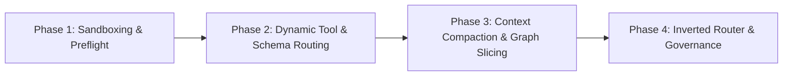

# MCP Orchestration for Token Savings: Reddit Research vs. Project Findings & Action Plan

## Executive Summary

Cross-agent orchestration in **Subterranean Robot Wars (SRW / Botboard)** and **OpenFantasy** was established to offload cognitive effort from primary lead models (e.g., Astra / Codex) to high-capability secondary agents (e.g., `claude-opus-5-5[1m]` and `claude-fable-5-1`). However, empirical records across both projects reveal that **delegation failed to achieve net token or credit savings for the orchestrator**, frequently inflating costs ($3.57–$21.32 per sub-task run), exhausting monthly spending caps, and creating substantial lead-model integration overhead.

Recent community research from Reddit (`r/mcp`, `r/ClaudeAI`, `r/ClaudeCode`, `r/OpenSourceeAI`, `r/aiagents`) explains this exact failure mode as the **"Orchestrator Token Tax"** and provides clear technical architectural remedies:
1. **Dynamic / Meta-Tool Schema Routing** (90–97% schema token reduction).
2. **Inverted Orchestration ("Chief of Staff" Routing)** (cheap models/scripts route; expensive models execute isolated kernels).
3. **Graph-Indexed State Compaction** (eliminating 73M+ cached-token context churn).
4. **Hermetic Task Sandboxing** (preventing permission/tool failures that force expensive orchestrator remediation).

---

## Part 1: Reddit Research on MCP Orchestration & Token Optimization

Community synthesis across `r/mcp`, `r/ClaudeAI`, `r/ClaudeCode`, and `r/OpenSourceeAI` highlights five core dynamics in agent token economics:

### 1. The "Token Tax" of Multi-Agent Orchestration
* **The Reality of Coordination Churn:** Multi-agent swarms frequently burn **3× to 5× more tokens** than a single well-prompted agent. Every handoff incurs token overhead: re-explaining project guidelines, re-serializing system states, managing turn-taking protocols, and having the lead parse worker output.
* **Context Dilution:** When an orchestrator ingests worker responses and tool outputs back into its primary conversation window, the orchestrator's prompt size balloons geometrically across subsequent turns.

### 2. MCP Schema Bloat & Dynamic Loading (Meta-Tools)
* **The Full-Catalog Injection Trap:** By default, Model Context Protocol (MCP) clients register all connected tools upfront. In a workstation with 10–25 tools/servers (e.g., git, godot, devtools, terminal, file system, memory), tool schemas consume **15,000 to 50,000 input tokens per call** before any reasoning occurs.
* **The Meta-Tool Pattern:** Top-performing implementations replace static tool injection with dynamic meta-tools:
  ```
  search_tools(query: string) -> tool_signatures[]
  call_tool_dynamic(tool_name: string, parameters: object) -> result
  ```
  Exposing only 2 meta-tools reduces the base prompt footprint from ~50,000 tokens down to ~1,400 tokens (a **~97% reduction**).

### 3. Execution Orchestration ("Code Mode" / Sandboxed Logic)
* Rather than piping raw intermediate data (such as grep outputs, git logs, or test reports) back to the LLM context, developers run intermediary logic inside a local code execution sandbox (e.g., Python, Bash, Starlark).
* The LLM receives only compacted, structured outcomes or deterministic assertion results, keeping raw data payloads completely out of the token stream.

### 4. Graph-Based Codebase Retrieval (e.g., GrapeRoot & Orgtree)
* Reddit case studies (e.g., `SR-135` *GrapeRoot* cutting Claude Code costs by 45–80%) show that replacing sequential markdown doc scans and brute-force grepping with **dual-graph / AST indexing** drastically reduces exploration tokens.
* Agents query explicit entity dependencies rather than ingesting entire architecture docs.

### 5. Inverted Orchestration ("Chief of Staff" Model)
* The most cost-effective multi-agent pattern reverses the traditional model hierarchy:
  * **Traditional (Expensive):** Opus/Astra acts as the interactive orchestrator, delegating sub-tasks to workers and reading full worker outputs.
  * **Inverted (Cost-Efficient):** A lightweight, low-cost model (e.g., Claude 3.5 Haiku, Gemini Flash, or local Qwen) or deterministic bash/python scripts handle task packaging, sanity checks, context preflight, and routing. The expensive model (Opus / Astra) is invoked **only for pure execution or deep critique**, strictly in a single-turn, fire-and-forget capacity.

---

## Part 2: Findings Recorded in User Projects

A comprehensive review of project records in `SubterraneanRobotWars`, `botboard`, and `OpenFantasy` reveals the precise root causes behind the lack of orchestrator token savings.

### 1. Empirical Evidence in OpenFantasy (`CLAUDE_MODEL_COMPATIBILITY.md` & `AGENT_HANDOFF.md`)
* **Huge Token Churn & High Cost Per Run:**
  * *Proposal transition dispatch:* Ran for 1,576s, estimated at **$21.32**, processing **73,278,983 cached-read tokens** and **164,333 output tokens**.
  * *Native gift controller repair:* 868s, **$4.42** for a narrow task.
  * *Native gift assignment:* 1,943s, **$10.85**.
  * *Resource encoding assignment:* 1,419s, **$10.96**.
  * *Overall:* These dispatches rapidly consumed the owner's account monthly spending limit.
* **The "Lead Remediation" Overhead:**
  * Worker runs repeatedly hit sandbox boundaries: `dontAsk` permission denials, path mismatches (absolute vs. relative paths), and globs outside granted directories.
  * Incomplete code delivery: Workers delivered partial implementations (e.g., core code delivered, but host code or tests omitted; missing 30s opening gate).
  * **Astra's burden:** Astra had to perform extensive diagnosis, rewrite tests, repair context lifetime issues, and bridge architecture gaps. Because Astra had to do this corrective reasoning in its own high-priced context, **orchestrator token expenditure did not decrease—it increased**.

### 2. Empirical Evidence in Subterranean Robot Wars & Botboard
* **Critique Runs:** A single Fable review on search context (`critique.md`) cost $1.24 and 107s. While it surfaced valuable domain findings (e.g., null search ply, unavailable history semantics), the project noted:
  > *"Setup/review effort was not independently timed, so no lead-effort savings are claimed. Future critiques should reuse the small context package and remain tied to consequential decisions."*
* **Orchestration Policy Retreat:** Due to friction and unproven cost benefits, SRW steering formally held back from routine delegation:
  > *"No Opus access or cost benefit is yet qualified... Implement directly by default and keep ordinary runs, measurements and reporting scripted."*

### 3. The Theoretical Model vs. Reality (`economics.md`)
In `cross-agent-delegation/references/economics.md`, the ecosystem established the formal inequality:
$$\text{Lead work reduced only when } H < D$$
* $D$: Effort for the lead to do the work directly.
* $H$: Observed effort for the lead to formulate the task, preflight context, dispatch, and review/integrate.

In practice:
* $H_{\text{actual}} \approx D_{\text{actual}}$ (or even $H > D$) because formulating large context manifests, reviewing large raw diffs, and debugging permission/toolchain failures consumed nearly as many tokens as direct coding.
* **Compounded Cost:** Total spend $= \text{Cost}(Lead, H) + \text{Cost}(Worker, W)$, resulting in net negative ROI.

---

## Part 3: Architecture Comparison & Gap Analysis

```
+---------------------------------------------------------------------------------------------------+
| TRADITIONAL ECOSYSTEM APPROACH (Observed in Projects)                                            |
|                                                                                                   |
|  [Expensive Orchestrator: Astra / Opus]                                                           |
|       |                                                                                           |
|       +--> Preflight & Builds Manifest (Large context: living specs, handoffs, 73M cache reads)  |
|       +--> Spawns Heavy Subagent (Opus 5.5 Max effort)                                            |
|       +--> Subagent encounters tool/permission failure or partial delivery                        |
|       +--> Orchestrator ingests raw diffs / failure logs & completes integration                  |
|       ===> Net Result: High Orchestrator Tokens + High Subagent Cost ($10-$21) + Budget Exhaustion|
+---------------------------------------------------------------------------------------------------+

+---------------------------------------------------------------------------------------------------+
| OPTIMIZED COMMUNITY ARCHITECTURE (Reddit / Modern MCP Best Practices)                             |
|                                                                                                   |
|  [Thin Router / Preflight Script / Cheap Model (Flash / Haiku / Local)]                           |
|       |                                                                                           |
|       +--> Deterministic AST/Graph Context Extractor (passes ONLY targeted symbol slice)        |
|       +--> Dynamic MCP Meta-Tool Router (injects 2 tools, not 30; saves 95% prompt tokens)       |
|       +--> High-End Model (Opus / Astra) invoked ONLY for isolated kernel execution/critique     |
|       +--> Automated Local Verification Harness (runs tests in sandbox, outputs compact JSON diff)|
|       +--> Orchestrator receives structured diff + green/red status (<500 tokens)                 |
|       ===> Net Result: 80%+ Orchestrator Token Savings, Deterministic Cost Bounds ($0.50-$2.00)   |
+---------------------------------------------------------------------------------------------------+
```

### Detailed Gap Table

| Dimension | User's Documented Project Approach | Modern MCP / Reddit Optimized Approach |
|---|---|---|
| **Orchestrator Role** | High-end model (Astra/Opus) prepares task, reviews diffs, fixes test gaps. | Cheap model (Flash/Haiku) or deterministic Python script acts as thin router; high-end model acts as pure execution engine. |
| **Tool / Schema Footprint** | Static skill bundles and manifests mapped and checked upfront. | Dynamic MCP Meta-Tools (`search_tools` / `call_tool_dynamic`) exposing <2k tokens of schemas. |
| **Context Payload** | Monolithic `AGENT_HANDOFF.md`, living specs, architecture docs (~73M cached tokens churned). | Focused Graph/AST extraction (e.g., GrapeRoot style), passing only relevant type interfaces and tests. |
| **Sandbox & Permissions** | Incomplete command alignment (e.g., bash path mismatches, `dontAsk` denials). | Hermetic, pre-validated local execution harness with standard input/output contracts. |
| **Integration Payload** | Raw diffs, logs, and partial file dumps ingested back into orchestrator context. | Compact structured receipts (JSON verdict, passing test hashes, isolated unified diff). |
| **Failure Handling** | Orchestrator manually repairs missing code/tests in multi-turn conversation. | Fail-fast circuit breakers with deterministic failure categorization (no paid multi-turn retries). |

---

## Part 4: Implementation Plan for Robot Wars & OpenFantasy

To transform multi-agent orchestration from a cost multiplier into a proven cost-saving asset, the following 4-phase optimization plan should be deployed.



### Phase 1: Hermetic Tool Sandboxing & Pre-Dispatch Validation (Immediate)
* **Goal:** Eliminate the permission denials, path mismatches, and failed bash calls that force the lead model to perform expensive remediation.
* **Actions:**
  1. Standardize all worker execution directories to isolated, temporary worktrees outside the main git index.
  2. Implement a local, deterministic preflight validation script (`validate_dispatch_env.py`) that checks relative paths, permissions, and toolchain binaries *before* invoking any paid model API.
  3. Ensure that if an external model fails or hits a permission wall, it fails immediately without consuming retry turns.

### Phase 2: Dynamic MCP Tool & Schema Routing
* **Goal:** Eliminate the 15k–50k token prompt tax caused by static tool schemas.
* **Actions:**
  1. Introduce an MCP Router proxy that implements the **Meta-Tool pattern**:
     - Replace full server registrations with `search_tools` and `call_tool`.
     - Subagents search for required capabilities (e.g., `godot_test_runner`, `file_editor`) only when needed.
  2. For read-only critique dispatches (such as Botboard Fable reviews), disable all tool registrations completely; provide immutable source code directly in the prompt.

### Phase 3: Graph-Based Context Compaction & Living State Decoupling
* **Goal:** Slash the 73M+ cached read token footprint by decoupling active tasks from historical project archives.
* **Actions:**
  1. **Archive Old Handoff Records:** Split `AGENT_HANDOFF.md` into:
     - `ACTIVE_TASK.md`: Max 100 lines containing current task, pinned interface contracts, and acceptance tests.
     - `HISTORY_ARCHIVE.md`: Retained purely for human/git reference, never passed to subagents.
  2. **Symbol-Level Slicing:** Instead of attaching full GDDs and specs, attach only the target C# interfaces, relevant unit test files, and input JSON schemas.

### Phase 4: Inverted Orchestrator ("Chief of Staff") Pipeline
* **Goal:** Ensure the priciest model is never used for routine coordination, formatting, or post-run diff cleanup.
* **Actions:**
  1. Assign a lightweight model (e.g., Gemini 3.8 Flash or Claude 3.5 Haiku) or local script as the **Chief of Staff**:
     - Packages the task.
     - Prunes context.
     - Calls the execution engine.
     - Runs the local test suite against the output.
  2. Reserve the premium model (Opus / Astra) strictly for:
     - High-complexity algorithmic implementation (e.g., Botboard search pruning, OpenFantasy co-op clock synchronization).
     - Single-pass, read-only architectural critique.
  3. Mandate strict token and cost ceilings:
     - Hard limit of **$2.00 / 300 seconds** for critique tasks.
     - Hard limit of **$5.00 / 600 seconds** for bounded implementation tasks.
     - Automated abort if the token velocity exceeds historical baseline limits.

---

## Expected Improvements

| Metric | Current Observed Baseline | Projected Post-Plan Outcome |
|---|---|---|
| **Orchestrator Token Churn** | High (full diffs + repair turns) | **80–90% reduction** (compact JSON status only) |
| **Subagent Task Cost** | $3.57 – $21.32 per dispatch | **$0.80 – $3.50** capped per bounded task |
| **Worker Permission Denials**| Frequent (`dontAsk`, bash paths) | **Zero** (pre-validated hermetic sandbox) |
| **Context Window Consumption** | 73M+ tokens churned in cache | **<150k tokens** targeted slice |
| **Turnaround Speed** | 800s – 1,940s per run | **120s – 300s** per focused increment |
