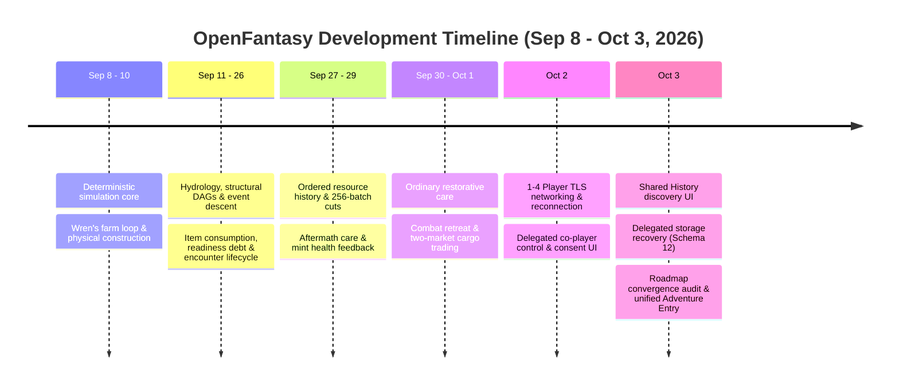
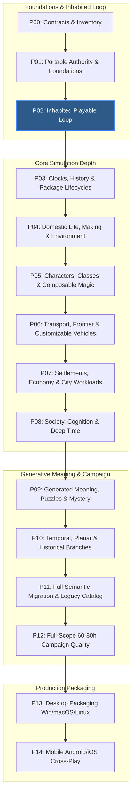
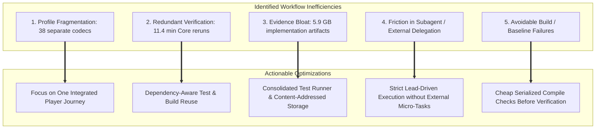

# OpenFantasy — Progress, Roadmap & Efficiency Report

**Evaluation Date:** October 3, 2026 UTC  
**Active Phase:** Phase 2 (P02 — Inhabited Playable Loop)  
**Baseline Design:** `spec-v1_1` (181 Requirements)  
**Living Roadmap Authority:** [`Beta/implementation/CURRENT_ROADMAP.md`](file:///Users/alucinor/Workspace/Projects/OpenFantasy/Beta/implementation/CURRENT_ROADMAP.md)  
**Supporting Audits:** [`Beta/implementation/roadmap-audit-20261003/`](file:///Users/alucinor/Workspace/Projects/OpenFantasy/Beta/implementation/roadmap-audit-20261003/README.md)

---

## Executive Summary

Between September 27 and October 3, 2026, OpenFantasy experienced its fastest delivery period of connected user-facing capabilities to date. The codebase expanded from single-player encounter recovery (Profile 25 / Schema 7) up to **Profile 40 / Schema 12**, integrating **1-to-4 player TLS networking**, **two-market cargo trading**, **combat retreat**, **co-player delegated control**, and a unified **Adventure Entry** launch mode.

However, an exhaustive audit conducted on October 3 reveals a structural dichotomy: while low-level deterministic simulation and durable host recovery are exceptionally mature, **the project remains in Phase 2 of its 15-phase roadmap**. None of the 181 baseline requirements are closed full-scope, and significant workflow friction—such as redundant verification reruns, evidence bloat (5.9 GB in implementation records), and fragmented proof profiles—is slowing conversion into a unified player experience.

Below is an evidence-backed report on **actual progress**, **the complete roadmap**, **completion estimates**, and **actionable efficiency optimizations**.

---

## 1. Actual Progress & Velocity Breakdown

### 1.1 Activity vs. Delivered Value (September 8 – October 3)



### 1.2 Quantitative Metrics Snapshot
* **Commits**: **274 commits** across the `Beta/` path since September 8 (with **103 commits** between September 27 and October 3).
* **Code Volume**:
  * Runtime C# Source: **1,122 files** (4.8 MB uncompressed).
  * Runtime Tests & Fixtures: **836 files** (10.4 MB).
  * Architecture Reference: **83 subject pages** (1.0 MB, 679 verified links).
  * Implementation Records & Evidence: **53,449 tracked files** (5.9 GB uncompressed, 5.8 GB under `/qualification/`).
* **Test Suite Scale**: Over **2,360 distinct passing test cases** across Core and Hosting, supplemented by independent Python byte oracles, SQLite `SIGKILL` crash probes, and 58 preserved Git milestone branches.

### 1.3 Key Functional Leaps Since Last Review
1. **Multiplayer (1 to 4 Players)**: Full TLS/WebSocket transport, authenticated handshakes, private invitations, and network disconnect resilience where characters enter safe defensive policies until TLS reconnection.
2. **Co-Player Delegated Control**: Players can grant temporary permissions (movement, shared inventory gifting, companion combat aid) without transferring permanent actor ownership.
3. **Regional Cargo Trading**: A 14-region trade corridor where players buy goods from local markets, haul cargo, and sell at remote outposts.
4. **Lawful Combat Retreat**: Formal disengagement mechanics allowing players to escape combat while retaining road threat proximity.
5. **Unified Adventure Entry (`tools/play.py`)**: Replaced fragmented test selections with a single unified entry point into Profile 40 with Wren autonomous and shared multi-player entry via `--join`.

---

## 2. Full Roadmap & Phase Ledger (P00 – P14)

The project scope is defined by 15 architectural phases in [`spec-v1_1/IMPLEMENTATION_PLAN.md`](file:///Users/alucinor/Workspace/Projects/OpenFantasy/Beta/spec-v1_1/IMPLEMENTATION_PLAN.md) and tracked in [`CURRENT_ROADMAP.md`](file:///Users/alucinor/Workspace/Projects/OpenFantasy/Beta/implementation/CURRENT_ROADMAP.md):



### 2.1 Current Status by Phase
* **P00 (Contracts & Inventory)**: *Partial*. Core catalog targets (12 shipping categories) remain unfinalized.
* **P01 (Portable Authority)**: *Substantial*. Pure C# core, SQLite journal, and physical hydrology/structures are proven, but platform exports (Windows/Linux) and 10,000-actor distant scheduling remain open.
* **P02 (Inhabited Playable Loop)**: *Active & Partially Integrated*. High technical capability, but lacks closure on **one coherent discoverable journey**: Notice → Talk → Gather/Make → Recruit → Expedition → Trade/Haul → Threat/Care → Return.
* **P03 – P14**: *Open*. Foundational primitives exist (e.g. historical commit replay for P10, basic vehicle domain rules for P06), but full generative systems, 60–80 hour campaign content, and mobile cross-play are scheduled for subsequent execution.

---

## 3. Estimation Models & Projections

### 3.1 Why Naive Velocity Extrapolation Fails
Extrapolating recent velocity (e.g. 103 commits or 15 profiles in 6 days) to predict overall completion produces misleading estimates:
1. **Unequal Complexity Curves**: Building isolated, developer-driven proof profiles in C# is radically faster than authoring human-accepted pixel art, expressive walk/cast animations, acoustic soundscapes, and non-repetitive narrative puzzles.
2. **The "Last Mile" Integration Trap**: As shown in the October 3 audit, accumulating 38 snapshot profile codecs did not automatically create an integrated game. Integrating systems across a continuous save requires exponentially more edge-case handling.
3. **Mandatory Human Acceptance Gates**: Automated headless scripts cannot satisfy human comfort, HUD legibility, game balance, or player enjoyment requirements.

### 3.2 Realistic Three-Tier Completion Estimate

```
               [ Phase Profile & Effort Distribution ]

  Foundations (P00-P02):  ██████████████████░░░░░░  (75% of Phase Scope)
  Core Systems (P03-P08): ████░░░░░░░░░░░░░░░░░░░░  (15% of Phase Scope)
  Campaign & Art (P09-P12): █░░░░░░░░░░░░░░░░░░░░░░░  (5% of Phase Scope)
  Production (P13-P14):   ░░░░░░░░░░░░░░░░░░░░░░░░  (0% of Phase Scope)
```

| Milestone Horizon | Target Deliverable | Estimated Timeframe | Critical Dependencies |
|---|---|---|---|
| **Immediate (P02 Exit)** | Unified Inhabited Journey (Notice → Trade → Danger → Return) | **2 – 3 Weeks** | Single-save trade/danger integration, NPC companion recruitment, human usability pass |
| **Mid-Term (P03 – P08)** | Deep Simulation Core (Weather, Composable Magic, Vehicles, Cities) | **3 – 5 Months** | 10k-actor scheduling, vehicle damage/upkeep, multi-client sleep/travel synchronization |
| **Long-Term (P09 – P14)** | Full 60–80h Campaign, Procedural Meaning, Desktop & Mobile Release | **6 – 10 Months** | Generative mystery solvers, production pixel art & audio pipelines, 3-OS packaging & mobile touch |

---

## 4. Root-Cause Workflow Inefficiencies & Actionable Optimizations

The October 3 audit identifies 5 major friction areas where development effort is currently leaking:



### Inefficiency 1: Fragmentation Across Too Many Proof Profiles
* **Problem**: The team created 38 profile codecs (Profiles 1–40), but until the Adventure Entry commit (`d1a460a9`), the default local launcher still opened Profile 5 (the original construction farm). Systems were proved in parallel silos rather than enriching a common game world.
* **Optimization**: **Adopt the "One True Journey" Policy**. Discontinue creating separate snapshot profiles for isolated tests. Require every new mechanic to integrate directly into the Profile 40 Adventure save lineage or provide explicit justification.

### Inefficiency 2: Redundant Core Test Reruns
* **Problem**: Across 6 consecutive packets, all 1,885 Core cases were executed repeatedly (11,310 case executions totaling 11.4 minutes), despite zero Git diffs in Core source code, solely due to binary timestamp mismatches.
* **Optimization**: **Implement Dependency-Aware Artifact Reuse**. Qualify an evidence cache that reuses test run artifacts when Git source tree hashes, compiler flags, and toolchain versions are strictly identical.

### Inefficiency 3: Implementation Record & Evidence Bloat
* **Problem**: The repository contains **53,449 tracked implementation files** (5.9 GB uncompressed, with 5.8 GB in `/qualification/`) and 67 custom test scripts (`verify.py`, `finalize.py`, `check.py`), creating massive directory traversal overhead.
* **Optimization**: **Consolidate Verification Tooling**. Replace the 67 custom scripts with a single declarative test runner (`tools/verify.py`) using structured JSON test manifests and content-addressed storage for large SQLite databases and TRX logs.

### Inefficiency 4: Delegation Friction & Model Mismatches
* **Problem**: Significant time was lost to subagent timeouts or write-permission denials (e.g. a 1,323s Fable run with denied writes; a 900s Opus timeout without output).
* **Optimization**: **Honor the October 3 Owner Steering**. Proceed with direct, single-lead execution without native subagents or external delegation unless an explicit, high-risk review checkpoint requires an independent critic.

### Inefficiency 5: Avoidable Compile & Namespace Failures
* **Problem**: Multiple packets recorded avoidable compile errors (such as missing `using` directives for `AuthorityDispatchException` or layout clipping found only at the full native gate).
* **Optimization**: **Pre-Verification Smoke Checks**. Add a cheap 2-second CLI compilation check (`dotnet build --no-incremental`) before invoking full multi-process native verification suites.

---

## 5. Strategic Recommendations for the Team

1. **Close P02 Before Building New Systems**: Do not begin Phase 3 (Clocks/History) until the complete loop—Notice, Talk, Gather/Make, Recruit, Haul Cargo, Combat Retreat/Care, and Return—is playable in a single continuous session under Profile 40.
2. **Prioritize Human Usability Testing Early**: The game currently requires ~200 individual manual confirmations to complete Wren's construction task, and HUD occlusion issues persist. Conducting early human playtests on desktop will prevent building complex systems on top of uncomfortable control schemes.
3. **Maintain Strict Documentation Synchronization**: Continue using the single source of truth in [`CURRENT_ROADMAP.md`](file:///Users/alucinor/Workspace/Projects/OpenFantasy/Beta/implementation/CURRENT_ROADMAP.md) to ensure handoff indexes reflect actual playable reality rather than isolated test milestone counts.
