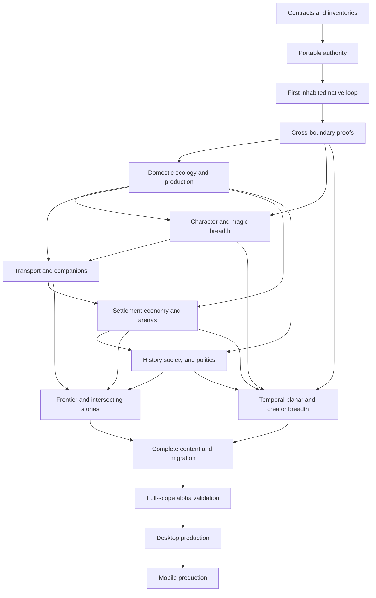

# Complete implementation and production plan

## Status and completion boundary

This plans all 181 requirements of revision 1.1 through Windows/macOS/Linux production and subsequent mobile support. It retains the first 150 requirement mappings and adds historical geology, fluids, ecology, adaptive audio, procedural introduction and conditional local reuse as cumulative work. Read with [requirements](REQUIREMENTS.json), [coverage](COVERAGE.json), [GDD](GDD.md), [technical design](TECHNICAL_DESIGN.md), [geological design](GEOLOGICAL_WORLD_DESIGN.md), [ecology and fluids](ECOLOGY_AND_FLUIDS.md), [audio direction/runtime](AUDIO_DIRECTION_AND_RUNTIME.md), [decisions](DECISIONS.md) and [validation](VALIDATION.md). Phases specify required work/evidence; no runtime, content, performance or gameplay tests are claimed passed. Frozen v1.0 remains preserved separately. RQ-168 names the successor Beta and the predecessor Alpha OpenFantasy; current prose and product metadata follow that direction while archived names, paths and requirement text/hashes remain untouched. RQ-169/170 extend the continuous audio lane with adaptive world sound and first-class acoustic production coverage.

Build in Beta with a portable deterministic C# authority and Godot C# presentation. Alpha OpenFantasy remains a preserved reference and migration source. Selective implementation reuse is permitted; every original concept and content item remains accounted for and incorporated. One to four players share a hosted world, locally, through player hosting or through a dedicated server. MMORPG operations are later expansion work; extension and identity foundations belong in this plan.

C# is the selected first implementation, subject to the [LANG-01–04 qualification gate](../research-v0_8/csharp-rust-core-reassessment.md) before broad P04 work. A measured decision can replace the whole core with Rust behind a coarse in-process C ABI, or isolate a demonstrated native hotspot, while retaining one authority, fixtures, data contracts and Godot presentation. Do not construct two complete cores speculatively or treat a microbenchmark as proof of the complete game. Revision 1.1 extends that gate with geological preparation, fluid/reaction scheduling, ecological transitions and provenance/history growth; added scope alone does not select Rust.

Every required non-mobile game domain must meet its completion gate before P13 desktop production. P14 completes supported mobile clients and their interoperability. Early slices prove contracts and production; they are not substitutes for the full game. The doubled adventure horizon remains an assessed stretch target, while world continuation and the substantial adventure path remain requirements. Coverage enumerates actual supported families, not every D&D/Final Fantasy variant or generated world.

## Execution model and evidence

Each work item names requirement IDs, one primary owner, dependencies, affected contracts/files, permitted placeholders, validation and independent reviewer. Expand demonstrable increments using retained modules, definitions, migration fixtures and regressions. Refactor failures with explicit save migration. “No throwaway code” prohibits a deliberately disposable engine or fake network architecture, not learning from a failed test.

Temporary graybox art, unfinished dialogue wording and reduced definition counts are permitted when visibly labeled and absent from the quality claim being tested. Authority, inventory/custody, save durability, actor parity, clock rules, branch transfer, supported package execution and resource accounting, mutable stacked terrain/support and lifecycle authority must be real whenever their behavior is claimed. Geological processes, fluid transfers and ecological populations likewise require actual retained rules and quantities; an era montage or biome repaint cannot stand in for simulation. Scripted fixtures may establish known starting states; they cannot secretly produce the successful consequence under test. Art approval requires native motion, not concept images alone. Small bounded geological, liquid and food-web models precede breadth; neither planet-wide three-dimensional fluid dynamics nor an unrestricted genome/evolution simulator is a prerequisite or a promised deliverable.

Every phase produces a retained build, versioned manifest, traceable results, defects and integration record. Deterministic fixtures exercise exact outcomes; property and fuzz tests exercise conservation, bounded execution, legal references and security. Virtual playtest agents exercise actual builds and report commands, seeds, checkpoints and visible evidence. Human playtests establish comprehension, pacing, emotional response, comfort and enjoyment. Neither critic prose nor an imagined playthrough counts as execution.

Failure blocks dependent expansion. First correct the failing contract or implementation; then rerun affected evidence. Changing a supported profile requires a product decision naming affected requirements. Do not silently drop actors, vehicles, narrative paths or content. Roll back to the previous compatible checkpoint/build; retain failed seeds and migration backups. A dependency failure can stop one lane while unrelated art, semantic migration or documentation continues.

## Gradual player introduction and conditional local reuse

The [experience/onboarding contract](PLAYER_EXPERIENCE_AND_ONBOARDING.md) is a production lane, not an after-the-fact tutorial overlay. P00 records teaching/prerequisite graphs and the distinction between human assistance state and character knowledge; P02 binds a native observe/practice/use/combine introduction to actual Alpha content and few clear choices; P03 proves seasonal/resource constraints, alternate solutions, changed mentors and mixed-experience co-op. P04–P10 extend those grounded patterns with their mechanics. P12 observes both spacious early sessions and coherent endgame orchestration/delegation across unfamiliar seeds. P13/P14 preserve accessible product behavior. LEARN-01–04 remain unrun.

The [local reuse register](LOCAL_REUSE_DECISIONS.md) selects actual implementation candidates, with source hashes, extraction boundaries and required fixtures. P00 records inventory/provenance and accept/adapt/reject decisions; P01–P03 prove selected contracts in retained modules; domain phases port only justified algorithms/data/tests; P11 closes every accepted candidate with integration evidence or an explicit rejection/replacement. Prior source tests are not Beta tests. No project is imported wholesale and no full evolution simulator is adopted by default. Later regression covers the supported desktop/mobile product.

## Dependency graph and parallel production

Content, art, audio, localization, accessibility and migration are continuous lanes beginning in P00–P02. They do not wait until P11. P11 is their complete-scope reconciliation gate. Preparatory P04/P05 work and later independent domains can proceed concurrently once shared contracts stabilize, but P05 acceptance depends on P04 production foundations (including RQ-025), and P08 acceptance depends on P07 institutional/economic foundations (including RQ-051). The graph records acceptance dependencies; parallel preparation cannot close a phase before its retained prerequisites. Planning for history, packages, mobile portability and four-player authority starts at P00; the graph identifies substantial integration gates, not the first time those concerns are considered.

Every gameplay domain records authoritative state → readable feedback → meaningful action and narrative consequence, including novice/expert views and interrupted performance. The art lane proceeds from approved references to native family kits, animation/attachment tests, representative scenes and only then bulk production. Its ledger enumerates body × direction × action × incompatible equipment coverage, paired interactions, vehicle arrangements, tile seams, environmental states and distinctive character/boss choreography. Histories and cultural variants share compatible components where appropriate. Validation rejects clipping, repetitive silhouettes, illegible magic and age cues that falsely imply simulated facts. Older accepted options and source assets remain preserved.

The audio lane produces authored location/character/culture motifs, exploration and combat layers, era variations, ambient beds, material/action sounds and essential alert cues. Map these to actual semantic state with transition, intensity, duration and concurrency metadata. Test restraint under repeated encounters and weather changes, mixing on target devices, volume controls, captions and visual alternatives to critical sounds. Verify stems and cues through the package pipeline. Fully voiced generated dialogue is not a baseline obligation; readable authored text and expressive performance are.

The [audio contract](AUDIO_DIRECTION_AND_RUNTIME.md) makes sound first-class for applicable assets, materials, biomes and NPC/player/creature actions. Their manifests declare semantic triggers, contact/material context, sources, repetition/voice limits, listener permission and explicit intentional silence; a missing mapping is an incomplete asset. Composers/sound creators own editable stems, original place motifs and mix choices, while client builders own cue/playback/acoustic integration. Preserve cozy work/exploration, varied restrained music, ambience and quiet; ordinary encounters do not automatically merit bombast. Town/dungeon, seaside birds, overhead creatures, wind/rain, cave water and changing ecology need coherent native identities. Use authored fades/layers with listener-scoped context; cosmetic playback cannot commit simulation actions or expose secret actors. Long-session fatigue, transition quality and immersion require actual human listening, not manifest completeness alone.

The interface/localization lane covers the adventure HUD, inventory/equipment, loadouts, filtered progression/process graphs, research/journal/bestiary, social/kinship views, settlement orders, construction previews, strategic travel and timeline/portal atlas. Test remapping, controllers and keyboard/mouse, scalable text, subtitles, non-color cues, reduced motion/flashing, height/occlusion and target selection. String IDs, pluralization and parameterized generated descriptions enter authoring early; final language counts, complete translations and expanded-layout evidence are recorded in the shipping manifest. Administrative views remain distinct from earned introspection. These lanes have P11 catalog completeness and P12/P13 quality/release gates even where a requirement chiefly names another domain.

The [presentation contract](PRESENTATION_CONTRACTS.md) binds those lanes to each domain. Expanded research contributes retained, **unrun** qualification cases: [PX-01–08](../research-v0_8/presentation-production-and-player-experience.md) begin at P02/P03 for choice use, narrative attention, earned clarity, native kits, field routes and career exchange; full social availability follows P08/P09, repeated-session acceptance P12, and platform parity P13/P14. [TERR-01–09](../research-v0_8/terrain-runtime-and-worlds.md) map stacked mutation to P02; concurrent edits, cross-border hazards, deterministic preparation, exact history and loading/Wait to P03; mining-cost and routing breadth to P04/P06/P07; and archive/return endurance to P10/P12. Reuse their actual fixtures instead of building parallel test harnesses. A reference game's shipped port, large roster or attractive still cannot substitute for these outcomes.

The following additional cases are also unrun. An introduction uses real retained services and a small content set; the second gate covers full supported breadth, followed by P12 regression. Exact situations and outcomes remain in the linked source; `COVERAGE.json` records each case's phase mapping.

| Family | Retained introduction → full integration |
|---|---|
| [SK skills/magic/dreams](../research-v0_8/skills-crafting-magic-and-dreams.md) | SK-01/02/08 P02 → P05; SK-03/04 P03 → P05; SK-05 P04 → P09; SK-06/07/09 P03 → P10. Protect equipped/favorite/heirloom/reserved ingredients, conserve production, bound research, preserve dream/evidence provenance and keep expert controls optional. |
| [SOC society](../research-v0_8/society-lifecycles-and-emergent-stories.md) | SOC-01/02 P02 → P08; SOC-03/04 P03 → P08; SOC-05 P03 → P09; SOC-06 P02 → P07; SOC-07 P03 → P08; SOC-08 P03 → P10; SOC-09 P04 → P12. Validate motives, memory, lifecycle, continuing mandates, real trade and ordinary-career play. |
| [PLACE topology/progression](../research-v0_8/places-puzzles-and-progression.md) | PLACE-01/02 P02 → P09/P07 respectively; PLACE-03 P02 → P07; PLACE-04/05 P03 → P09; PLACE-06 P02 → P07; PLACE-07 P02 → P09; PLACE-08 P03 → P10; PLACE-09 P02 → P12; PLACE-10 P03 → P12. Actual geometry, resource/time/knowledge prerequisites and recovery routes must support the claimed choices. |
| [SYN combinations](CROSS_SYSTEM_SYNERGIES.md) | SYN-01/02 P02 → P09; SYN-03 P02 → P08; SYN-04 P03 → P09; SYN-05/06 P03 → P10; SYN-07 P02 → P07; SYN-08 P03 → P12; SYN-09 P03 → P09; SYN-10 P04 → P08; SYN-11 P05 → P10; SYN-12 P05 → P09; SYN-13/14 P02 → P09/P10 respectively; SYN-15 P03 → P12; SYN-16 P02 → P12. These combine existing fixtures; schema preparation can precede the first actual composite action. |
| [ECO workflow/packages](../research-v0_8/ecosystem-packages-and-production.md) | ECO-01 P00 → P02 compares minimal/curated instructions and durable lead handoff; ECO-02 P02 → P04 proves a second editable native kit and deliberate import-error detection; ECO-03/04 P03 → P10 qualify meaningful package/history upgrades and recorded optional-AI replay. Repeat affected cases during full-catalog and P12 release qualification; tools or extra agents earn use through observed results. |
| [GEOR geological history](../research-v0_9/geological-world-generation.md) | GEOR-01/03 P03 → P10; GEOR-02 P01 → P10; GEOR-04 P03 → P08; GEOR-05 P02 → P10; GEOR-06 P03 → P12. Prove causal chronology, finite shared macro boundaries, conserved source claims, staged hazards and changed rivers/coasts before broad expansion. |
| [SUB underwater, underground and ice](../research-v0_9/submerged-subterranean-and-glacial-worlds.md) | SUB-01 P02 → P07; SUB-02 P03 → P04; SUB-03 P03 → P07; SUB-04/05 P03 → P10; SUB-06 P02 → P09. Prove real elevations, recharge/conduits, held-encounter flooding, irreversible glacial change, historical habitation and ecological/native readability. |
| [ECOG fluids and living ecosystems](../research-v0_9/ecology-fluids-and-living-biomes.md) | ECOG-01/03 P02 → P04; ECOG-02/04/06 P03 → P10; ECOG-05 P02 → P10. P06 adds aquatic travel and P08/P09 social/narrative consequences. The family is distinct from ECO workflow/package tests. All GEOR/SUB/ECOG cases regress at P12, affected desktop profiles at P13 and supported mobile profiles at P14. |
| [AUD adaptive music and world sound](../research-v0_9/adaptive-music-and-world-sound.md) | AUD-01/02/04 P02 → P12; AUD-03 P03 → P10. P02 introduces retained native playback and acoustic metadata, P03 proves Wait/recovery/listener boundaries, P04–P10 add domain/era breadth and P11 closes catalog. P12 requires human long-session acceptance; P13/P14 qualify production devices and interruption behavior. |
| [LEARN procedural introduction](../research-v0_9/procedural-onboarding-and-mechanic-pacing.md) | LEARN-01 P02 → P12; LEARN-02/03 P03 → P12; LEARN-04 P02 → P12. P00 defines teaching versus causal graphs; P02 implements observe/practice/use/combination; P03 tests alternate solutions, ignored help, changed resources and mixed-experience co-op; later domains extend these same lessons and P12 proves endgame coordination. |
| [LIFE local lifeform candidates](../research-v0_9/local-lifeform-code-review.md) | LIFE-V01 P03 → P10; LIFE-V02 P02 → P10; LIFE-V03 P02 → P12; LIFE-V04 P01 → P10. Only selected source mechanisms enter Beta; retain independent inheritance, ecology, teaching and save/target counterexamples. The single passing source continuation test is separate evidence. |
| [LOCAL terrain/roguelike candidates](../research-v0_9/local-terrain-and-roguelike-code-review.md) | LOCAL-01 P02 → P11, cosmetic effects cannot change authority; LOCAL-02 P02 → P09, channel connectivity cannot create fluid/power; LOCAL-03 P02 → P10, target/food/seed custody; LOCAL-04 P03 → P10, ecology cadence/history; LOCAL-05 P02 → P09, realized progression witnesses and reproducible self-play; LOCAL-06 P03 → P09, seeded tiny-board puzzle topology/solvability. All regress in P12–P14 as applicable. |
| [New SYN integration chains](CROSS_SYSTEM_SYNERGIES.md) | SYN-17/18 P03 → P10; SYN-19 P03 → P10; SYN-20 P03 → P12; SYN-21 P02 → P12; SYN-22 P02 → P12. Retain the coastal-city/headwaters chain, taint ecology, live flood during Wait, acoustic context and gradual introduction through broad orchestration. |

RQ-151–167 use the same three gates as earlier requirements: first real machinery, full supported domain, then full-game release regression. P00 commits finite process/material/species catalogs and benchmark definitions; P01–P03 prove causality and persistence with a small world; P04–P10 expand actual families and integration. P11 reconciles content and native coverage, P12 qualifies combined scale and enjoyment, P13 ships every required desktop domain, and P14 qualifies the same contracts on mobile. Per-case mappings describe retained proof introduction, not permission to defer their schemas until that phase.

## Cultural, lifecycle and generation completion

RQ-173–181 are required desktop scope. The [cultural and afterlife contract](LANGUAGE_AND_AFTERLIFE.md) and [generation validation contract](GENERATION_VALIDATION.md) enter P00 schemas and candidate policies. P01 persists language/comprehension, slow biological exposure, form identity and generation conflict witnesses. P02 implements a readable cultural legacy place, background-sensitive individual relations, a real culturally distinct craft/building family and optional interpreted detail; no language grind or universal fluency is allowed to conceal missing alternatives. P03 proves one actual death→estate/remains→eligible spirit/return transition, co-op scoped comprehension, biological age across Wait/history/consented skips, and finite generation repair/rejection before schema hardening.

P05 expands writing, acting, translation and original magical/rite capabilities. P07 builds functional cultural towns and workshops. P08 integrates age, lifecycles, relationship influences, evolving traditions and institutional consequences. P09 completes language/cultural narrative breadth and integrated compatibility/difficulty/attention validation; P10 completes afterlife/planar/temporal forms and generation continuity. P11 accounts for all supported definitions, body/action/audio families and chronic generator pruning. P12 requires human low-friction language, slow mortality, ordinary memorial care, distinctive town/craft use, early simplicity and late orchestration; P13/P14 retain release/platform acceptance. Cultural identity never becomes a universal personality rule or an instant building reskin.

| Additional family | Retained introduction → full integration |
|---|---|
| CULT-01/02 | P02/P03 respectively → P09; readable multilingual life and scoped interpretation |
| CULT-03 | P01 → P08; slow biological exposure, calendar and supported natural death |
| CULT-04/05/06 | P03 → P10; actual one-person form transitions, finite haunting/rites and nonduplicating return |
| CULT-07/08 | P02/P03 respectively → P09; cultural towns/crafting and migration/affiliation change |
| GEN-01/02/03/04/05 | P01/P02/P02/P01/P03 respectively → P07/P09/P09/P10/P10; exact cases in GENERATION_VALIDATION |
| RED-01/02/03/04 | P03/P01/P02/P02 respectively → P10/P10/P09/P12; exact cases in the [Reddit research synthesis](../research-v0_9/reddit-procedural-world-synergies.md) |

All these cases remain unrun and regress in P12–P14 as applicable. A generator's reported rejection rate, repeated repair count and time-to-valid-world must be measured alongside variety, conservation and progression. Successfully rejecting bad candidates alone does not prove it can produce a good campaign.

RQ-179–181 deepen these same phases: P00 inventories the additive eleven named species families, earlier RQ-019 beings, every Alpha creature and required subspecies, equipment/design lineages, cultural clothing/possessions and multidimensional civilizational capabilities; P01 supplies body/form and knowledge schema; P02 compares actual native architecture, equipment/tool use and a small martial/mechanical/magical method. P05 adds supported body/skill/magic practices, P07 actual castles/workshops and material logistics, P08 historical learning/migration/affiliations, P09 integrated cultural variety and counterplay. P11 closes the full required species/equipment/action/tile/sprite/acoustic catalog; P12–P14 qualify readability, use, sustained balance and platforms. Every selected method needs real costs and animation; no culture is merely a reskin or a universal technology level. CULT-X01 P02→P09, BODY-X01 P01→P11 and CULT-X02 P02→P09 retain the exact assertions in VALIDATION.

## P00 — Freeze executable contracts and the production inventory

Reconcile this version against the complete requirement register and archived owner decisions. Establish Beta/Alpha OpenFantasy naming in new source, package and product metadata while preserving legacy archive paths and payloads. Isolate Beta from Alpha OpenFantasy’s C# build globs and Godot import paths before adding source. Pin the Godot/.NET versions and development/export dependencies, target desktop devices, supported renderer choices and benchmark workloads. Create the actual project/host/test build skeleton. Mobile preparation identifies export/toolchain risks without replacing the agreed desktop-first delivery.

Prepare LANG-01–04 with named hardware/OS, language-neutral command/numeric/RNG/archive/projection fixtures and reproducible instrumentation. Define both the 10,000-actor early workload and separate 20,000-resident city probe, specifying full retained state, due cognition/work, 512 detailed actors and four active branches; counts alone are insufficient.

Freeze the revision 1.1 interfaces before dependent content: stable formations/substrate and site attachments; finite macro catchments and boundary flux contracts; process integration schedules; water/lava/other-liquid material and reaction tables; aquifer/void/ice separation; coarse/detail ownership; plant stages, diets, food webs, dispersal and bounded inherited variation; disturbance/taint sources; and historical provenance. Name throughput/storage/queue budgets and conservative microfixtures for each. Retain the coastal-city/headwaters comparison and a small producer–herbivore–predator habitat as cross-phase fixtures. Define ordinary physical profiles separately from explicit magical sources; avoid introducing global solves or routine catastrophic pacing as hidden requirements.

Pin semantic sound/observation boundaries, cue recovery IDs, listener contexts and asset/action acoustic fields in the initial package schema. Inventory music/stem/ambience/SFX families and intentional-silence cases with supported transition, codec and device qualification tasks. Rendering variation and musical phase need not enter core determinism; actionable acoustic evidence does.

Define the numeric/rules profile, identity/version schema, clock policy, branch custody, secret projections, semantic action/scene boundary and supported package capabilities from the TDD. Create versioned finite catalogs for intended classes, effects, production processes, bodies, vehicles, materials, support/building geometries, biomes, site grammars, narrative families, UI screens and audio roles. Preserve exact source snapshots and enumerate remaining code/prose concepts; give conflicts explicit reconciliation records. Record each catalog's target count and coverage denominator before bulk production. Capacity and cost estimates remain uncommitted until measured throughput exists.

**Exit:** a clean Beta build on the selected toolchain, complete requirement/design/phase mapping, inspectable catalogs and repeatable source preservation. Core and critic reviewers find no contradictory ownership or clock semantics. Unknown workload numbers become named measurement tasks with conservative test fixtures, not hidden guarantees.

## P01 — Portable authority and durable world primitives

Implement engine-free IDs, canonical serialization, command receipts, keyed RNG streams, deterministic commit ordering, versioned definitions, typed effect/process dependencies, actor state, custody, events and scoped observations. Include durable mutable terrain/material occupancy, stacked spaces/connectors, support and navigation dependencies, condition causes, kinship, lifecycle, ethical commitments and office/authority references. Random-access generated/lived history is a core service; checkpoints only accelerate exact-time reconstruction. Introduce the package manifest/compiler and storage/network adapter interfaces immediately. Build checkpoint plus journal recovery and a plain .NET runner. Godot receives projections and submits commands; its scene tree never becomes the authoritative inventory or quest database.

The proof follows a player and NPC performing the same legal work/action from equivalent state, transferring an item and continuing after restart. Retry a command, kill the process around a commit and restore the acknowledged result exactly once. Compile and run the same core without Godot. Export a tiny real client on Windows, macOS and Linux and establish dedicated-server startup.

Implement the first deterministic macro-to-local geological generator with stable formation/reservoir IDs, shared boundary records, strata and a finite watershed. Introduce canonical process intervals and stage journals into exact-time history now. Implement conservative liquid/reservoir transfer ownership, reaction/phase definitions and biological growth/diet/dispersal state with due-event scheduling; these run in the plain core. GEOR-02 first varies realization and worker order across a small macro boundary. Check nonnegative quantities, exclusive coarse/detail ownership, finite dependency discovery and provenance conservation. Later epochs and ecosystems expand these same modules.

Begin LANG-01/03/04 on these real modules and expand through P02/P03. Record allocation/GC, memory, durable bytes, restore latency, queue age and replay equality across worker counts, architectures and debug/release builds. Add LANG-02's simultaneous terrain/support/fluid, encounter, market and history workload as those services become real; no stub can count as its measured implementation.

**Exit:** repeatable state/event hashes under the pinned rules, no duplicate ownership/rewards, recoverable failures and demonstrable player/NPC parity. A compiler rejects illegal cycles, unknown references and unbounded effects. Qualify durable resident/visitor records and causal scheduling at the city workload; the first 10,000-actor fixture is not a population cap. Presentation can remain graybox; authority and persistence cannot.

## P02 — One inhabited legacy place, one complete playable loop

Import a connected real legacy NPC, quest, class/ability, recipe, item, monster and place with original payloads and explicit Beta IDs. Each NPC already has the complete applicable actor-state schema, including recoverable knowledge, commitments, progression and history; a small content sample does not permit shallow NPC records. Implement the bounded perception → belief → desire/preference → commitment → feasible action → memory loop and scheduler here, including real local/offscreen job reconciliation. World, epoch and branch interfaces are present even before richer histories are authored. Use Wren's work and a repair/expedition as a compact loop: notice a need, speak, gather, make, recruit, encounter a threat, use a cooperative action and return to a changed place. Use a two-market cargo/escort circuit: buy actual stock, haul owned lots, encounter a threat and sell against a changed quote/stock state. Retain costs, price knowledge and risk. Make battle transition on the same field using full Wait, legal staging, camera/UI/music and persistent aftermath. Investigate missing cargo through actual evidence, testimony and alternate clues. Restore Alpha zone chat and scoped system notices with actual two-client delivery; keep player coordination distinct from NPC speech/knowledge. P03 tests retry/reconnect, membership boundaries and safe text rendering. Traveling merchants bring these actual goods and NPC travelers retain routes/commitments. This introduces early-to-midgame trade play; P07 expands the economy. Add a real field-action puzzle with team and noncombat solutions, visible skill animations and accessible alternatives; active exploration does not weaken combat Wait.

Make excavation and building real in this loop: mine a supported tunnel beneath an occupied floor, use stairs/vertical access, construct an upper floor and remove a support. Navigation, clearance, collision and deterministic structural consequences follow authoritative edits, survive restart and distinguish actors above/below. Painted height and scripted collapse cannot substitute.

Give the location real relief, strata, a river/outlet, an upper dry cave and lower flooded passage. Include flowing water and a contained second material such as lava, plus an actual declared cooling/reaction and ice or phase-change microfixture. Use a persistent seasonal plant, herbivore and predator/intermediate creature with real food and nonautomatic hostility; remove a food source and observe feasible responses. Record dispersal/harvest quantities, growth time and native stage cues. GEOR-05, SUB-01/06 and ECOG introductions use this loop; they do not require a broad catalog or a fully inhabited underdark yet.

Dedicated artist agents supply a native accepted person, creature, animal and interactive object kit, including personality idles and practical actions. Add usable controller/keyboard input, remapping, scalable text and redundant essential feedback immediately. Exercise novice, journeyman and expert views of the same work/action: clear choices and observable dangers first; learned knowledge unlocks truthful inspection and actions. Expertise never forces micromanagement, reveals unauthorized facts or exposes implementation telemetry. Advanced actors can retain the simple view. Connect up to four actual clients, including joining and reconnecting while the loop is active. Add interaction audio and one adaptive musical transition as real production assets or explicitly marked temporary assets when audio quality is not under review. Begin native day/night calibration against the initial roughly 40-minute uninterrupted cycle; real sleep and acceleration qualification begins in P03.

RQ-169/170 require an actual native audio fixture here: town → wilderness → on-field encounter → aftermath, plus cave/shelter contrast, material/tool/footstep actions, wind/rain and an ecologically valid bird/seaside cue. Include ordinary work with intentional quiet and gentle fades. Use independent listener contexts on connected clients, editable original sources and accepted acoustic intent on each applicable kit/action. Temporary audio cannot close this quality gate.

**Exit:** the loop works through save/restart and network reconnect; user acceptance covers actual motion/rendering, not only still references. Human players recognize the causal outcome. Stop broad scene production if staging, clarity or authoring effort fails this proof.

## P03 — Prove clocks, branches, packages and optional AI before hardening

Retain a small real fixture in which one party holds a combat decision while another travels, attempts a transfer and approaches with a lingering hazard. Exercise entry, refusal, merge, withdrawal, disconnection, host absence, scheduled work and the stated calendar/deadline policy. Add a moving platform dependency, initially with a simple assembly. Verify cosmetic idles do not advance authoritative effects. Retain competing excavation/build edits, streamed support/fluid propagation, versioned navigation/visibility invalidation and collapse admission across Wait boundaries; interrupted commits cannot duplicate ore or leave illegal occupancy. Exercise death with real custody, dependant care, job and office succession, rather than only setting a life-state flag. Cross detailed/coarse simulation, Wait and restart with one birth/maturation event: one identity, lineage draw and declared biological exposure clock.

Add real resting and sleep scheduling here: normal-time sleep while others continue, explicitly consented shared acceleration, host absence, watch changes and interrupted recovery. Recovery accrues only for completed eligible intervals; neither cancellation nor repeated short rests grants an instant full refill. One player's bedtime cannot advance another's calendar without the selected consent rule. Exercise an isolated player with no consenting companion while others refuse acceleration; human and actual-build virtual playtests must assess normal-time sleep, short respite and deferred sleep. If inactivity or recovery pressure makes that situation unsatisfying, revise the tuning and interaction before expanding rest-dependent content.

Extend the early geography/habitat fixture through a staged quake or breach/flood crossing an unloaded boundary and a held encounter; include a supported liquid reaction, buoyant ice/floe movement, aquifer recharge and a nutrient transfer. Prove finite work and recovery of partially committed event stages, source/capacity reservation, no hidden held-body damage and no automatic ocean-wide pause. Query unprepared interior instants during uplift/erosion, deposition, plant growth and disturbance; repeat in reversed query order after restart, with unchanged numeric schedules and source identities. Intervene with a dam or excavation in a child branch and revalidate endogenous downstream events instead of replaying the parent's flood unchanged. Retain a small glacial accumulation/retreat and inherited-trait/taint-source fixture now, with bounded definitions, so P10 cannot discover an incompatible archive or ecology schema. Show no duplicated ore, water, seeds, organisms or export rights through promotion/demotion and historical transfer. These are real GEOR/SUB/ECOG proofs, not precomputed scene swaps.

Retain four explicit adversarial extensions in the same fixtures: a newly built dam invalidates and replans a live flood's uncommitted stages; incoming water during Wait has finite real storage and physical backpressure rather than an infinite reservation queue; every macro catchment has a finite outlet/storage witness and dependency discovery rejects cycles; and mine → volcanic infill → re-excavation reconstructs each exact historical state without applying an old excavation overlay to the wrong geological revision. A failed case blocks dependent expansion even if its static scene looks correct.

Exercise audible action retries, late join/reconnect, changing enclosure/medium, competing music transitions and Wait. Reconstruct sustained soundscape context without replaying old one-shots, allowing callbacks to apply damage, or leaking private/distant events through music or captions. Four separated clients may hear different appropriate mixes while sharing one authority. Bind these proofs to the existing real scene and storage/network fixture.

Query several previously unprepared instants across generated prehistory and recorded lived history in reversed request order, then transfer stable actors and an item into an exact-time child branch. Verify consistent identity/mutations, preparation latency, restart and protected source history; never substitute a nearby checkpoint. Test territorial claims and ethical commitments without granting authority merely for constructing a castle. Retain an injury fixture changing limb/sense capability, held equipment and native action eligibility, with explicit restoration. Generate a supported start with an executable advancement/recovery witness across capability, knowledge, material, party, calendar and planar dependencies; repeat after world events, rejecting impossible composite gates. Interrupt transit and reconnect without cloning or stranding either. Install a small package through the intended compiler, upgrade it with a save migration and reject an incompatible removal. Record an optional AI proposal as a validated canonical decision; replay it with the provider disconnected. Provider absence must leave the ordinary game functional. Add a real dream/realm tether fixture: one NPC dreamer, live body, shared actor/resources, a visiting power, interruption and return. A partner's Wait/care or body death cannot duplicate the dreamer or export symbolic matter.

**Exit:** explicit cross-boundary and recovery traces pass with real storage and hosted clients. Structural placeholders may simplify the map, not transactions. Close LANG-01–04 before broad P04: retain p50/p95/p99 step time against the 50 ms scheduler window, allocation/GC, storage and backlog traces under combined loads, plus desktop export/replay/recovery evidence. Repair demonstrated algorithm/layout/allocation defects first. Pervasive remaining managed costs or a concrete embedding requirement can justify a whole Rust replacement only with equivalent integration/export/recovery proof; an isolated bottleneck may justify one bounded kernel. If neither candidate meets the declared profile, revise the workload implementation or explicitly qualify a new profile without deleting actor depth/history. A failed gate blocks dependent expansion; preserve the actual fixtures and data. Later full-city/content workloads requalify this early result.

## P04 — Domestic life, environment and deep making

Expand mining through hardness/tool suitability, extraction, ore grading, refining, smelting, alloying and smithing, connecting actual deposits and lots to fortress/vehicle/equipment construction. Expand herbal preparation, cooking, teas and alchemy through foraged/cultivated ingredients. Jobs reserve real lots, tools, station capacity and labor; substitutions, quality, byproducts, interruption, repair and salvage remain accountable. Connect practice, apprenticeship and discovered knowledge to usable recipes and creation primitives. Provide intent-focused interfaces with deeper truthful inspection where learned.

Build regional seasons/weather, light and exposure; water/food/fatigue/shelter; farming, fishing, foraging, animal husbandry, breeding and domestic commitments; habitat/resource relationships, migration and ecological adaptation. A seasonal supply shortage should change harvest, a meal or remedy, work choices and household behavior. Expand species-specific germination, growth, dormancy, flowering/fruiting, harvest and regrowth using actual soil/water/light/temperature/care and biological exposure intervals. Complete bounded herbivory, predation, competition, fear, territory and temperaments across the supported domestic/wild roster. Add seed dispersal and colonization through actual wind/water/animal/caravan carriers and barriers. Acclimation, learned behavior and inherited variation remain distinct, bounded and traceable; no population appears solely because a biome label changed.

Expand erosion, sediment, groundwater and supported fluid mixing/separation, temperature, phase/reaction and moving-ice rules from the P03 services. Integrate beneficial/hazardous hot springs with actual place, access and exposure. Track impact, combat, fire, collapse and other event damage separately from time/use/weather deterioration; both change persistent material-specific condition, function and repair while retaining age/provenance. Delegate care and work through actual actors and supplies. Run habitat depletion, succession, recovery and a limited magical-taint source with containment and gradual recovery; everyday care must remain readable and useful rather than a compulsory ecology spreadsheet.

Complete home, inn and wilderness rest with camp preparation, shelter, food, watches, cooking, repair, research, companion care and social interaction. Their jobs compete for actual time, people, supplies and safety; not every character can sleep, keep watch and repair simultaneously. Use an initial roughly 40-minute full day/night cycle as a pacing hypothesis, then evaluate how often rest interrupts intended activity. Offer meaningful camp decisions and delegated routines instead of requiring frequent repetitive chores.

**Exit:** a multi-season household/workshop survives detailed/coarse transitions and restart without duplicated yield or labor. Supported plant/food-web and fluid rules produce accountable changes and readable native feedback; changing camera distance cannot reroll traits, food, seeds, predators or ecological outcomes. Players can sustain a satisfying domestic routine without compulsory combat progression. Weather signals and maintenance choices remain readable and manageable.

## P05 — Character, class, discovery and magical breadth

Complete the character customization and body/attachment contracts with stats, traits, equipment, conditions, skills, schools, classes/jobs, specializations and permitted combinations. Keep class, profession, office, species, religion, ethics and control mode independent. Individual good/evil and law/chaos tendencies respond to choices; reputation, cultural judgment and divine commitments remain distinct. Include Squire, Mage, Scout and their original abilities early; expand the entire shipping roster through definitions.

Implement overlapping learning routes, introspection, shared discoveries and research. The magic workbench composes supported elemental facets and operations into researched spells, rituals, illusion, invocation, enchantment, spellbinding, summoned companions and persistent area/person/object effects. Add costs, limits, resistance, stacking, interruption, dispel, knowledge permissions and original feedback. Material enchantments interact with hardness, damage, upkeep and fabrication through declared operations. A supported creation uses the same definition/compiler path as official content.

Extend those declared operations to supported elemental liquid/ice interactions, ecological protection/restoration and bounded magical adaptation/taint. Magical sources have costs, propagation, exposure and removal rules; a spell cannot bypass material custody or instantly reconstruct a destroyed ecosystem unless that exact budgeted operation is supported. Shared knowledge rules govern geological interpretation and forecasts.

**Exit:** a player and NPC independently learn, research, teach and use the same capabilities. Fishing, hunting, cooking, knitting, writing, acting and acrobatics join existing skill families with native actions and actual puzzle/quest/narrative solutions, sharing NPC costs and knowledge. Expand combinations in real-time field puzzles and P07 locations. Cross-domain effects work during exploration, making and combat; rejected compositions explain why. Complete lasting injury, scarring and supported restorative magic using the original body schema; ordinary healing cannot silently regrow a missing eye/limb. Accepted body/equipment/action families pass animation compatibility and player readability checks. Unsupported silhouettes are catalog work, not silently substituted generic bodies.

## P06 — Persistent transport, mounts and frontier residency

Complete all ten named transport profiles: ships, boats, canoes, carriages, chariots, dwarven tanks, sandships, tunneling ships, air balloons and airships. Each uses real assemblies, parts, condition, load, propulsion, crew, cargo and customization. Exercise docking, towing, boarding, disembarking, theft, wreck/salvage, repairs and enhancement. Distinct movement domains enforce geology, water, lift, atmosphere, clearance and persistent excavation/support consequences through deterministic approximations; tunneling never grants passage through uncleared rock.

Add different horse, lizard and bird mount types plus pets/familiars as actors, with anatomy-compatible equipment, training, feeding, rest, shelter, illness/injury, bonds and delegated care. Recall and summoning obey one identity/custody lifecycle. Stream their complete state across land, water, underground and air boundaries.

Integrate caravan camps, anchorages and onboard rest with crew watches, animal care, route/weather conditions and interrupted travel. Real duties determine who recovers or works, and shared time acceleration follows the same consent rule as a stationary camp.

Qualify real underwater access across bathymetry, flooded caves and changing coasts with current, depth, breath, temperature and declared pressure tolerance. Grounded, swimming, floating, sealed and airborne assemblies use their supported movement/attachment rules; moving floes, flood fronts and changed entrances affect routes, cargo and crew. Test aquatic species, mounts and native motion/interaction in actual geometry. Revalidate navigation after subsidence, deposits, glacial change and excavation without replacing the locality or losing inhabitants.

**Exit:** normal traversal, cold loading and worst-case travel pass: maximum supported speed, abrupt reversal, dense occupied customized vessel, storm/night conditions and four widely separated players. Measure preparation latency, frame time, authoritative tick time, memory, bandwidth and save growth on the minimum desktop profiles. No void traversal, regenerated terrain, lost passengers or useful duplication is accepted. Improve generation/cache scheduling before expanding speed or world density.

## P07 — Settlements, operated dungeons, trade and competition

Extend building into towns, fortresses, workshops, infrastructure and institutions, with stacked floors/subfloors, excavated rooms, load/support, vertical access, construction stages, ownership, permissions, logistics and labor. Management and individual adventure inspect the same place and people. Support player-operated dungeons with traps, secrets, locks, vertical access, light, archaeology and sustainable operating resources. Creation produces eligible blueprints and dungeon grammars. Castle/town/crypt/dungeon growth feeds actual territorial claims, defense, institutions and nation-building; sovereignty requires recognition, resources and contested jurisdiction rather than a building label.

Complete shops, production businesses, caravans, contracts and trade networks; allow a merchant or craftsperson to progress without mastering heroic combat. Run a player-built arena with actual entrants, rules, funded prizes, ranking evidence, fame and appropriate injury/recovery policy. Integrate theft, disputes and obligations with personal knowledge rather than an omniscient global reputation switch.

Build supported underwater and underdark settlements using the same actors, institutions, food/energy, air or species-appropriate needs, shelter and logistics. Qualify pumps, floodworks, seals, drains, channels and port access with bounded liquid/heat/contamination rules. A breached compartment or tainted water supply creates actual evacuation, care, repair, trade and ownership consequences. P06's access/capability qualification precedes acceptance of these inhabited extensions; surface settlement work may proceed independently earlier.

**Exit:** a settlement and commercial route continue with NPC labor while the player explores; operated dungeons and an arena produce durable consequences. Management UI exposes shortages and responsibility through real stockpile filters/minimum/maximum targets, job priorities/shifts, district roles and steward/foreman/quartermaster delegation. Validate capacity, reserved/protected inputs, commitments, fatigue and exception handling without duplicated work or compulsory novice dashboards. Invalid geometry, unfunded rewards and recursive production gains fail safely. Qualify a nominal 20,000-resident city plus actual visitors and goods, with chapel crypts, sewers, caves and shadow-plane connections. Named residents retain full state; causal scheduling and distant work avoid requiring every resident to plan every tick. Population targets remain measured profiles, not permission to delete inhabitants.

## P08 — Eons, peoples, institutions and autonomous world events

Complete staged genesis through cosmology, geology/hydrology, climate, life, species/lineage change, cultures, cities, institutions and historical individuals. Seed elemental/crystal tendencies and deity relationships while preserving exceptional births, individual learning and cultural diversity. Gods have explicit powers, limits, knowledge, interventions and worship institutions. History leaves strata, ruins, artifacts, claims and descendants. At the initial day rate, a 60–80-hour campaign spans roughly 90–120 normal days before holds/acceleration. Demonstrate life transitions with existing families and near-due events; qualify optional historical advancement without forcing compressed generations per campaign.

Extend the existing NPC perception, beliefs, needs, commitments, planning and memory loop to full world and institutional scope across domestic, professional and political life. Every instantiated individual remains recoverable with the same applicable depth offscreen. Nations, guilds and overt/covert factions act through real resources, news, alliances and authority. Birth, maturation, marriage/partnership, household care, aging and death change durable kinship and obligations. Resolve inheritance, guardianship, offices and command hierarchies through explicit rights and contested succession. Armies, supply, morale, territorial change, conquest and captivity affect actual people and allow playable continuations.

Integrate geological disasters, degraded habitats and tainted forests with real migration, relief work, food/market shocks and political decisions. Preserve displaced households, title and resource claims; distinguish fixed surveyed borders from feature-following river borders and present control. News spreads through witnesses and communication. Ecological effects may change animal behavior and NPC plans without assigning universal hostility by monster label or granting secret global hazard knowledge.

**Exit:** a known person can become a refugee, ruler, rival, companion or independently successful adventurer for traceable reasons. Distant war and local action reconcile identities and resource losses. Secret facts remain absent from unauthorized clients. Comparative depth is assessed on declared systems/interaction axes, never an unsupported blanket “beyond Dwarf Fortress” claim.

## P09 — Frontier meaning and intersecting narrative possibilities

Combine history-backed generation, contextual random encounters, authored adventurelets and encounter decks with genuine inhabitants, supplies, motives and geography. Encounter selection must not invent a forbidden creature, resurrect a consumed resource or spawn an unlimited army. Provide alternatives to fighting and distinct travel rhythms without filling every wilderness step with interruptions. Validate authored constraints and realized nonlinear geometry: loops, multiple entrances, vertical links, landmarks and alternate skill/social routes must change actual player choices, not merely graph counts.

Bind recurring characters, NPC-to-NPC relationships, rumors, private commitments and expressive scenes into multiple contingent intersecting grand narrative possibilities per seed. A dark lord may arise, remain absent, join a party or lose to NPCs; players can help, ignore, oppose or join powers while following ordinary careers. Original quest routes remain represented under valid starting conditions, with truthful alternate continuations when the world changes.

Build incident/evidence/hypothesis mystery families with alternate clue routes and alternate evidence and truthful cold-case/failure continuations when world changes destroy solvability. Author camp/inn conversations, watch incidents, visitors, discoveries and relationship developments against actual participants, knowledge and surroundings. Respect sleep and job commitments; a camp event cannot duplicate a distant companion or freeze urgent world facts without the explicit clock policy.

Author geology/ecology-backed discoveries: an avulsed river reveals a route, a quake opens a leg of an existing cave, a drowned district retains evidence, and a changing or tainted forest alters foraging and local relationships. Validate the actual access/capability/evidence path after change; no guaranteed treasure room, fabricated rescue or magically restored clue may substitute. Native dry/wet/icy/aged states and ecological responses should make causes recognizable with restrained detail.

**Exit:** human sessions show recognizable people and meaningful differences among sampled seeds, regions, sites and careers. The frontier feels expansive without repeating the same situations under new names. Measure encounter novelty, travel downtime, consequence recognition, unwanted interruption and meaningful choice. Validate composite difficulty/capability/DC, stock, evidence, timing and plane constraints using constructive route witnesses. Optional difficult gates can remain; generated starts and permitted world changes need intelligible advancement or recovery/continuation. Scheduled opportunities matter without a universal reset cycle or terminal date. Rework grammar/content before enlarging map counts if variety or density fails.

## P10 — Full planar, temporal, creator and extension capabilities

Expand P03's retained transfer into spatial portals, planes, any requested available historical instant, governed future visits and alternate branches with diverged societies, places and artifacts. The full generated/lived chronology remains addressable after archival compaction; preparation budgets govern latency, not allowed dates. Complete puzzles, quests and production graphs requiring extinct life, lost knowledge or supported temporal/planar progression. Complete supported multidimensional topology through stacked volumes and connected planes with distinct physics, clocks and traversal. Expand tethered NPC dream realms through learned powers/classes, subjective beliefs and declared waking consequences; interruption and body care retain one actor/resource authority. Advanced creation can build eligible connections under host policy. Rehearse historical item cloning, rapid-aging profit, branch catch-up, two groups in different eras and disconnected travel.

Finish sanctioned expansion surfaces for every major domain: world/history rules, actors, items, effects, processes, narrative, art, audio, UI and tools. Base content uses those same formats. Add per-server configuration, dependency resolution, capability/resource limits, package distribution/join verification, upgrade/removal reports and reversible migrations. Optional AI can propose parameters, definitions, prose and evaluations under scoped knowledge; only accepted validated outputs become canonical. Export/fork/sharing and future discovery/community integration have documented boundaries; they do not require an MMORPG launch.

Complete the supported geological chronology: continental/province motion, rifting/collision, uplift/denudation, volcanism/subsidence, avulsion/deltas, glacial/ice-age intervals and underwater/underdark evolution. Complete historical ecological succession, biome transitions, dispersal/migration, bounded inherited adaptation and persistent magical transformation/recovery. Visit the same coastal city/headwaters through five linked historical states and a changed intervention branch. Reconstruct real formations, sites, water/ice, ecological populations, local holds and provenance at arbitrary requested instants, including interior integration times. Preserve known facts and canonical boundary histories across frontier expansion, generator/package changes and archive compaction. Full supported breadth must meet these contracts; numerical Earth-system completeness is not claimed.

**Exit:** a creator independently adds an eligible cross-domain package without engine edits. Provider-free replay and malformed/expensive package tests pass. All temporal outcomes preserve exact requested instants, ownership, source-world protection and coherent player recap.

## P11 — Complete migration and production catalog

Close every migration record: source bytes and provenance, target definitions/instances, field transforms, dependencies, art mapping, supported placement and playable evidence. Current denominators include 201 source files, 532 structured records, 10 indexed code-defined entries and 187 document headings requiring semantic review; these are different coverage units. Authored content includes 123 NPCs, 45 quests, 63 items, 35 monsters, 3 classes, 12 abilities, 28 recipes, 25 regions and 89 asset files. Reconcile newer Alpha OpenFantasy deltas before completion. Do not count preserved ZIP bytes as playable incorporation.

Verify both faithful legacy fixtures and integrated generated-world realization, including the full main/side quest graph, destinations, site families, customization and all transport progression. Preserve legacy presentation as a compatibility/reference set with integrated mappings; accepted replacements maintain identity. Record honest limitations when source saves never contained a historical fact.

The new shipping catalog reports exact counts by family, legal combinations, reachable definitions, produced assets, approved assets and unresolved entries. Transport, mount, material/alloy, building, botanical/tea/spring, lifecycle and institutional families require playable coverage, not labels. Revision 1.1 adds geological formations/events, liquid/reaction/ice profiles, aquatic/underdark sites and capabilities, plant stages, diet/food-web families, biome transitions, dispersal/adaptation and taint/recovery families. Every shipped definition has valid references and a reachable use; every capability family has functional and presentation coverage. Exhaust finite authored content; use family, topology, climate, history, seed and boundary partitions for generators, plus pairwise and selected higher-order interaction suites. Maintain a supported synergy matrix with representative multi-domain fixtures sharing actors, custody, time, knowledge, progression and native feedback; reject contradictory combinations explicitly. Infinite instance enumeration is neither required nor claimed. Legacy realization constraints remain valid amid the added geological/ecological generator; archiving source content does not satisfy incorporation if the supported start can no longer realize its places or routes.

Reconcile the acoustic matrix alongside visual actions: every applicable shipping asset/material/biome/action has a working sound mapping or explicit intentional silence, permitted source/evidence semantics, variation/repetition limits and required accessible feedback. Catalog place/era music, compatible stems/fades, ordinary/epic contexts and quiet policies. Accepted original source projects, licenses and actual playback evidence remain attached to the asset records.

**Exit:** zero silently unmapped source entries, zero unclassified semantic concepts, zero unreachable shipping definitions without explicitly justified conditions, and complete native art/audio/UI/localization/accessibility coverage for the release catalog. Independent content and technical critics reconcile the denominators.

## P12 — Full-scope alpha, endurance and quality validation

Run the complete game over representative normal, adversarial and long-lived worlds. Include four separated players, inhabited structures, dense customized transport, sustained effects, stacked fortresses and tunnel edits, event damage alongside long-term wear, lifecycle/office transitions, large histories, branch forks and repeated package/save upgrades. Test fresh worlds and migrated saves on Windows, macOS and Linux. Rehearse crash recovery, disk pressure, interrupted writes/downloads, malformed commands, reconnects, empty/always-on host policies and long absence. Measure durable-state growth and cleanup without deleting consequential history.

Re-run LANG-01–04 with P07's full-city activity and the complete production content/history mix, including concurrent geological event stages, macro dependency preparation, liquid/heat/reaction fronts, plant/food-web scheduling, migration, provenance fragmentation and four historical branches. Run all GEOR-01–06, SUB-01–06 and ECOG-01–06 with documented profile bounds and source-level causal traces; measure step latency, backlog age/progress, allocation/GC, memory and archive/preparation growth separately. Early P03 results qualify their measured retained subset, never every future workload. Preserve the distinction between renderer, collector, core computation, durability and historical-preparation stalls when deciding what to revise.

Human playtests pursue adventure, farming, trade/crafting and management; verify the 60–80-hour adventure quality target through actual representative campaigns, not extrapolation from a short loop. Assess continuation after success, retirement, defeat and independently resolved crises. Validate difficulty, economy, accessibility, controller/keyboard ergonomics, text/localization expansion, audio mix, scene skipping, visual repetition and motion comfort. Complete credits and provenance review.

Measure day/night/rest pacing in normal, delayed and split-party sessions: frequency of forced stops, useful daylight, night opportunities, camp decisions, interruption costs and perceived chore burden. Repeat the isolated no-companion/refused-acceleration case alongside cooperative camp play. Calibrate rare lasting injuries versus common quiet scars across actual encounter exposure and long-lived NPC populations, including readable risk and recovery routes. Tune the initial roughly 40-minute cycle from observed evidence while preserving meaningful time, recovery and consent; its selection is not proof that the pacing already works.

Assess geological/disaster frequency, underwater legibility, meaningful ecological differences between seeds and ordinary careers in changed environments. Verify that rare catastrophe, predators, seasonal failure, adaptation and magical taint create choices and recoverable continuations instead of routine demolition, automatic aggression or repetitive upkeep. Include quiet worlds and naturally absent events. Historical breadth and human enjoyment require observed evidence alongside conservation tests.

Run AUD-01–04 and long crafting/exploration/return sessions with the complete sound catalog. Humans assess musical phrase recurrence, quiet/cozy space, fade continuity, rare warranted escalation, overlapping calls/loops, dialogue intelligibility and fatigue. Cover surface/cave/underwater/ice, weather/time/ecology changes, independent co-op contexts and muted or reduced dynamic-range play; appropriate captions/visual cues preserve essential information. Measure voice/streaming/memory cost and missing/duplicate cues on real exports. Headless traces alone do not establish audio quality.

**Exit:** published profile budgets and gameplay targets have evidence; no unresolved critical save, authority, progression, accessibility or content-loss defects remain. Failed fun or depth targets require content/rule iteration and repeat affected sessions. They cannot be dismissed because deterministic tests pass.

## P13 — Desktop production release and support

Prepare signed/distributable desktop builds, dedicated-host packages, installation/update/uninstall behavior, platform store artifacts where selected, release notes, licenses/credits, server/admin/player/creator documentation and support diagnostics. Rehearse clean install, upgrade, downgrade compatibility boundaries, save backup/recovery and rollback using production artifacts. Match published requirements and supported package/seed limits to measured evidence.

Use staged release candidates and a controlled rollout with clear recovery instructions. Approval concerns the concrete release artifacts after all authorized preparation and checks are complete. Maintain issue triage, reproducible crash/causal reports, compatibility policy and a regression corpus for patches. No required non-mobile domain is deferred under the label “post-release polish.” Audit the Beta product name, Alpha OpenFantasy migration attribution and unchanged archival provenance in final release artifacts.

**Exit:** production acceptance references every desktop requirement across all 181 rows and resolved evidence, the full content catalog, supported profiles and an exercised support/rollback procedure. Geological, liquid, ecological, exact-history and adaptive audio families are required desktop scope; affected GEOR/SUB/ECOG/AUD fixtures run against production artifacts and supported profiles. Ongoing updates preserve existing saves or provide explicit safe migrations.

## P14 — Mobile completion through the same core

Deliver mobile clients through the retained Godot/C# core and package formats. Verify supported Android/iOS toolchains, hardware and export constraints with real devices before committing exact device support. Implement touch controls, readable interfaces, performance/thermal/memory budgets, suspend/resume, interruptions, connectivity changes and platform storage/lifecycle behavior. Optimize measured hotspots; reduce presentation cost through declared quality settings without deleting simulation/content depth.

Run compatibility and hosted play with desktop participants, including a four-player hosted world with separated participants. Respect mobile store signing, packaging and release/support requirements. Dedicated hosting may remain a desktop/server responsibility; mobile client support does not imply an untested always-on phone host.

Qualify geological/underwater/underdark and ecological presentation plus authoritative replay/commands through remote hosted play, with historical preparation, hazard admission, changing liquids/ice and suspend/reconnect. Reuse GEOR/SUB/ECOG fixtures on the supported mobile profiles rather than reducing world depth or historical access to fit a device. Measure device-side memory, bandwidth and thermal cost separately from host simulation capacity.

Requalify AUD cases with device speakers/headphones, output-route changes, platform interruption/ducking, suspend/resume, memory/streaming and accessible mix controls. Restore current musical/environmental context without replaying stale events or affecting authority. Mobile performance reductions may alter supported presentation quality, never erase essential acoustic/visual evidence.

Verify instructional/controller glyphs and touch alternatives during real actions as well as menu navigation. Sea of Stars' documented mobile multiplayer omission is a concrete reminder that a reference port does not establish Beta's promised parity; retain four-player interoperability as this phase's own executed gate.

**Exit:** the published mobile device matrix passes the same authority, content and save contracts plus mobile lifecycle, input, battery/thermal and performance evidence. P14 is required plan completion, not an unowned future possibility.

## Central orchestration, roles and forecasts

This central chat maintains the dependency board, decisions, accepted artifacts and integration state. Engine coders own bounded modules; Godot/client builders own adapters, UI and rendered behavior; world/social/system builders own explicit domains; content authors own definitions, stories and semantic migration; dedicated artists own calibrated native asset families and consistency; audio creators own cues, ambience, music and mix. Virtual playtesters run builds and adversarial scenarios. Independent critics review contracts, production cost, content coverage and actual evidence before integration. The author of a risky change cannot be its sole acceptance reviewer.

Codex and Claude may each own any substantial role. Antigravity defaults to bounded maintenance. Use ecosystem skills/tools where they improve a concrete task; avoid mandatory model handoffs, redundant paperwork or tooling that cannot produce validated native artifacts. Persist reusable owner preferences in the skills source and installed ecosystem; keep game-specific rules and accepted art in Beta. Each agent works within declared file/contract ownership, preserves others' changes and reports assumptions and actual checks. The coordinator resolves conflicts and reruns integration checks.

Estimate schedules and staffing after P02 and the first P04/P05/P06 authoring batches supply measured throughput. Track approved integrated assets/scenes/definitions per unit effort, rework, review latency, regression cost and remaining catalog counts. Use ranges and dependency-aware forecasts, updating when measurements change. More parallel agents can increase proposals while leaving review/integration bottlenecks unchanged. Production dates follow demonstrated capacity and complete scope; they are not invented from the number of agents available.
