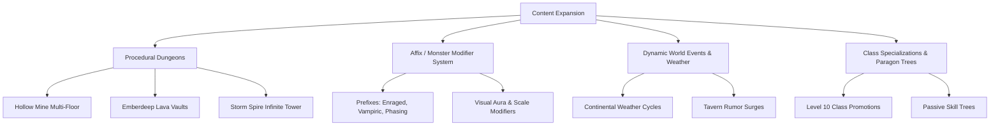

# OpenFantasy — Project Review & Procedural Expansion Roadmap

## Executive Summary
**OpenFantasy** is an exceptionally structured, highly disciplined 2D open-world MMORPG prototype built with **Godot 4.4 (.NET/C#)** and Python content generators. Its engineering stands out for:
1. **Strict Deterministic Architecture**: Complete decoupling of gameplay simulation (`src/Sim/`) from Godot presentation nodes (`src/Client/`), driven by fixed-tick updates and seed-stable `XorShift64` RNG.
2. **Robust Content Pipeline**: High-density offline generators (`gen_world.py`, `gen_npcs.py`, `gen_assets.py`, `gen_layers.py`) emitting schema-validated JSON datasets and procedural pixel art.
3. **16-Bit Aesthetic Integrity**: Custom paper-doll character compositor (~25M combinations), 16×24 4-direction sprites, 16×16 tiles, and retro FF6-inspired UI gradient windows.

Below is an architectural review, followed by strategic pathways to expand game content, increase procedural generation capabilities, and enhance generated asset/narrative quality.

---

## 1. Core Architecture & Pipeline Review

### Strengths
* **Deterministic Simulation Core**: `src/Sim/World.cs` runs pure C# logic (movement collision, ATB combat math, loot tables, gathering, crafting, vehicles, parties) without relying on Godot physics or nodes. This guarantees exact reproducibility and lightweight server execution.
* **Automated Verification**: `SelfTest.cs` provides 100% headless integration testing covering state hash stability across 1000s of ticks, movement boundaries, quest chains, and content schemas.
* **Original Asset Compositor**: `gen_layers.py` + `SpriteComposer.cs` provides a 4-tone grayscale layer tinting system that generates distinct paper-doll character sprites dynamically at runtime.

### Areas for Architectural Evolution
* **Offline vs. Runtime Procedural Generation**: World geometry and NPC placement are currently statically generated by Python scripts at build time and loaded as giant static JSON files (`world.json` is ~100KB, `npcs.json` is ~63KB). Moving key generation logic into C# (or wrapping C# seeds into runtime generation) will unlock dynamic dungeons, random world seeds, and infinite replayability.
* **Static World Tile Maps**: The 512×512 world grid is fixed. Introducing procedural chunking or multi-layered floor transitions will allow seamless indoor/outdoor transitions and deep multi-floor dungeons.
* **Tile Autotiling & Transitions**: Currently, terrain tiles rely on basic edge masks (foam and grass fringe). Dual-grid autotiling (47-tile Wang sets) would dramatically improve visual transitions between biomes.

---

## 2. Strategies for Content Expansion

### 2.1 Multi-Floor Procedural Dungeons
* **Floor Generators in C#**: Implement seed-driven dungeon floor generators (BSP tree rooms for catacombs, cellular automata for caverns, and drunkard-walk mazes for sewers).
* **Dungeon Instancing / Delves**: Transform existing cave entrances (`hollow_mine`, `emberdeep`, `sunken_crypt`, `storm_spire`) into gateways to procedural 5-floor delves with scaling mob difficulty and boss rooms on the final floor.

### 2.2 Monster Affix & Rare Archetype System
* **Prefix / Suffix Modifiers**: Attach dynamic stat multipliers, element inflections, and extra abilities to standard monsters:
  * *Example*: **Brimstone Bramble Wolf of Speed** (+30% Speed, Fire damage, trail of ember particles).
* **Rarity Bands**: Normal → Elite (2× HP, aura) → Named Champion (unique drop table, mini-boss telemetry).

### 2.3 Continental Weather & Environment Cycles
* **Dynamic Weather States**: Clear, Rain, Blizzard, Sandstorm, Miasma Fog.
* **Gameplay Integration**:
  * Rain increases Water/Ice ability damage and slows movement off-road.
  * Blizzards in Kharzum increase frost monster aggro range.
  * Miasma Fog in Sylvas spawns temporary shadow wisps.

### 2.4 Class Promotions & Dual-Spec Ability Trees
* **Level 10 Class Promotions**:
  * *Squire* → **Paladin** (Holy Retribution, Cover) or **Berserker** (Whirlwind, Bloodlust).
  * *Mage* → **Archmage** (Chain Lightning, Meteor) or **Necromancer** (Siphon Life, Raise Skeleton).
  * *Scout* → **Sniper** (Headshot, Eagle Eye) or **Shadowblade** (Vanish, Poison Dagger).
* **Passive Skill Nodes**: Small stat/utility nodes chosen every level (e.g. +3% Movement Speed, +5% ATB Charge Rate).

---

## 3. Expanding Procedurally Generated Content

### 3.1 ARPG-Style Procedural Item Generator
* **Affix Table System**: Generate equipment items dynamically with prefix/suffix stat combinations:
  * *Item*: **Vanguard's Iron Blade of the Flame** (+4 Attack, +2 Defense, +5 Fire Damage).
* **Rarity Tiering**: Common (White) → Fine (Green) → Rare (Blue) → Epic (Purple) → Mythic (Gold).
* **Icon Tinting**: Automatically tint procedural item icons based on material (`bronze`, `iron`, `steel`, `mythril`) or elemental infusion (`fire`, `ice`, `lightning`).

### 3.2 Dynamic Quest Board & Rumor System
* **Procedural Bulletin Board Quests**: Generate daily/weekly bounty contracts at town taverns:
  * *Cull Contract*: "Kill 12 [Monster Variant] in [Region]".
  * *Supply Run*: "Gather 8 [Crafting Resource] for [Town Shopkeeper]".
  * *Escort / Courier*: "Deliver sealed parcel from [Town A] to [Town B] within [Time Limit]".
* **Dynamic Rewards**: Scaled XP, gold, and randomized rare gear matching player level.

### 3.3 Dynamic Wilderness Points of Interest (POIs)
* **Random World Encounters**: Spawn temporary POIs across overworld regions based on server seed:
  * *Wandering Merchant Camps*: Rare stock for 30 minutes.
  * *Fallen Aethertech Relics*: Mini-event requiring party defense against waves.
  * *Hidden Herbalist Groves / Mineral Veins*: High-yield gathering clusters.

---

## 4. Improving Quality of Generated Content

### 4.1 Dual-Grid / Wang Autotiling for Natural Terrain
* **Current State**: `gen_assets.py` uses basic edge masks for foam and grass fringe.
* **Upgrade**: Implement **47-tile Wang autotiling** (standard 16-subtile corner/edge bitmask) for:
  * Grass-to-Sand beach transitions.
  * Snow-to-Rock mountain edges.
  * Water-to-Land shorelines.
  * Cobble-to-Road town borders.
* **Benefit**: Removes rectangular tile artifacting, creating lush, hand-painted JRPG terrain feel.

### 4.2 Context-Aware Grammar Dialog Engine (Tracery / Context Templates)
* **Current State**: `gen_npcs.py` selects dialog lines from static string arrays.
* **Upgrade**: Implement a contextual grammar engine incorporating:
  * **Personality Traits**: Gruff, Cheerful, Mysterious, Scholarly.
  * **Current World Events**: Weather status, recent boss defeats, town economic health.
  * **Player Context**: Player class, equipped gear, completed quest milestones.
* **Example Grammar Expansion**:
  * `"Hail, [class_title]. Did you hear? Someone cleared [dungeon_name] yesterday!"`
  * `"With this [weather_condition], my [crop_type] crop will suffer..."`

### 4.3 Procedural Audio & Chiptune Stinger Generator
* **8-Bit / 16-Bit Sound Synthesis**: Write a lightweight Python/C# wave synthesizer for retro sound effects:
  * *Sword Swing*: White noise burst with pitch decay.
  * *Magic Cast*: Sine wave arpeggios.
  * *Craft Success / Level Up*: Multi-tone triumphant chord fanfare.
* **Dynamic Audio Layering**: Mood-based ambient chiptune tracks with stems added/removed based on indoor/outdoor/combat state.

### 4.4 Sprite Micro-Animations & Expressive Frame Extensions
* **Expanded Directional Animations**: Add idle breathing, weapon stance, casting pose, and victory cheer frames to the paper-doll layer compositor.
* **Particle & Spell Animation Generator**: Procedurally generate 16×16 impact effects (fire bursts, ice shards, healing sparkle clusters) with palette swap routines.

---

## 5. Recommended Priority Implementation Roadmap

| Phase | Target Area | Key Action Items | Complexity |
|---|---|---|---|
| **Phase 1** | **Item & Monster Quality** | • Add Affix/Prefix modifier system for monsters & items • Implement ARPG-style randomized item drops & tooltip tinting | Low-Medium |
| **Phase 2** | **Visual Polish & Autotiling** | • Upgrade `gen_assets.py` to 47-tile Wang dual-grid terrain autotiling • Add particle micro-animations (sparks, ripples, spell effects) | Medium |
| **Phase 3** | **Procedural Quests & Narrative** | • Implement Dynamic Tavern Rumor & Quest Board generator • Add context-aware dialog engine based on player & world state | Medium |
| **Phase 4** | **Procedural Dungeons** | • Port floor generation logic to C# (`Sim`) for multi-floor delves • Add procedural rooms/caverns for Hollow Mine, Sunken Crypt, Spire | Medium-High |
