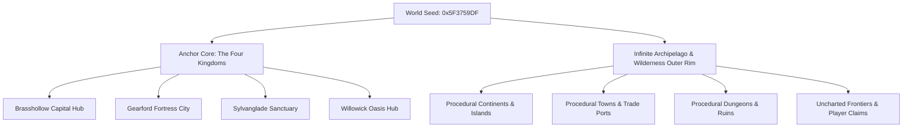

# OpenFantasy — Runtime Seed Procedural World Design ("Infinite Aldermere")

## Executive Summary
Transitioning OpenFantasy's content pipeline from **offline static JSON generation** to a **runtime seed-driven C# simulation engine** transforms the game from a fixed 512×512 map into an **infinite, deterministically generated 16-bit JRPG world**.

Drawing inspiration from *No Man's Sky*, *Minecraft*, and classic open-world JRPGs, this design addresses the "infinite world paradox" by balancing **procedural scale** with **hand-crafted 16-bit JRPG charm and social permanence**.

---

## 1. Core Paradigm: The Anchor & Archipelago World Model

To prevent infinite space from feeling empty or generic, the world is structured into two complementary layers:



### 1.1 The Anchor Core (Hand-Authored / Fixed Templates)
* **The Story & Social Hubs**: The 4 main capitals (Brasshollow, Gearford, Sylvanglade, Willowick) and key story landmarks (Castle Aldermere, Storm Spire) remain fixed in layout or synthesized from hand-crafted structural blueprints.
* **Purpose**: Provides a familiar, persistent home for players to gather, form parties, trade, and experience main quest arcs.

### 1.2 The Infinite Outer Rim (Procedural Archipelagos & Frontiers)
* **Seamless Overworld Horizon**: Beyond the coastal docks, players aboard canoes, sailboats, ships, or the *Brasswing* airship can travel infinitely across procedurally generated ocean waters into new continents, island chains, and uncharted landmasses.
* **Deterministic Coordinate System**: Every location in the world is derived from `(WorldSeed, ChunkX, ChunkY)`. Two server instances using the same seed generate the exact same infinite world.

---

## 2. Architectural Design of the C# Runtime Engine

### 2.1 Chunk-Based Deterministic Simulation (`src/Sim`)
* **Active World Chunks**: The server simulates 32×32 tile chunks on demand based on player proximity.
* **State Hashing & Memory Efficiency**: Chunks with no active players are saved/unloaded from active RAM, while player modifications (built structures, cleared bosses, harvested farms) are stored in delta persistence records.

```
       [ Chunk (X-1, Y-1) ]   [ Chunk (X, Y-1) ]   [ Chunk (X+1, Y-1) ]
       [ Chunk (X-1, Y)   ]   [ PLAYER CHUNK   ]   [ Chunk (X+1, Y)   ]
       [ Chunk (X-1, Y+1) ]   [ Chunk (X, Y+1) ]   [ Chunk (X+1, Y+1) ]
```

### 2.2 Biome Vector Fields & Terrain Synthesis
Using layered 2D Simplex/Perlin noise functions evaluated in C#:
1. **Elevation Noise**: Oceans → Coastal Beaches → Plains → Hills → Mountains.
2. **Temperature & Moisture Fields**:
   * *Hot + Dry* → Miradel Sand Dunes / Sunken Canyons.
   * *Cold + Dry* → Kharzum Snowfields / Glacial Peaks.
   * *Warm + Wet* → Verdance Grassland / Dense Jungle.
   * *Cool + Wet* → Sylvas Swamps / Fog-Veined Forests.
   * *Aethertech Anomaly Field* → Crystal Wastes / Magitek Ruins.

### 2.3 Universal Seed Derivation & Stable Content Addressing
Seeding is not just terrain — **every content domain is a pure function of the world seed
plus stable generative coordinates**, with player-caused changes stored as deltas:

* **Derivation rule**: `Content = Generate(WorldSeed, StableId, DomainTag)` where
  `StableId` is built from where/what the content is (chunk coords, settlement site cell,
  NPC index, shop id + day index, dungeon floor number, chest id). Regenerating any
  content at any time yields identical output; nothing procedural is ever *stored*, only
  *re-derived*.
* **Stable IDs**: every procedural entity (town, NPC, shop, dungeon, chest) carries an ID
  derived from its generative coordinates — so delta records, quest references, waystones,
  and discovery-log entries survive unload/reload and version-stable regeneration.
* **Domains covered**: terrain & biomes, settlement placement/layout/architecture,
  NPC rosters (name, paper-doll appearance, personality, role, home/work tiles, dialog
  seeds), shop types & stock & regional prices, tavern rumor and quest-board contracts,
  monster spawn tables & mutations, gathering nodes & farm plots, adventure-site
  placement/type/theme/floor layouts, and loot (chest contents are
  `Hash(WorldSeed, ChestId)` — stable regardless of the order chests are opened).
* **Deterministic time**: restocks, quest-board refreshes, and rumor rotation key off a
  sim-side day index derived from the tick counter — never wall clock.
* **Delta persistence per domain**: purchases within a stock cycle, taken/completed
  contracts, harvested nodes, cleared bosses, opened chests, built structures.

---

## 3. Procedural Content Synthesis at Scale

### 3.1 Procedural Town & Village Architect
* **Grammar-Based Layout Generator**:
  * Town center plaza generated around a central Crystal and Forge.
  * Road grids carve paths connecting gates, taverns, shops, and houses.
  * Architectural styles dynamically selected based on biome (e.g. Stone/Slate in Tundra, Timber/Thatch in Forest, Sandstone in Desert).
* **Phoneme Name Generator**:
  * Synthesizes town names (*e.g., Oakhaven, Frostguard, Emberwick, Stormwatch*) and NPC names from racial phoneme tables.
* **Full Settlement Stack** (every layer derived per §2.3):
  * **Population Roster**: settlement tier (hamlet → village → town → port) sets the
    roster template (innkeeper, smith, grocer, guards, farmers, children, eccentrics);
    each NPC's name, race, paper-doll appearance, personality trait, daily schedule, and
    home/work tiles derive from `(WorldSeed, SettlementId, NpcIndex)`.
  * **Shops & Economy**: shop lineup follows tier and biome (a tundra outpost sells cold-
    weather gear and hot stew; a port sells canoes and charts). Stock lists derive from
    `(WorldSeed, ShopId, DayIndex)` with tier-gated item quality; regional price modifiers
    derive from biome supply themes (ore cheap near mines, herbs cheap near groves) so
    trade routes emerge from the seed itself.
  * **Tavern Layer**: rumor tables and bulletin-board contracts (cull, supply, courier,
    escort) generate per settlement per day-index, referencing *actual* nearby procedural
    content — the monsters, resources, and adventure sites the generator placed in
    surrounding chunks.

### 3.2 Procedural Bestiary & Ecosystem Mutation
* **Archetype Inflection Matrix**: Base monsters (Wisps, Wolves, Golems, Scorpions, Slimes, Spirits) are procedurally mutated by region climate + seed:
  * **Visual Mutation**: Dynamic palette-swap ramp indices mapped to body/glow layers.
  * **Behavioral / Stat Mutation**: Speeds, aggro ranges, elemental resist, and ability slots (e.g. *Brimstone Wolf* casts Fire Nova, *Frost Bat* casts Ice Shard).

### 3.3 Adventure Site Taxonomy
Adventure sites span far more than caves. Each type pairs a **structural generator** with
biome-driven theming; exteriors live in overworld chunks (site stamps that override
terrain), interiors and underlevels are instanced multi-floor maps.

| Site Type | Generator Recipe | Signature Features |
|---|---|---|
| **Caverns** | Cellular-automata chambers ∪ noise-worm galleries; prefab vault landmarks; DLA crystal variant | Natural loops, sub-caves, underground rivers, ore veins |
| **Mines** | Agent tunnelers + grid rooms; drunkard-walk collapse zones; zonal breakthrough into cavern | Man-made/natural hybrid, cart tracks, lift shafts |
| **Catacombs / Crypts** | Room scatter + MST + loop-edge reinsertion; braided-maze crypt wings; boss/secret vaults | Trap tiles, secret crypt doors, surface-ruin midpoint entrances |
| **Sewers** | L-system mains echoing the street grid above + braided maze laterals; junction-chamber vaults | Many grate entrances, cellar connections, half-flooded canoe routes |
| **Temples / Shrines** | Symmetric recursive subdivision; WFC mosaic detailing; nested crypt sub-level | Secret passages, vertical crypts below, puzzle gates |
| **Towers** | Per-story interior subdivision; collapsed-floor damage pass; basement catacombs | Collapsed floors linking non-adjacent stories, basements, sky entrances |
| **Castles / Forts** | Wall/courtyard grammar → interior subdivision; BSP underdungeon; worm escape tunnel | Multiple gates, wall walks, escape tunnels to the wilderness |
| **Surface Ruins** | Intact grammar layout → decay passes (CA erosion + drunkard damage); buried underlevels | Approach from any side, cellar stairs into underlevels |
| **Forest Depths / Groves** | Poisson-disc trees under biome-noise density; space-colonization trails between Voronoi clearings | Multiple trails, hidden clearings, sacred hearts |
| **Aethertech Facilities** | Concentric subdivision; WFC circuitry floors; DLA crystal overgrowth | Elevator crystals, teleporter pads, service ducts, guardian golems |
| **Sunken Grottos / Wrecks** | Cellular automata + water-level masks; shipwreck vaults | Vehicle-gated entrances, water-level route changes |
| **Sky Islands** | Noise island mask + tower recipe atop | Airship docks, chute/fall routes back to the surface |

Recipes are **data-declared blends** of a shared technique library (cyclic topology
grammar; BSP, room-scatter+MST, cellular automata, noise worms, mazes+braiding, agent
tunnelers, Voronoi zoning, L-systems, interior subdivision, space colonization,
Poisson scatter; WFC and prefab vaults for detailing). Rare cross-family blends
(a flooded catacomb, a rooted tower) appear as notable discoveries.

### 3.4 Jaquayed Site Topology ("Xandering")
All adventure sites follow the non-linear design principles of Jennell Jaquays (per The
Alexandrian's *Xandering the Dungeon*): exploration must offer meaningful route choice,
not corridors-to-a-boss. Generation is **graph-first**: floor topology is synthesized by
a **cyclic graph grammar** (à la *Unexplored*) that composes nested cycle motifs —
two-route splits, lock-key loops, hidden shortcuts, dangerous detours — so loops exist
by construction, then *validated against the Jaquays invariants* and embedded into tile
geometry by the site's recipe (§3.3). Failed graphs deterministically regenerate with an
incremented salt (still a pure function of the seed).

**Enforced invariants** (scaled to site size):
1. **Multiple entrances** — ≥2 ways in for surface-connected sites (main gate + sewer
   grate, cellar stair, cliff cave…); single-entrance only as a deliberate exception.
2. **Loops, not trees** — minimum cycle count per floor; branches meld back; no
   dead-end-corridor sprawl.
3. **Multiple level connections** — ≥2 independent connections between adjacent floors,
   plus level-skipping links (chutes, collapses, elevator crystals) in deeper sites.
4. **Secret & unusual paths** — hidden doors, teleporter pads, underwater passages;
   at least one per floor above minimum size.
5. **No accidental chokepoints** — no single room severs the majority of a floor unless
   it is a designed boss gate.
6. **Landmarks** — each floor gets an orientation anchor (chasm, statue hall, crystal
   shaft, waterfall) so loops read as navigable, not disorienting.
7. **Nested & divided spaces** — larger sites contain sub-levels and split floors
   (a crypt beneath the temple, a flooded east wing) with their own loops.

---

## 4. Making Infinite Space Meaningful ("Solving the NMS Paradox")

A common issue in procedurally generated games is that infinite space can feel homogeneous. OpenFantasy solves this using **JRPG Progression & Cartography Systems**:

### 4.1 Global Cartography & Discovery Log
* **First Explorer Telemetry**: When a player discovers an uncharted island, town, or dungeon floor, their character name is permanently written to the server's **Atlas of Aldermere**:
  > *"Discovered by Brand the Shield — Year 2026"*
* **Cartographer Guild XP**: Players earn Guild Renown and map tokens for mapping uncharted hexes.

### 4.2 Seed Coordinates & Tradeable Waystones
* **Waystone Items**: Players can buy or craft *Blank Waystones*, bind them to remote uncharted locations, and trade or sell them in town markets.
* **Coordinate Sharing**: Players can share 16-character coordinate codes in chat (*e.g. `/navigate 84F2-99B1`*) allowing party members to plot airship courses together.

### 4.3 Player Homesteads & Frontier Outposts
* **Wilderness Land Claims**: Players can purchase land claims in procedural frontiers to build farms, player housing, or guild outposts using gathering materials.

---

## 5. Comparison: Current Static vs. Runtime Seed Architecture

| Feature | Current Static JSON Pipeline | Runtime Seed Procedural Engine |
|---|---|---|
| **World Size** | Fixed 512×512 Aldermere Map | Infinite Procedural Archipelagos |
| **Data Footprint** | ~100KB static `world.json` + ~63KB `npcs.json` | Minimal (~4KB seed + C# generator code) |
| **Replayability** | Fixed locations & static NPC placements | Infinite exploration, unique per server seed |
| **Dungeons** | Static single-level cave regions | Unlimited multi-floor Jaquayed sites across 12 site types |
| **Towns** | 4 static hand-authored towns | 4 Core Capital Anchors + Infinite Frontier Towns |
| **NPCs & Shops** | 123 statically placed NPCs, fixed stock lists | Seed-derived rosters, schedules, stock cycles, regional prices |
| **Cartography** | Static world map | Player-driven discovery, mapping, & waystone trading |

---

## 6. Conclusion & Recommendation

Adopting a **Runtime Seed Procedural World Design** elevates OpenFantasy into an endless, emergent 16-bit JRPG MMO. By combining **hand-crafted capital hubs** with **infinite procedural frontiers**, the game captures the breathtaking vastness of *No Man's Sky* while keeping the tight combat, party play, determinism, and aesthetic charm of classic JRPGs.
